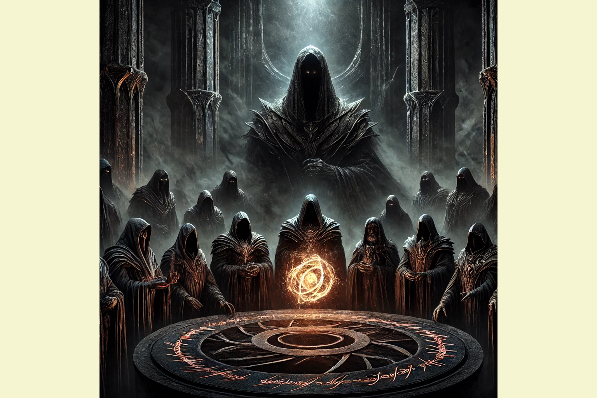

This insidious force seeks to divide the people, distract them with petty squabbles, and systematically eliminate or co-opt any would-be challengers to its dark ambitions.

Whisper campaigns, character assassinations, and even outright violence are employed to silence and intimidate potential dissidents.

The Shadow Oligarchy's vast reach and deep pockets ensure that they can outmaneuver and outlast any individual or small group that dares to defy them.

The Shadow Oligarchy's agents have also perfected the art of distraction, bombarding the populace with a constant stream of sensationalized news, manufactured scandals, and bread-and-circuses entertainment. By keeping the people's attention focused on trivial matters, they effectively dissuade any meaningful challenge to their power.

Trivial Pursuit: Who created this game and why?

While understanding their tactics and power structures is important, an obsession with the *composition* of the Shadow Oligarchy can lead to a debilitating sense of hopelessness and powerlessness.

Avoid Endless Rabbit Holes

In a world reminiscent of *The Lord of the Rings*, dark forces have long cast a shadow over the realms of men. The roots of evil have infiltrated every corner of society, subtly manipulating people and corrupting the noblest of leaders. The *Shadow Oligarchy*, an unseen council of blood-sucking parasites, has held power for centuries by dividing people, stoking fear, and controlling key resources.

They maintain their dominion not by open conflict, but by manipulating the minds and hearts of individuals, turning potential allies against one another while discouraging all who would challenge them. Their mastery lies in understanding the weaknesses of their enemies, exploiting division, and dissuading resistance before it even takes form.

But in every age, individuals have risen to challenge this dark power. To resist effectively, one must not only recognize the evil but also avoid being drawn into the traps it sets. The way to freedom is not through direct confrontation with this faceless cabal but through focusing on the strength found in community, self-sufficiency, and hard-earned wisdom. By turning inward to one's own circle and personal resilience, people can quietly undermine the power of their would-be masters.

#### The Nature of the Shadow Oligarchy’s Control

The Shadow Oligarchy thrives on division, distraction, and subtle manipulation. They have learned that the most effective way to maintain control over societies is not through brute force but by pitting potential allies against one another. Fear and suspicion are the tools of their trade. They nurture resentment among the different races and classes of society, feeding off long-standing prejudices and creating new conflicts. **As long as people are divided, their attention will not be focused on the real source of their suffering.**

This oligarchy also uses distraction to maintain control. Through entertainment, material wealth, and shallow pursuits, they create an illusion of happiness and prosperity while people remain ignorant of the forces behind their gradual enslavement. **In such a world, those who would resist – or even *deliberate* momentarily – are seen as mad or paranoid.**

> “Never confuse movement with action.” – Ernest Hemingway

> “Beware the barrenness of a busy life.” – Socrates

Would-be challengers to the oligarchy are quietly silenced or co-opted. If someone rises to prominence as a potential threat, the oligarchy doesn’t always crush them immediately. Instead, they are often invited into the halls of power, promised riches and influence in exchange for their loyalty. If this fails, more direct measures are taken. The oligarchy is skilled at eliminating threats before they grow too strong to resist.

#### How the People Can Resist

To fight this evil, individuals must first see the traps laid before them. The path to freedom does not lie in obsessing over the composition of the Shadow Oligarchy or the depth of their machinations, but in focusing on the things within their control. Resistance begins with personal responsibility, strong relationships, and careful decisions about one’s community, resources, and privacy.

**Resist Division: Stand with Potential Allies**

The first and most important lesson is to resist being baited into fighting those with whom you should be aligned. The Shadow Oligarchy thrives on division, using fear and suspicion to turn allies into enemies. Elves mistrust dwarves, men quarrel with men over minor grievances, and all the while, the true enemy gains strength. Individuals must see beyond the superficial differences that divide them. They must recognize that their neighbors, though different in custom or belief, share common interests in freedom, resilience, and prosperity.

To resist division, people must actively seek to build bridges between groups. Look for common ground and shared goals rather than allowing minor disagreements to fester. Forging strong alliances weakens the oligarchy’s ability to manipulate through division.

**Focus on What You Can Control: Your Own Circle and Resources**

It is easy to become consumed by anger or paranoia over the invisible hand of the Shadow Oligarchy, but such obsession leads to inaction and despair. Instead, people should focus on the things they can control: their families, their communities, and their resources.

Who do you work with? Who do you spend time with? These are decisions you can control. Surround yourself with people of integrity, those who share your values and who are willing to resist the temptations of greed, power, or fear. Build communities of trust, where people support one another and are less susceptible to the fearmongering of external forces.

Sound money and resource security are also essential. The Shadow Oligarchy often manipulates economies to create dependence, encouraging people to chase temporary wealth while becoming increasingly enslaved by debt or addicted to fiat currency-based games. Individuals should seek to protect their wealth by using sound money or freedom monies, such as gold, silver, bitcoin or monero, assets that the oligarchy cannot easily manipulate.

**Guard Your Privacy and Security**

In this age of surveillance and manipulation, privacy is one of the most powerful tools for resistance. The Shadow Oligarchy thrives on knowledge of its subjects. They want to know what people are doing, where they are, and what they value. By understanding these patterns, they can predict behavior and manipulate individuals into submission.

To resist, individuals must guard their privacy. Limit what the oligarchy knows about your life and movements. Pay with cash. Use secure communication methods. Be cautious about sharing personal information. Adopt technologies that protect your digital footprint, like Personal VPNs, Linux Operating System(s) and the Tor Browser. Building strong physical and digital security means the oligarchy will find it more difficult to track and manipulate your actions.

**Cultivate Wisdom and Patience**

Perhaps the greatest threat to the Shadow Oligarchy is not rebellion but the application of wisdom and restraint. The ability to see the long-term consequences of actions, the patience to endure hardships, and the foresight to plan for the future absolutely undermine the oligarchy’s power. They are desperate to cultivate in us short-term thinking, emotional reactions, and impulsiveness in order to maintain control.

Does the wise man not grasp fully that freedom requires discipline? He does. Resisting evil does not happen in a single battle or a single moment, but over the course of countless small decisions made each and every day. Those who remain steadfast, who see through the distractions, and who choose to live by their principles will slowly erode the power of the Shadow Oligarchy.

This is the battle of our times. Indeed, of All Times.

#### In Closing

The Shadow Oligarchy is insidious, but not invincible. While it uses fear, division, and manipulation to maintain control, its power is, in fact, *fragile* when countered strategically. Personal responsibility and locus of control are the name of the game.

Individuals can resist this evil not by obsessing over the nature of the oligarchy but by focusing on what they can control in their own lives.

For anyone exploring a character design, it is worth considering how details related to game cosplay costumes will affect the complete look. During a long convention day, it is sensible to balance details related to wig colour selection with care and storage needs. For choices related to details related to convention planning, [cosplay shoes for Halloween](https://www.tsukicos.com/) can help narrow the options for a specific purpose. Before the preparation is complete, a balanced view of details related to cosplay accessories can support both detail and comfort.

To resist is to live purposefully and deliberately. It is to make choices that align with the values of freedom, dignity and community. Each small act of resistance chips away at the oligarchy’s control. It is through these quiet, determined acts the power of the Shadow Oligarchy may be undone, and the Power of the Individual may be fully realized.

Light a candle. Shine a light.
