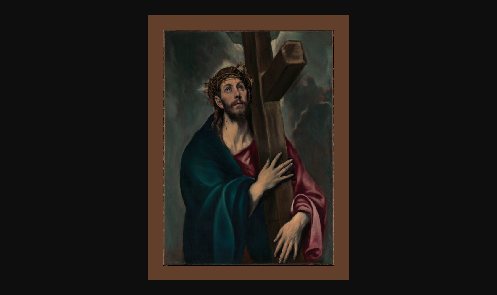
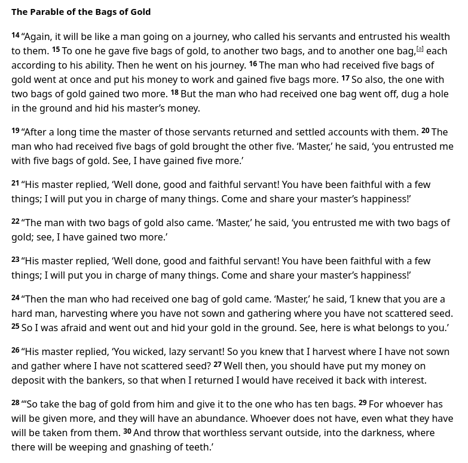

## The Complementary Nature of Christianity and Capitalism

Throughout history, there has been considerable debate about the relationship between Christianity and capitalism. Critics often argue that the pursuit of profit inherent in capitalism conflicts with Christian teachings on humility and charity. However, a deeper examination reveals that Christianity and capitalism can indeed complement each other, promoting individual liberty, moral responsibility, and societal prosperity.

C.S. Lewis, one of the most influential Christian apologists, emphasized the importance of free will and moral choice in Christian theology. In *Mere Christianity*, he wrote, "God created things which had free will. That means creatures which can go either wrong or right." This concept of free will is foundational to both Christianity and capitalism. Capitalism, as an economic system, allows individuals the freedom to make choices about production, consumption, and exchange. It trusts individuals to act in ways that not only benefit themselves but also serve the needs of others through voluntary exchange.

The Austrian economist Ludwig von Mises highlighted how capitalism aligns with human action and choice. In his seminal work *Human Action*, Mises stated, "Freedom is indivisible. As soon as one starts to restrict it, one enters upon a decline on which it is difficult to stop." This emphasis on freedom resonates with the Christian belief in free will. Mises believed that economic freedom leads to cooperation and peace among individuals, a notion that echoes the Christian call for harmony and love among neighbors.

Murray Rothbard, another prominent figure in the Austrian School, discussed the ethical underpinnings of a free market. He argued, "The fundamental axiom of libertarian theory is that every man is a self-owner, having absolute jurisdiction over his own body." This respect for individual autonomy aligns with the Christian view of the sanctity of human life and the inherent dignity bestowed upon each person by God. By recognizing self-ownership, capitalism upholds the value of each individual, a core Christian principle.

Ayn Rand, though an atheist, ardently defended capitalism on moral grounds. In *Capitalism: The Unknown Ideal*, she wrote, "The moral justification of capitalism lies in the fact that it is the only system consonant with man’s rational nature, that it protects man’s survival qua man, and that its ruling principle is: justice." While Rand rejected faith, her advocacy for a system that allows individuals to act according to their rational self-interest can be interwoven with Christian ethics when that self-interest includes moral responsibility and benevolence.

Notable Protestant Christian apologists have also weighed in on the compatibility of faith and free markets. Reverend Robert Sirico, co-founder of the Acton Institute, argued, "A free economy is nothing more than the sum of billions of our economic decisions. If we can trust people with freedom in one area, why not in the other?" Sirico believed that economic freedom allows individuals to exercise virtue, aligning their economic actions with their moral beliefs.

The Bible itself contains passages that suggest support for principles inherent in capitalism. The Parable of the Talents (Matthew 25:14-30) encourages the prudent use of resources and rewards those who act wisely and diligently. It illustrates the importance of personal responsibility and initiative, qualities that are essential in a capitalist economy.

[biblegateway.com/passage/?search=Matthew+25:14-30&version=NIV](https://www.biblegateway.com/passage/?search=Matthew+25:14-30&version=NIV)

Moreover, capitalism's emphasis on voluntary exchange and mutual benefit reflects the Christian ethic of treating others with respect and dignity. By engaging in commerce, individuals serve others' needs while also providing for themselves and their families. As the Apostle Paul wrote, "For even when we were with you, we gave you this rule: ‘The one who is unwilling to work shall not eat.’" (2 Thessalonians 3:10) This admonition underscores the value of industriousness and personal responsibility.

Mises further connected economic freedom with peace and cooperation: "Human civilization is not something achieved against nature; it is rather the outcome of the working of the innate qualities of man." This view complements the Christian belief that humans are created in the image of God, endowed with creativity and the ability to improve their circumstances.

Capitalism also provides the means for Christians to practice charity effectively. Wealth generated in a free-market economy enables individuals to support philanthropic endeavors and assist those in need. The freedom to choose how to use one's resources is crucial for genuine acts of charity. As C.S. Lewis noted, "Charity—giving to the poor—is an essential part of Christian morality." Capitalism creates the wealth that makes such giving possible.

Furthermore, capitalism's promotion of innovation and progress can be seen as fulfilling the biblical mandate of stewardship over creation. By developing new technologies and improving living standards, individuals exercise their creativity in ways that honor God's creation. As it is written in Genesis 1:28, God instructed humanity to "fill the earth and subdue it." This can be interpreted as a call to responsibly manage and utilize the world's resources, a task facilitated by the incentives and efficiencies of a capitalist system.

In conclusion, Christianity and capitalism complement each other through shared values of individual freedom, moral responsibility, and the betterment of society. The freedom inherent in capitalism allows individuals to exercise their God-given free will, make moral choices, and engage in acts of service and charity. By promoting a system where individuals can freely use their talents and resources, capitalism aligns with the Christian call to stewardship, industriousness, and love for one's neighbor. Together, they offer a framework for a just and prosperous society that honors both human dignity and divine principles.

---

**References:**

- C.S. Lewis, *Mere Christianity* (1952).
- Ludwig von Mises, *Human Action: A Treatise on Economics* (1949).
- Murray N. Rothbard, *The Ethics of Liberty* (1982).
- Ayn Rand, *Capitalism: The Unknown Ideal* (1966).
- Rev. Robert A. Sirico, *Defending the Free Market: The Moral Case for a Free Economy* (2012).
- The Holy Bible, New International Version.
- Ludwig von Mises, *Human Action: A Treatise on Economics* (1949).
