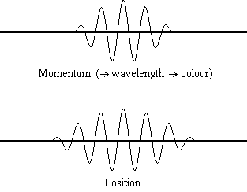
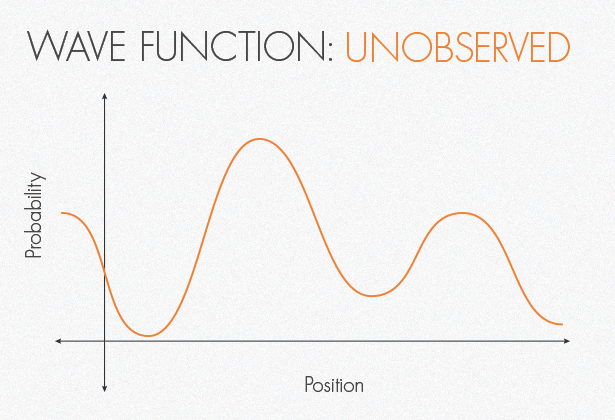

What parallels can be drawn between the teachings of Jesus Christ and the findings of Quantum Physics? I found myself wondering this recently during my morning readings of the Bible and the book "[Building Quantum Computers: A Practical Introduction](https://www.cambridge.org/highereducation/books/building-quantum-computers/6A73C509D3E0F5F0A566A11F6A566A90#overview)".

> "The more I examine the universe and study the details of its architecture, the more evidence I find that the universe in some sense must have known we were coming."  
>   
> – Freeman Dyson

---

`note: this post is a largely AI-generated exploration of ideas`

The enigmatic world of quantum physics shares intriguing parallels with the teachings of Jesus Christ, challenging our understanding of reality and the nature of interconnectedness. By exploring these themes, we gain deeper insights into both the physical universe and the gospel.

Heisenberg's Uncertainty Principle asserts the fundamental limit in knowing a particle's exact position and momentum simultaneously. Similarly, Jesus spoke of the limitations of human knowledge when he said, "But about that day or hour no one knows, not even the angels in heaven, nor the Son, but only the Father" (Matthew 24:36, NIV). Both concepts emphasize the inherent uncertainty in our comprehension of the universe.

Illustration of Heisenberg's Uncertainty Principle

Physicist Richard Feynman famously admitted, "I think I can safely say that nobody understands quantum mechanics." This acknowledgment of mystery echoes the humility expressed in the Bible: "For my thoughts are not your thoughts, neither are your ways my ways," declares the Lord (Isaiah 55:8, NIV). Both perspectives recognize that there are aspects of existence beyond human understanding.

> "Ultimately, all parts of the universe are interconnected in an intimate way, and the apparent separateness of subatomic particles is an illusion."   
>   
> – David Bohm

Quantum entanglement reveals that particles can instantaneously affect each other regardless of distance—a phenomenon Albert Einstein referred to as "spooky action at a distance." This profound interdependence mirrors Jesus's teaching: "I am the vine; you are the branches" (John 15:5, NIV). Just as branches stem from the vine, we are all linked with one another and with Christ. The Apostle Paul further elaborated on this unity: "So in Christ we, though many, form one body, and each member belongs to all the others" (Romans 12:5, NIV). As American physicist David Bohm put it: "Ultimately, all parts of the universe are interconnected in an intimate way, and the apparent separateness of subatomic particles is an illusion."

The Copenhagen Interpretation suggests that observation affects quantum outcomes, implying that reality is influenced by our perceptions. Jesus highlighted the power of perception when he taught, "The eye is the lamp of the body. If your eyes are healthy, your whole body will be full of light" (Matthew 6:22, NIV). Both ideas suggest that our understanding and experience of reality are shaped by how we observe and interpret it.

Wave Function: Unobserved & Collapsed

Quantum superposition posits that particles can exist in multiple states simultaneously until observed. This notion parallels the dual nature of Jesus as both divine and human. Moreover, Jesus taught about the presence of God's kingdom within us: "The kingdom of God is in your midst" (Luke 17:21, NIV). Just as particles exist in multiple states, the divine exists both within and beyond us.

Philosophers and theologians have long explored themes of unity and the nature of existence. Saint Augustine, in his Confessions, deeply pondered the concept of time and God's relationship to it. He contemplated how God exists outside of time yet is present in every moment within it: "For You are infinite and never change. In You, today never comes to an end, and yet our 'today' does come to an end in You, because time, as well as all things, exists in You." His reflections on the eternal present and the transcendence of God parallel the complex notions in quantum mechanics, where particles can exist in states that challenge our conventional understanding of time and space.

Centuries later, philosopher Søren Kierkegaard delved into the paradoxes of faith and reason. In his work Fear and Trembling, he explored the tension between ethical duty and absolute faith, illustrating the complexity and paradoxical nature of true belief. Kierkegaard stated: "Faith begins precisely where thinking leaves off." This sentiment resonates with the paradoxes found in quantum mechanics, where the behavior of particles defies classical logic and requires a leap beyond conventional reasoning to comprehend.

Physicist Freeman Dyson observed, "The more I examine the universe and study the details of its architecture, the more evidence I find that the universe in some sense must have known we were coming." This idea resonates with the biblical concept of a purposeful creation, as stated in Jeremiah: "For I know the plans I have for you," declares the Lord (Jeremiah 29:11, NIV).

Swiss psychiatrist Carl Jung, along with physicist Wolfgang Pauli, explored the coupling of mind and matter, suggesting that quantum mechanics and consciousness might be "complementary aspects of the same reality." This perspective aligns with Jesus's teaching on the interplay between the spiritual and material worlds: "Whatever you bind on earth will be bound in heaven, and whatever you loose on earth will be loosed in heaven" (Matthew 16:19, NIV).

These parallels between quantum physics and the teachings of Jesus highlight how both realms invite us to contemplate the profound mysteries of existence. As physicist Max Planck concluded, "Science cannot solve the ultimate mystery of nature. And that is because, in the last analysis, we ourselves are part of the mystery we are trying to solve." Through both scientific inquiry and spiritual reflection, we are led to a greater appreciation of the interconnected fabric of reality.
