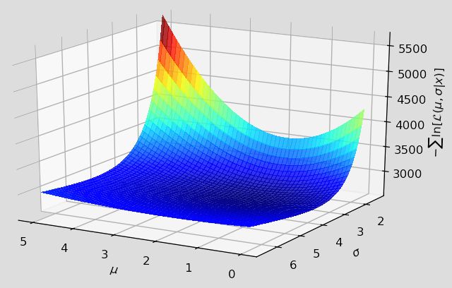
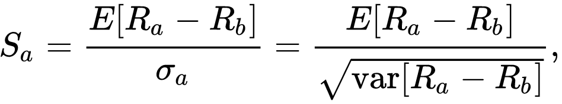
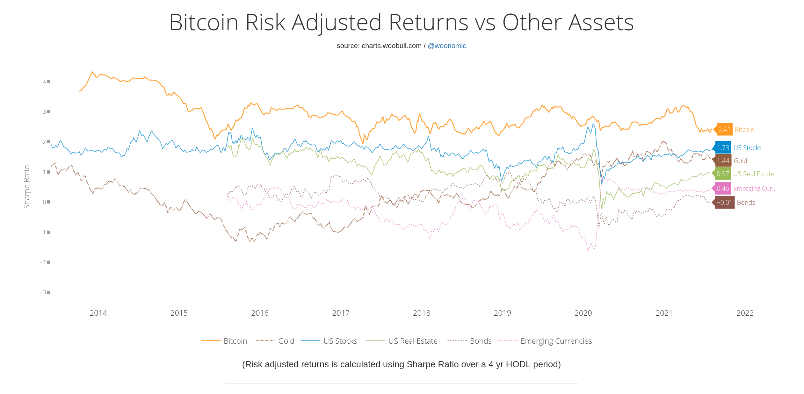
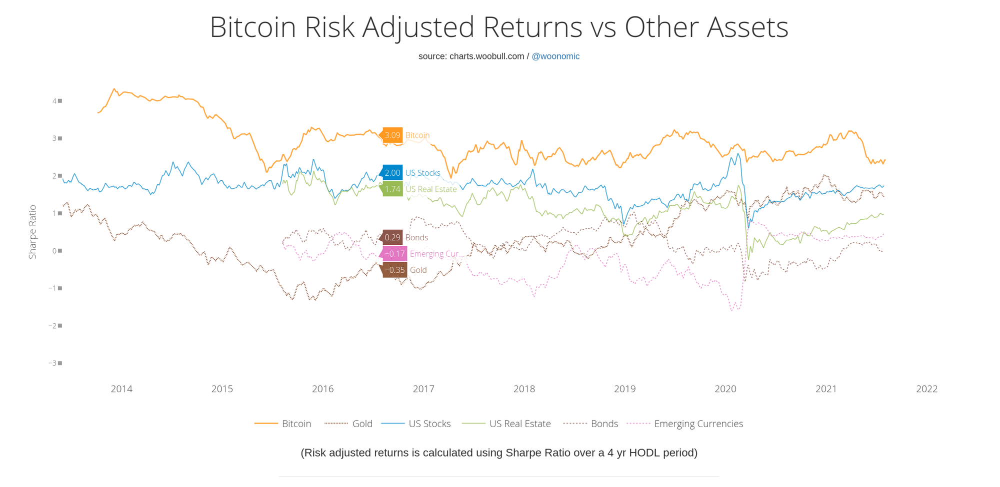
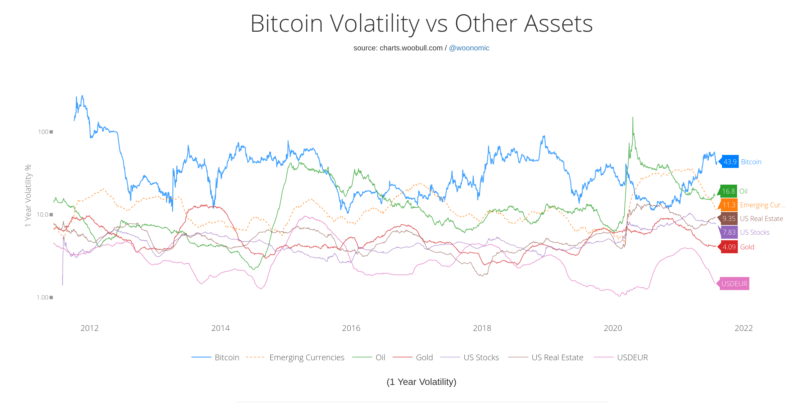

## Bitcoin vs. Other Assets

Bitcoin is still a relatively new asset class, but its performance over any given 4-year holding period has surpassed that of anything else out there. This applies to all such 4-year holding periods since 2013 (after which the first such period came to completion.)

Looking at the returns in the context of bitcoin's high volatility is important, hence the [Sharpe](https://en.wikipedia.org/wiki/Sharpe_ratio) ratio is highlighted below. This ratio presents us with a **reward-to-variability ratio**: It measures the performance of an investment compared to a risk-free asset, such as t-bills or cash, after adjusting for risk, where risk is typically measured based on historical volatility or the standard deviation of returns.

The formula for the Sharpe ratio

As an aside, another good metric on which to view bitcoin's performance is the 'maximum drawdown', or by how much it has dropped during a given year. For a portfolio comprised of 100% bitcoin, it's not surprisingly very high: You could expect to lose about 82% of your portfolio's value if you bought at the top and sold at the bottom. However, if you did a 50/50 bitcoin and USD mix, your max drawdown drops to 40%. With 25/75 bitcoin and USD, it drops again to 27%. Since 2015, the respective compound annual growth rates of these three portfolios are: 101%, 84% and 54%. (Check out [Portfolio Visualizer](https://www.portfoliovisualizer.com/backtest-portfolio) yourself to play around with the asset allocations. NOTE: I used GBTC and BIL as equivalents for this simulation.)

Now let's get to the meat of it. How well does bitcoin perform versus other asset classes?

### Risk-Adjusted Returns over a 4-Year Holding Period

Current Sharpe Ratios:

- 1 - Bitcoin: 2.41
- 2 - US Stocks: 1.73
- 3 - Gold: 1.44
- 4 - US Real Estate: 0.97
- 5 - Emerging Currencies: 0.46
- 6 - Bonds: -0.01

Click to view interactive chart from @woonomic

Sharpe Ratios Five Years Ago:

- 1 - Bitcoin: 3.09
- 2 - US Stocks: 2.00
- 3 - US Real Estate: 1.74
- 4 - Bonds: 0.29
- 5 - Emerging Currencies: -0.17
- 6 - Gold: -0.35

Click to view interactive chart from @woonomic

---

### Volatility of Bitcoin vs. Other Assets

One-Year Annualized Volatility; Highest to Lowest, Current Figures:

- 1 - Bitcoin: 43.9% ( typical range: 11-88% )
- 2 - Oil: 16.8%
- 3 - Emerging Currencies: 11.3%
- 4 - US Real Estate: 9.35%
- 5 - US Stocks: 7.83%
- 6 - USDEUR: 7.1% ( corrected chart: <https://invst.ly/vnn3g> )
- 7 - Gold: 4.09%

Click to view interactive chart from @woonomic

---

### KEY TAKEAWAYS

- Bitcoin's volatility has not decreased meaningfully since 2013. It has remained elevated compared to other asset classes, fluctuating between 11% and 88%.
- Bitcoin's risk-adjusted returns, which take into account its high volatility, have remained remarkably high, with its sharpe ratio hovering between 2 and 3.5 since 2015. On this metric, based on a 4-year HODL period, it has beaten every other asset class since the start of the data in 2013 (after the first 4-year HODL period).
- US Stocks, US Real Estate, and Gold are all currently performing well in terms of their respective sharpe ratios, with US Stocks being the closest competitor to bitcoin. Bonds, conversely, have done the worst, with a sharpe ratio just shy of 0% at present.
- A moderately conservative assumption for investors would be that the value of their bitcoin holdings could easily fluctuate 50% or more during the course of a given year, but that the expected returns over a 4 year holding period could remain higher than that of any other traditional asset class.

CAUTION: *There are no guarantees in life. Do your own research and don't invest more than you can afford to lose.*

---

**Sources:**

Risk-adjusted returns using a 4-year HODL period:

- <http://charts.woobull.com/bitcoin-risk-adjusted-return/>
- credit: <https://twitter.com/woonomic>

One-year volatility:

- <http://charts.woobull.com/bitcoin-volatility-vs-other-assets/>
- credit: <https://twitter.com/woonomic>
