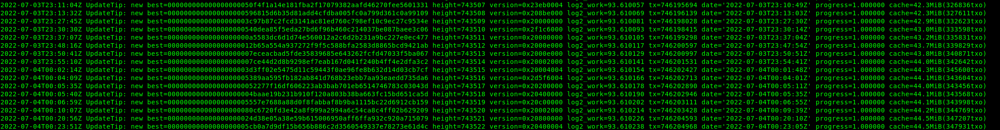
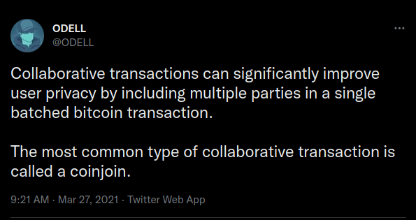
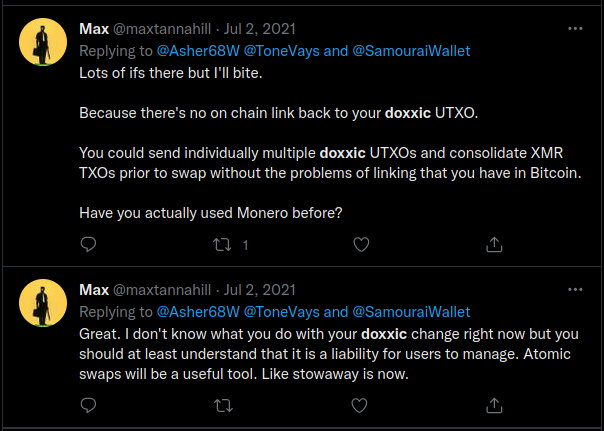

What is Private Money?

Private Money, I'd argue, is that which you can either obtain or spend (or both) while revealing as few of the following facts about yourself as possible. Facts such as:

- Your identity
- Where you spent/earned it
- How much you spent/earned
- How much you have all together in a given account or asset
- Who the counterparties, senders and recipients are
- What products or services were exchanged

Cash, in moderate amounts, fits the bill (no pun intended). But you can't reasonably expect to wield more than $5,000 or so and interact with the legacy financial system without some level of scrutiny.

As a result of the [Bank Secrecy Act](https://en.wikipedia.org/wiki/Bank_Secrecy_Act) of 1970, and the fact that the reporting thresholds were never updated for inflation\*, any transaction over $10,000 will trigger an automatic [Suspicious Activity Report](https://en.wikipedia.org/wiki/Suspicious_activity_report#History) (SAR).

> `*` $10,000 from October, 1970 would be equivalent to $74,186.80 as of May, 2022, after adjusting for (CPI) inflation: <https://www.bls.gov/data/inflation_calculator.htm>

Transacting with gold and silver above certain amounts will also [raise eyebrows](https://www.jmbullion.com/reportable-bullion-transactions-infographic/) and leave a paper trail.

So given this, it's not really feasible to spend or deposit more than $10,000 with any regulated entity in a very private way.

(You may be able to buy a car for cash for more than this, but somewhere this transaction will be recorded too.)

Obviously, spending large amounts of money in a private way is difficult. Whether you think the regulations around reporting and whatnot are useful, justified or not, doesn't matter. This is just the way it is.

Even with bitcoin the same basic thresholds and reporting requirements would apply in these situations.

Large purchases will attract attention. The question is the extent of that attention, and what you reveal when you spend.

### Spending and Receiving Bitcoin as Privately as Possible

When used intelligently, bitcoin can be spent without revealing your total balance or the history of the [UTXOs](https://en.bitcoin.it/wiki/UTXO) that are consumed as inputs to the transaction. (More on this later.)

When receiving bitcoin, especially onchain, privacy can be preserved when receiving money via peer-to-peer transactions or mining, particularly if you use a new address each time.

**Bitcoin is really the first such money (i.e. 'cash-like instrument') that can be sent across the internet, requiring no physical presence, while maintaining moderate-to-good levels of privacy.**

**The three most important tips for beginners are:**

- Take control of your bitcoin; hold your own private keys
- Use a new address every time you receive bitcoin
- Use a wallet that allows for [Coin Control](https://medium.com/blockstream/blockstream-green-coin-control-ac4ef179280f), and permits you to select specific UTXOs when you spend

For an intermediate user, I also **strongly recommend that you spin up your own bitcoin node**. A great resource on how to do this on a cheap raspberry pi computer is [RaspiBolt](https://raspibolt.org/).

The next step up in privacy is to ***CoinJoin your bitcoin***.

### CoinJoin: What and How

As [Egge of BTC21.de](https://btc21.de/en/coinjoin-with-sparrow-how-to-anonymize-your-bitcoins/) describes it, CoinJoin is:

*"... a protocol for improving on-chain privacy in which several participants create a joint transaction that contains Bitcoin from all participants and pays it out to new addresses of these participants. This makes it impossible to tell exactly which address belongs to which participant at the end."*

To 'CoinJoin your bitcoin' means to sever the link to the past history of each of your UTXOs. When done properly, you can acheive excellent Forward Privacy in spending your bitcoin. This means that when you spend your CoinJoin'ed UTXOs, you won't reveal your total bitcoin balance, nor create a link back to the original coins.

For a full tutorial and explainer on CoinJoin using [Sparrow Wallet](https://www.sparrowwallet.com/), I recommend this video by [Ian Major](https://twitter.com/ian__major):

<https://www.youtube.com/watch?v=e-jNudU9Xw4>

### DISCLAIMER: Not legal, tax or financial advice.

The fact that you can break the link to the past history of your coins, and avoid linking future spends to your past transactions, is what makes bitcoin a fungible (fungible-able?) commodity money.

The fact that you can use it in this manner, however, should not be taken as tacit endorsement of or a recommendation to engage in tax evasion. In the eyes of the law, you are still responsible for paying capital gains tax if you made a profit, and reporting every sale of (i.e. purchase made with) bitcoin.

> **[IRS Notice 2014-21](https://www.irs.gov/pub/irs-utl/2018ntf-bitcoin-cryptocurrency-an-introduction-and-tax-consequences.pdf)**:  
> Q-1: How is virtual currency treated for federal tax purposes?  
> A-1: For federal tax purposes, ***virtual currency is treated as property***. General tax principles applicable to property transactions apply to transactions using virtual currency.

There are different ways to account for your trades/spends/sales of bitcoin. You might find First-In, First-Out (FIFO) to be the easiest. But to properly account for all your gains (or losses), you'll need a record of every time you received, earned or bought bitcoin.

### Other Privacy Gotchas

While there are many other considerations, perhaps too many to enumerate here. The Bitcoin Wiki Privacy page does a good job of laying them out here: <https://en.bitcoin.it/Privacy>

One I do wish to focus in on, however, related to CoinJoin, is the **[Doxxic Change](https://bitcoiner.guide/doxxic/)** question.

Inevitably, with Equal-Output (amount) CoinJoins, you are left with some amount of "unmixed change" that is still associated with the original inputs to the CoinJoin transaction. Spending this change may "doxx" you, or reveal more information than you'd normally care to about other associated inputs or previous transactions, and can undo much of the privacy benefit of the CoinJoins you performed in the first place.

The question of how to spend said doxxic change is a non-trivial and somewhat contentious one.

Some advocate for swapping it with monero, and then back to bitcoin. This would tend to be a fairly straightforward and simple way to deal with the problem. Beware of custodial risks and privacy risks, however. 3rd party swapping services may (likely do) keep logs of your IP address and the specific UTXO you send them. It also means having to create and maintain a separate non-bitcoin wallet. Ideally, you would build up a bit of an XMR balance before switching back into BTC. (This adds some XMR/BTC price-slippage risk.)

Others advocate just leaving the change where it lies. Abandoning it, as it were. (The 'sad satoshis' option.)

Yet others suggest donating it to privacy and open-source related projects, such as the Tor project, or various bitcoin-related projects.

For more on the Doxxic Change question, I highly recommend reading [@BitcoinQ\_A](https://twitter.com/BitcoinQ_A)'s excellent article, ['Dealing with Coinjoin Change Outputs'](https://bitcoiner.guide/doxxic/).

### One Last Tip

**Where you broadcast from matters.**

If your bitcoin spends always emanate from the same place (i.e. your node at home), then you may be making the job easier for those who would surveil and track you.

If you can spare 5 or 10 more seconds, consider opening the Tor Browser or a Brave Private Window with Tor, and broadcasting your signed bitcoin transactions from the Mempool Onion site or the Blockstream Onion site:

- Mempool 'Broadcast Transaction' Onion Site:   
  `http://mempoolhqx4isw62xs7abwphsq7ldayuidyx2v2oethdhhj6mlo2r6ad.onion/tx/push`
- Blockstream 'Broadcast Transaction' Onion Site:   
  `http://explorerzydxu5ecjrkwceayqybizmpjjznk5izmitf2modhcusuqlid.onion/tx/push`

Also: Remember to refresh or create a new connection to the Tor network regularly, and try to space out your spends/broadcasts somewhat to reduce the risks of timing attacks.
