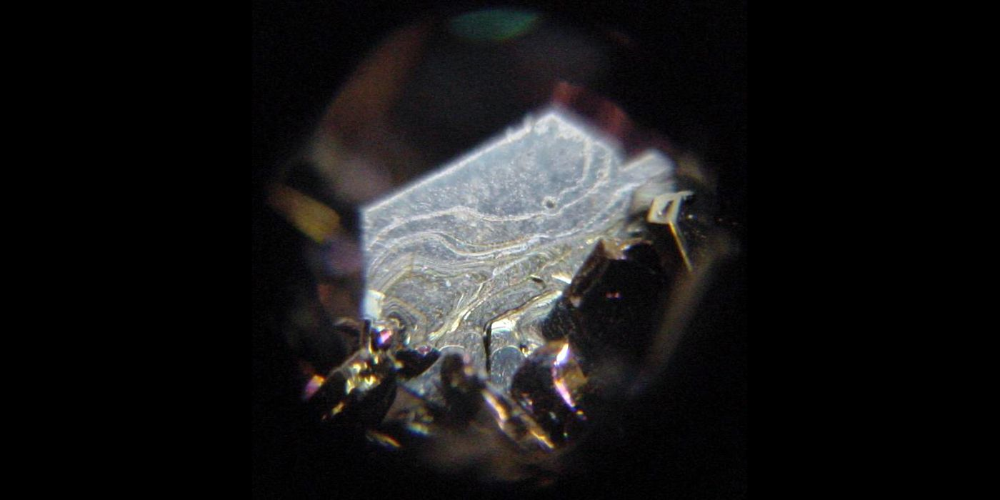

## Arranged from "Soft" to "Hard"

**1. "Largely Liquid"**

- 50% bitcoin
- 50% cash

*half the volatility, half the gains and half the losses*

**2. "Cash Flow + Sats Flow"**

- 40% bitcoin
- 25% bitcoin miners/home mining
- 25% real estate/rental properties
- 10% cash

*income focused, with significant upside in bull markets*

**3. "Let's Get Physical"**

- 50% bitcoin
- 10% bitcoin miners
- 10% gold/silver miners
- 10% oil & gas stocks
- 10% uranium miners
- 7% cash
- 3% gold/silver

*goes heavy on hard assets, and commodity and energy producers*

**4. "Monetary *Moissanite\**"**

- 90% bitcoin
- 7% cash
- 3% gold/silver

*nearly as hard of a monetary portfolio as you can get before you arrive at "#GetOnZero" levels*  
  
\*[moissanite](https://en.wikipedia.org/wiki/Moissanite) ≈ silicon carbide; nearly as hard as diamond

**5. "Get On Zero"**

- 100% bitcoin

*nothing simpler, but prepare for a wild ride*

---

Enjoy!
