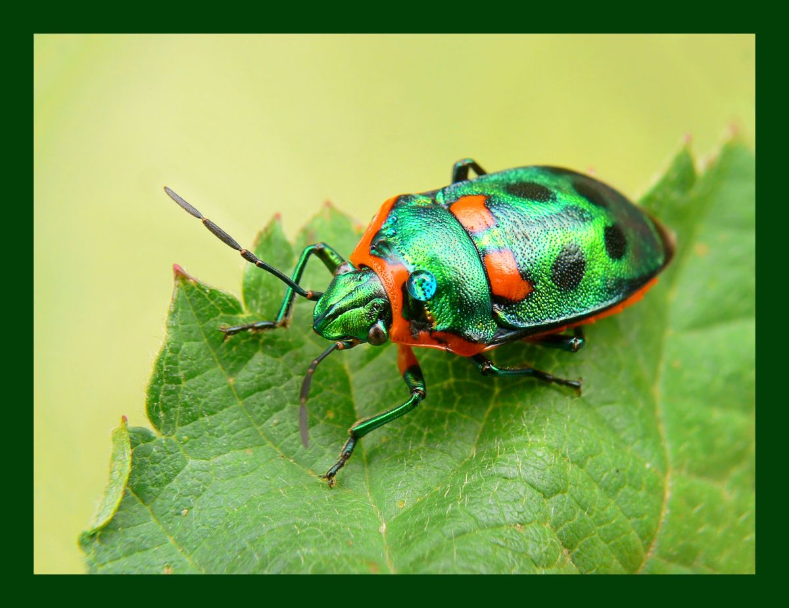
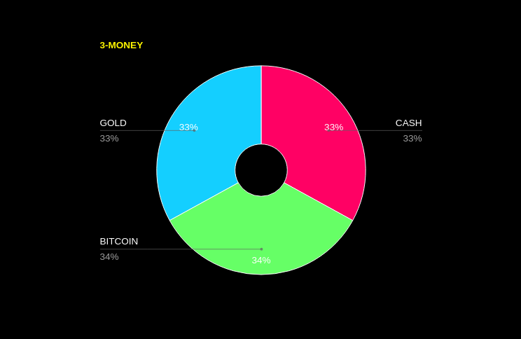
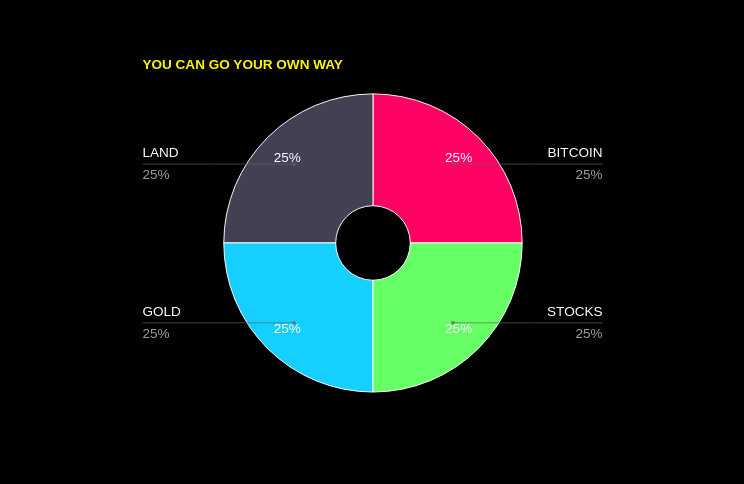

It seems all the "bugs" want you to think thing "X" is the only thing you should own, whether the "X" is Gold, Silver, Bitcoin or Bonds.  
  
Do your own thing.  
  
You don't have to pander to these people  
  
Beware the narcissist influencer, whose only aim is to use you. Similarly, the financial planner's main task is to harvest fees from you. Neither of these types really want you to be completely independent.

So disown these people and do your own thing.

Find others that value Truth Seeking as opposed to Constant Preaching.

---

## Consider the simple '3-MONEY' portfolio:

### Cash + Gold + Bitcoin

- Use whatever mix you want
- Keep it wherever you want
- Rebalance whenever you want
- *Don't pay a dime in fees to anyone*

---

## You Can Go Your Own Way

No need to over-complicate things by diversifying into a million assets. Nor do you have to go "all-in" on one thing.

Stay flexible.

Adapt as you go.

Be like water, as Bruce Lee said.

---

~ Peace
