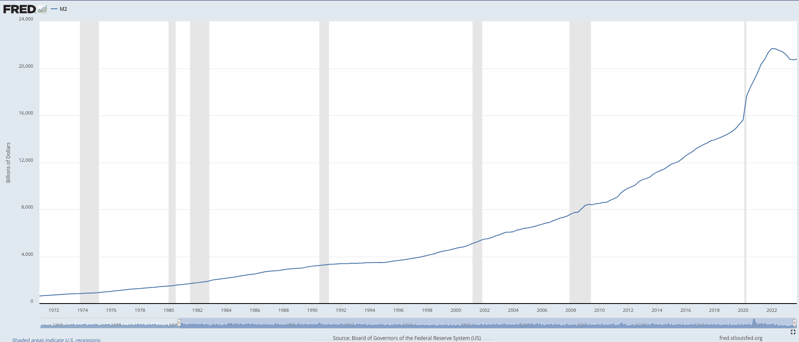

## The Last 50 Years: Money & The Economy

- **Nominal GDP (US): +6.16% CAGR**
- **PCE (US): +3.46% CAGR**
- **M2 (US): +6.79% CAGR**

## Takeaways

**From 1972 to 2022, the money supply has grown at a faster rate than nominal GDP (+0.63% more on average each year).**

Earning a real rate of return on your cash or investments of +1% or more would be sufficient during this period to maintain or grow your wealth.

The FED would tell you that that 'hurdle rate' is 3.46% (PCE) + 1.00% ~= 4.5%. The implication being that "a 10-year bond @ 4.5% would suffice".

The M2 money supply, on the other hand, would tell you that the hurdle rate is higher: 6.79% + 1.00% ~= 7.8%.

If you are not making 8% more each year, or nominally growing your net worth by 8% or more each year, you are falling behind.

## How can you make +8% or more per year?

- **Learn new skills.** I was able to double my income, working very hard over 9 years, teaching myself Linux and Python, and going from being a Teacher to being a Software Developer. You can do it too, but you have to work really hard and network with lots of like-minded people. **This type of move allows you to significantly increase your income (revenue).**
- **Invest wisely.** Pay down debt and invest in something: Stocks, Real Estate, Gold, Bitcoin. (Gold has traditionally kept up with M2 but not greatly outpaced it; Bitcoin is super volatile so be aware; Real Estate requires a big investment in terms of time and money upfront typically; Stocks can suffer from prolonged depressions and bear markets; Maybe consider a mix of these things, and keep some cash for emergencies.)

***Good Luck!***

## Data

- PCE: <https://fred.stlouisfed.org/series/PCEPI>
- GDP: <https://datatopics.worldbank.org/world-development-indicators/themes/economy.html>
- M2: <https://fred.stlouisfed.org/series/M2NS>
- CAGR Calculator: <http://www.moneychimp.com/calculator/discount_rate_calculator.htm>
