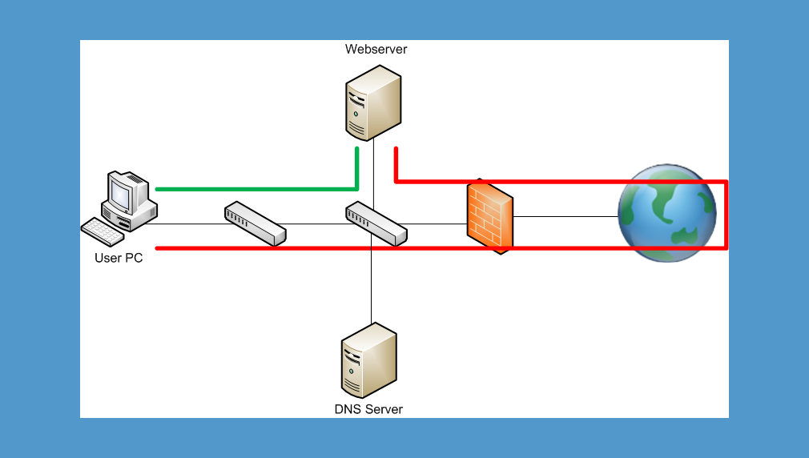
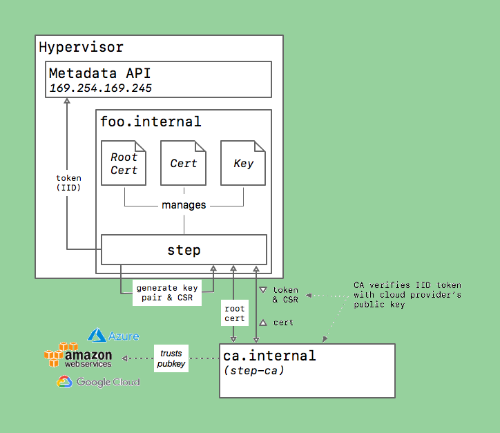

## Step CA

- **Step CA is a Self-Hosted Certificate Authority system that allows you to generate TLS certificates for use with services hosted internally (e.g. at home or behind the corporate firewall)**
- **This allows you to finally secure all communications using HTTPS, even inside your network**
- **The following is a setup guide tailored to RHEL-based Linux distributions (Fedora, Rocky, Alma, RedHat); adapt accordingly if you are on another OS**
- **SEE: <https://smallstep.com/docs/step-ca/index.html>**

---

## Step CA Installation: Certificate Authority Server

### Install Step CA and Step CLI on the "Certificate Authority" Server

**INSTALL step (CA):**

*This is the tool that allows you to run a certificate authority.*

SEE: <https://smallstep.com/docs/step-ca/installation/>

`wget https://dl.smallstep.com/certificates/docs-ca-install/latest/step-ca_amd64.rpm`

`wget https://dl.smallstep.com/certificates/docs-ca-install/latest/checksums.txt`

`cat checksums.txt | grep 'step-ca_amd64.rpm' ; sha256sum step-ca_amd64.rpm`

example output -- sha256 digests must match:

```
b0ff36e9ce6c185663e5987029ab8af930b35630b1dfa7f32f8ef401d445be80  step-ca_amd64.rpm
b0ff36e9ce6c185663e5987029ab8af930b35630b1dfa7f32f8ef401d445be80  step-ca_amd64.rpm
```

- `sudo rpm -i step-ca_amd64.rpm`

**INSTALL step-cli:**

*This is the tool that allows you to generate TLS certificates for your various apps and internal services.*

SEE: <https://smallstep.com/docs/step-cli/installation/>

`wget https://dl.smallstep.com/cli/docs-cli-install/latest/step-cli_amd64.rpm`

`wget https://dl.smallstep.com/cli/docs-cli-install/latest/checksums.txt`

`cat checksums.txt | grep 'step-cli_amd64.rpm' ; sha256sum step-cli_amd64.rpm`

example output -- sha256 digests must match:

```
847644a56b59f7bde8aa6f5baaa30f850f7e9d453069ea34f59e64e3efcf59c5  step-cli_amd64.rpm
847644a56b59f7bde8aa6f5baaa30f850f7e9d453069ea34f59e64e3efcf59c5  step-cli_amd64.rpm
```

- `sudo rpm -i step-cli_amd64.rpm`

### Initialize: Name PKI; Set DNS Name, Port and Provisioner

- First create a Very Strong Random Password and add it to `/etc/step-ca/password.txt`
- 20+ random characters should do...

Initialize the CA server:

```
[root@server1 step-ca]# step ca init --password-file /etc/step-ca/password.txt

✔ Deployment Type: Standalone
What would you like to name your new PKI?
✔ (e.g. Smallstep): Internal Domain Local CA

What DNS names or IP addresses will clients use to reach your CA?
✔ (e.g. ca.example.com[,10.1.2.3,etc.]): ca.internal-dns-name.com

What IP and port will your new CA bind to? (:443 will bind to 0.0.0.0:443)
✔ (e.g. :443 or 127.0.0.1:443): :443

What would you like to name the CA's first provisioner?
✔ (e.g. you@smallstep.com): admin@my-domain.com

Generating root certificate... done!
Generating intermediate certificate... done!

✔ Root certificate: /root/.step/certs/root_ca.crt
✔ Root private key: /root/.step/secrets/root_ca_key
✔ Root fingerprint: 0b594d3859920cd45b3cc0329e0a3eb7672d704df826659505249b490172c9d4
✔ Intermediate certificate: /root/.step/certs/intermediate_ca.crt
✔ Intermediate private key: /root/.step/secrets/intermediate_ca_key
✔ Database folder: /root/.step/db
✔ Default configuration: /root/.step/config/defaults.json
✔ Certificate Authority configuration: /root/.step/config/ca.json

Your PKI is ready to go. To generate certificates for individual services see 'step help ca'.
```

Take note of the `Root fingerprint` and the `Root and Intermediate Certificates`.

The `Root private key` must be kept absolutely secret.

**NOTE: Ideally, the Root Private Key should be generated and stored offline -- See 'Addendum' at the end of this article.**

> "Your Root CA Private Key should be guarded as closely as you would guard a Bitcoin Private Key. It should be generated offline and kept offline at all times in an ideal scenario."

---

## Run Step CA with Sane Defaults and Keep It Running

### Keep the Step CA server running, auto-restart, auto-start at boot

**SEE: <https://smallstep.com/docs/step-ca/certificate-authority-server-production/index.html#running-step-ca-as-a-daemon>**

copy all files into position:

- root\_ca.crt: `/etc/step-ca/certs/root_ca.crt`
- intermediate\_ca.crt
- intermediate\_ca\_key

edit paths in ca.json and defaults.json for password and db

`/etc/step-ca/config/ca.json` example config with default validity of 30 days for certificates:

```
{
  "root": "/etc/step-ca/certs/root_ca.crt",
  "federatedRoots": null,
  "crt": "/etc/step-ca/certs/intermediate_ca.crt",
  "key": "/etc/step-ca/secrets/intermediate_ca_key",
  "address": ":443",
  "insecureAddress": "",
  "dnsNames": [
    "ca.internal-dns-name.com"
  ],
  "logger": {
    "format": "text"
  },
  "db": {
    "type": "badgerv2",
    "dataSource": "/etc/step-ca/db",
    "badgerFileLoadingMode": ""
  },
  "authority": {
    "provisioners": [
      {
        "type": "JWK",
        "name": "admin@my-domain.com",
        "key": {
          "use": "sig",
          "kty": "EC",
          "kid": "3ItuCE4Onfjngz4I2gpEuUBi3eRFzJmjyizJJxGh9RI",
          "crv": "P-256",
          "alg": "ES256",
          "x": "C9vnWcoCFoCvMXOkUfU1dnhBh4o1JvhhV6ShBfxANok",
          "y": "4UMC2n-cgSzhGU7VfUj0nh9ZyZ_khPjsd4LQQlkSyns"
        },
        "encryptedKey": "eyJhbGciOiJQQkVTMi1IUzI1NitBMTI4S1ciLCJjdHkiOiJqd2sranNvbiIsImVuYyI6IkEyNTZHQ00iLCJwMmMiOjYwMDAwMCwicDSzIjoiZGp3M3FBRExMb0ZjZFpTdWh3SlpkdyJ9.QZ2y_sRXEaos0eTYYvrzewBUCSZ4lWKlmC0BfxIvKpy3andLArMAnw.CNqRLR9ZBwBbvF1y.v4JUF2z1U5fzwWNNX69Pw0RQJlk-3VtDskWGaHyUTcVI5Iaxtxf8BWJeJA5agk50hkZwzscAZ90IlHG-T4wBJhO2pgD3ixi8YT2Ys0XD1-NO2GnH3XVq8W8GfVVbHs-s30fyXfXmg5vxHmo-pv10PExahWIwzL4DnMyAbTGf44MnP3btNXqXRQrZ1pDbCF7UKk1ObxneXUMvJxWwmCGg9rnALkoYFlIvyITEOKXBclW1pwJ4P65bXOvcxpaAQlOGQsE_S2Gh9bXMR3nRCfGOeZLSHMX4Ow0Rr5OFxSYJViJSp1ZJkgCb1Tc7rG6JdMceY6SHiD-JzwTIKM6DsrI.Na1MzRTT0asV9icoXawD7A"
      }
    ],
    "claims": {
      "minTLSCertDuration": "5m",
      "maxTLSCertDuration": "2160h",
      "defaultTLSCertDuration": "720h"
    }
  },
  "tls": {
    "cipherSuites": [
      "TLS_ECDHE_ECDSA_WITH_CHACHA20_POLY1305_SHA256",
      "TLS_ECDHE_ECDSA_WITH_AES_128_GCM_SHA256"
    ],
    "minVersion": 1.2,
    "maxVersion": 1.3,
    "renegotiation": false
  }
}
```

`/etc/step-ca/config/defaults.json` example:

```
{
        "ca-url": "https://ca.internal-dns-name.com",
        "ca-config": "/etc/step-ca/config/ca.json",
        "fingerprint": "0b594d3859920cd45b3cc0329e0a3eb7672d704df826659505249b490172c9d4",
        "root": "/etc/step-ca/certs/root_ca.crt"
}
```

`chown -R step:step /etc/step-ca`

`vim /etc/systemd/system/step-ca.service`

```
[Unit]
Description=step-ca service
Documentation=https://smallstep.com/docs/step-ca
Documentation=https://smallstep.com/docs/step-ca/certificate-authority-server-production
After=network-online.target
Wants=network-online.target
StartLimitIntervalSec=30
StartLimitBurst=3
ConditionFileNotEmpty=/etc/step-ca/config/ca.json
ConditionFileNotEmpty=/etc/step-ca/secrets/password.txt

[Service]
Type=simple
User=step
Group=step
Environment=STEPPATH=/etc/step-ca
WorkingDirectory=/etc/step-ca
ExecStart=/usr/bin/step-ca config/ca.json --password-file secrets/password.txt
ExecReload=/bin/kill --signal HUP $MAINPID
Restart=on-failure
RestartSec=5
TimeoutStopSec=30
StartLimitInterval=30
StartLimitBurst=3

; Process capabilities & privileges
AmbientCapabilities=CAP_NET_BIND_SERVICE
CapabilityBoundingSet=CAP_NET_BIND_SERVICE
SecureBits=keep-caps
NoNewPrivileges=yes

[Install]
WantedBy=multi-user.target
```

- see also: <https://github.com/smallstep/certificates/blob/master/systemd/step-ca.service>

```
[root@server1 step-ca]# systemctl daemon-reload
[root@server1 step-ca]# systemctl start step-ca.service
[root@server1 step-ca]# systemctl status step-ca.service
● step-ca.service - step-ca service
     Loaded: loaded (/etc/systemd/system/step-ca.service; enabled; preset: disabled)
     Active: active (running) since Wed 2024-03-27 14:07:47 MDT; 2s ago
       Docs: https://smallstep.com/docs/step-ca
             https://smallstep.com/docs/step-ca/certificate-authority-server-production
   Main PID: 2100196 (step-ca)
      Tasks: 8 (limit: 48790)
     Memory: 18.2M
        CPU: 50ms
     CGroup: /system.slice/step-ca.service
             └─2100196 /usr/bin/step-ca config/ca.json --password-file password.txt

Mar 27 14:07:47 server1 systemd[1]: Started step-ca service.
Mar 27 14:07:47 server1 step-ca[2100196]: badger 2024/03/27 14:07:47 INFO: All 0 tables opened in 0s
Mar 27 14:07:47 server1 step-ca[2100196]: 2024/03/27 14:07:47 Starting Smallstep CA/0.25.2 (linux/amd64)
Mar 27 14:07:47 server1 step-ca[2100196]: 2024/03/27 14:07:47 Documentation: https://u.step.sm/docs/ca
Mar 27 14:07:47 server1 step-ca[2100196]: 2024/03/27 14:07:47 Community Discord: https://u.step.sm/discord
Mar 27 14:07:47 server1 step-ca[2100196]: 2024/03/27 14:07:47 Config file: config/ca.json
Mar 27 14:07:47 server1 step-ca[2100196]: 2024/03/27 14:07:47 The primary server URL is https://ca.internal-dns-name.com:443
Mar 27 14:07:47 server1 step-ca[2100196]: 2024/03/27 14:07:47 Root certificates are available at https://ca.internal-dns-name.com:443/roots.pem
Mar 27 14:07:47 server1 step-ca[2100196]: 2024/03/27 14:07:47 X.509 Root Fingerprint: 0b594d3859920cd45b3cc0329e0a3eb7672d704df826659505249b490172c9d4
Mar 27 14:07:47 server1 step-ca[2100196]: 2024/03/27 14:07:47 Serving HTTPS on :443 ...
```

### Check that it is working using step-cli

**GENERATE A CERTIFICATE FOR THE CA SERVER TO TEST IT:**

`step ca certificate ca.internal-dns-name.com /root/ca-srv.crt /root/ca-srv.key --password-file=/etc/step-ca/secrets/password.txt`

```
✔ Provisioner: admin@my-domain.com (JWK) [kid: 3ItuCE4Onfjngz7I2gpEueBi3eRFzJmjyizJJxGh9RI]
✔ CA: https://ca.internal-dns-name.com
✔ Certificate: /root/ca-srv.crt
✔ Private Key: /root/ca-srv.key
```

**VERIFY VALIDITY:**

`step certificate inspect --short ca-srv.crt`

```
X.509v3 TLS Certificate (ECDSA P-256) [Serial: 1087...1742]
  Subject:     ca.internal-dns-name.com
  Issuer:      Internal Domain Local CA Intermediate CA
  Provisioner: admin@my-domain.com [ID: 3Itu...h9RI]
  Valid from:  2024-03-27T20:17:17Z
          to:  2024-04-26T20:18:17Z
```

---

*Now you can go and generate certificates on all your other internal services! :)*

---

## GENERATE TLS CERTIFICATES FOR ANY INTERNAL SERVICE

### INSTALL step-cli ON ANY SERVER FOR WHICH YOU WISH TO GENERATE TLS CERTIFICATES:

SEE: <https://smallstep.com/docs/step-cli/installation/>

`wget https://dl.smallstep.com/cli/docs-cli-install/latest/step-cli_amd64.rpm`

`wget https://dl.smallstep.com/cli/docs-cli-install/latest/checksums.txt`

`cat checksums.txt | grep 'step-cli_amd64.rpm' ; sha256sum step-cli_amd64.rpm`

example output -- sha256 digests must match:

```
847644a56b59f7bde8aa6f5baaa30f850f7e9d453069ea34f59e64e3efcf59c5  step-cli_amd64.rpm
847644a56b59f7bde8aa6f5baaa30f850f7e9d453069ea34f59e64e3efcf59c5  step-cli_amd64.rpm
```

`sudo rpm -i step-cli_amd64.rpm`

BOOTSTRAP / CONNECT TO STEP CA SERVER:

`step ca bootstrap --ca-url ca.internal-dns-name.com --fingerprint 0b594d3859920cd45b3cc0329e0a3eb7672d704df826659505249b490172c9d4`

NOTE: ca-url and fingerprint will vary by installation/provisioner of Step CA software on the Step CA server

GENERATE A CERTIFICATE:

`mkdir -p /home/admin/.step/secrets`

copy `password.txt` from step-ca server to `/home/admin/.step/secrets/password.txt`

`step ca certificate <EnterNameOfService/Site/FQDN> /home/admin/.step/certs/step-cert.crt /home/admin/.step/secrets/step-cert.key --password-file=/home/admin/.step/secrets/password.txt`

```
✔ Provisioner: admin@my-domain.com (JWK) [kid: 3ItuCE4Onfjigz7I2gpEuUBi3eRFzJmjyizJJxGh9RI]
✔ CA: https://ca.internal-dns-name.com
✔ Would you like to overwrite /home/admin/.step/certs/step-cert.crt [y/n]: y
✔ Certificate: /home/admin/.step/certs/step-cert.crt
✔ Private Key: /home/admin/.step/secrets/step-cert.key
```

VERIFY VALIDITY:

`step certificate inspect --short /home/admin/.step/certs/step-cert.crt`

example output:

```
X.509v3 TLS Certificate (ECDSA P-256) [Serial: 2955...1316]
  Subject:     my-domain-app.internal-dns-name.com
  Issuer:      Internal Domain Local CA Intermediate CA
  Provisioner: admin@my-domain.com [ID: 3Itu...h9RI]
  Valid from:  2024-02-29T21:41:08Z
          to:  2024-03-30T21:42:08Z
```

MOVE INTO LOCATION:

Copy it and the associated private key into location:

`sudo cp /home/admin/.step/certs/step-cert.crt /etc/pki/tls/certs/step-cert.crt`

`sudo chmod 644 /etc/pki/tls/certs/step-cert.crt`

`sudo cp /home/admin/.step/secrets/step-cert.key /etc/pki/tls/private/step-cert.key`

UPDATE YOUR WEB SERVER:

Update your web server (apache/httpd, nginx, etc.) to use the new certificates

Renew before expiry using the same process

**Restart `httpd`/`nginx`/etc each time you change or update the certs**

UPDATE OS TRUST STORES:

**Install Root CA Certificate in OS Trust Stores:**

e.g. `step certificate install --all root-ca.pem` (copy root ca file from ca.internal-dns-name.com server first)

OPTIONAL: CLEANUP

delete the copies in the admin user's home directory:

`rm /home/admin/.step/certs/step-cert.crt`  
`rm /home/admin/.step/secrets/step-cert.key`

EXAMPLE CONFIG FOR APACHE:

`/etc/httpd/conf.d/httpd.conf`

```
# Load the necessary modules
LoadModule proxy_module modules/mod_proxy.so
LoadModule proxy_http_module modules/mod_proxy_http.so
LoadModule ssl_module modules/mod_ssl.so

# ServerName globally (optional, but recommended)
ServerName my-domain-api.internal-dns-name.com

# SSL Stapling Cache Configuration
# SSLStaplingCache "shmcb:logs/ssl_stapling(32768)"

<VirtualHost *:80>
    ServerName my-domain-api.internal-dns-name.com

    # Redirect all HTTP traffic to HTTPS
    RewriteEngine On
    RewriteCond %{HTTPS} off
    RewriteRule ^ https://%{HTTP_HOST}%{REQUEST_URI} [L,R=301]
</VirtualHost>

<VirtualHost *:443>
    ServerName my-domain-api.internal-dns-name.com
    #DocumentRoot "/var/www/html"

    # SSL Configuration
    SSLEngine on
    SSLCertificateFile /etc/pki/tls/certs/api-srv.crt
    SSLCertificateKeyFile /etc/pki/tls/private/api-srv.key
    SSLCertificateChainFile /etc/pki/tls/certs/intermediate_ca.crt

    # Only allow TLSv1.2 and TLSv1.3
    SSLProtocol -all +TLSv1.2 +TLSv1.3

    # A strong cipher suite configuration
    SSLCipherSuite ECDHE-ECDSA-AES256-GCM-SHA384:ECDHE-RSA-AES256-GCM-SHA384:ECDHE-ECDSA-CHACHA20-POLY1305:ECDHE-RSA-CHACHA20-POLY1305:ECDHE-ECDSA-AES128-GCM-SHA256:ECDHE-RSA-AES128-GCM-SHA256

    # Use the server's preference for cipher algorithm (optional)
    SSLHonorCipherOrder on

    # OCSP Stapling, improves SSL/TLS performance (optional but recommended)
    # SSLUseStapling on

    # Proxy requests to the application running on port 8080
    ProxyPreserveHost On
    ProxyPass / http://localhost:8080/
    ProxyPassReverse / http://localhost:8080/

    # Recommended security headers
    Header always set Strict-Transport-Security "max-age=63072000; includeSubDomains; preload"
    Header always set X-Frame-Options DENY
    Header always set X-Content-Type-Options nosniff
</VirtualHost>
```

---

### Create cron job for individual services to auto-renew certs

Make sure the `root_ca.cert` exists and is in place:

`/root/.step/certs/root_ca.crt` example:

```
-----BEGIN CERTIFICATE-----
MIIBvzCCABagAwIBAgIRALJ+cck2jeeep+kzo36xr2QwCgYIKoZIzj0EAwIwPjEZ
MBcGA1UEChMQVmlld25ldCBMb2NhbCBDQTEhMB8GA1UEAxMYVmlld25ldCBMb2Nh
bCBDQSBSb290IENBMB4XDTI0MDIyNzIzMDA1MloXDTM0MDIyNDIzMDA1MlowPjEZ
MBcGA1UEChMQVmlld25ldCBMb2NhbCBDQTEhMB8GA1UEAxMYVmlld25ldCBMb2Nh
bCBDQSBSb290IENBMFkwEwYHKoZIzj0CAQYIKoZIzj0DAQcDQgAEvnxRFFN7eknX
VRvuU5eeXLiTAYO46zOxM7snKrVPv7T9pjz7luO9f7Ok8clxJVnOyjts49yNQLFs
b7czm29mDaNFMEMwDgYDVR0PAQH/BAQDAgEGMBIGA1UdEwEB/wQIMAYBAf8CAQEw
HQYDVR0OBBYEFL9+8MJ2LJBlNQj+mc5n9kTdMXyBMAoGCCqGSM49BAMCA0cAMEQC
IBbStoygsavOl4ip18lAy8YLtoK65uratHT2B9/4NTGAAiAwVjtmtrRI+Ti9HM74
Jnboj7EL8pwnNqwbD+BgHqjECg==
-----END CERTIFICATE-----
```

Renew a certificate once manually to ensure the process is working as expected:

`[root@localhost tls]# step ca renew /etc/pki/tls/certs/step-cert.crt /etc/pki/tls/private/step-cert.key --ca-url ca.internal-dns-name.com`

```
✔ Would you like to overwrite /etc/pki/tls/certs/step-cert.crt [y/n]: y
```

What it looks like in the Step CA server logs when someone renews a certificate:

Example from `/var/log/messages` on the Step CA server:

```
Mar 28 06:51:17 server1 step-ca[3882]: time="2024-03-28T06:51:17-06:00" level=info certificate="MIICNzCCAd2gAwIBAgIRAIAd0BDTVnOMG4YL9bE/O+8wCgYIKoZIzj0EAwIwRjEZMBcGA1UEChMQVmlld25ldCBMb2NhbCBDQTEpMCcGA1UEAxMgVmlld25ldCBMb2NhbCBDQSBJbnRlcm1lZGlhdGUgQ0EwHhcNMjQwMzI4MTI1MDE3WhcNMjQwNDI3MTI1MTE3WjASMRAwDgYDVQQDEwdyb2NreXZtMFkwEwYHKoZIzj0CAQYIKoZIzj0DAQcDQgAEHulrG7QWqwUHse3i8uWlnplxQHDoXp27UHPCNMK7o++0trDOG1QZZjdqXdE1uayDLrIn8LYHrqAKTs00zu2IraOB3zCB3DAfBgNVHSMEGDAWgBQEjDFT+RNqmSUPM0ENFD4V+PT1EjAOBgNVHQ8BAf8EBAMCB4AwHQYDVR0lBBYwFAYIKwYBBQUHAwEGCCsGAQUFBwMCMB0GA1UdDgAWBBRkN0i//pDkUxA+iIwN1ql2RQPOhDASBgNVHREECzAJgydyb2NreXZtMFcGDCsGAQQBgqRkxihAAQRHMEUCAQEEE2FhbmRlcnNvbkB2YWxsaS5jb20EKzNJdHVDRTRPbmZqbmd6N0kyZ3BFdVVCaTNlUkZ6Sm1qeWl6Skp4R2g5UkkwCgYIKoZIzj0EAwIDSAAwRQIhAMvKIs3je5esRaYToM1XyfB8ZkNqkN5jkbSbaKKz7OmSAiBW6/00JBmGv6WgRP2sjZlTz9NCnb6+Fhwxs1xFHmoDtw==" duration=1.855276ms duration-ns=1855276 fields.time="2024-03-28T06:51:17-06:00" issuer="Internal Domain Local CA Intermediate CA" method=POST name=ca path=/renew protocol=HTTP/1.1 provisioner="admin@my-domain.com (3IutCE41nfjngz7I2gpJuUBi3eRFzJmjyizJJxGh9RI)" public-key="ECDSA P-256" referer= remote-address=192.168.0.168 request-id=co2mfhcdormvtevvl9j0 serial=170295333343620751858333324408664407023 size=3381 status=201 subject=rockyvm user-agent=Go-http-client/1.1 user-id= valid-from="2024-03-28T12:50:17Z" valid-to="2024-04-27T12:51:17Z"
```

Inspect the newly renewed certificate on the application server:

`[root@localhost tls]# step certificate inspect --short /etc/pki/tls/certs/step-cert.crt`

```
X.509v3 TLS Certificate (ECDSA P-256) [Serial: 2616...3298]
  Subject:     rockyvm
  Issuer:      Internal Domain Local CA Intermediate CA
  Provisioner: admin@my-domain.com [ID: 3Itu...h9RI]
  Valid from:  2024-03-27T21:52:19Z
          to:  2024-04-26T21:53:19Z
```

Set up cron job to auto-renew every 10 days:

```
# auto-renew step leaf certificate every 10 days
0 0 */10 * *  step ca renew /etc/pki/tls/certs/step-cert.crt /etc/pki/tls/private/step-cert.key --ca-url ca.internal-dns-name.com --force && systemctl restart httpd
```

API SERVER EXAMPLE:

```
# auto-renew step leaf certificate every 10 days
0 0 */10 * *  step ca renew /etc/pki/tls/certs/api-srv.crt /etc/pki/tls/private/api-srv.key --ca-url ca.internal-dns-name.com --force && systemctl restart httpd
```

APP SERVER EXAMPLE:

```
# auto-renew step leaf certificate every 10 days
0 0 */10 * *  step ca renew /etc/pki/tls/certs/app-srv.crt /etc/pki/tls/private/app-srv.key --ca-url ca.internal-dns-name.com --force && systemctl restart httpd
```

---

## MAKE SURE IT'S WORKING FOR END-USERS OF YOUR SERVICE

### Instructions to install Step CA Root Certs on your/your users' machine(s) so that any "child" (leaf) certificates will be trusted automatically by your OS/browser:

#### Add a local Certificate Authority to your Windows OS trust store

In Windows, hit the Windows key and type 'manage user certificates'; open the app

From the sidebar on the left:

- Expand 'Trusted Root Certification Authorities'
- Right click on 'Certificates' > All Tasks > Import (this opens the Certificate Import Wizard)

Certificate Import Wizard:

- Click Next on the first screen
- Browse to the Root CA (.crt) file on your filesystem and select/open it
- e.g. 'Internal Domain Local CA Root CA.crt'
- Place this cert into the 'Trusted Root Certification Authorities' store
- Click Finish on the last screen to import

From certmgr (Manage User Certificates), again from the main screen:

- From the sidebar, expand 'Intermediate Certification Authorities':
- Right click on 'Certificates' > All Tasks > Import (this opens the Certificate Import Wizard)

Run the Certificate Import Wizard again, but select the 'Intermediate CA' (.crt) file this time:

- Import 'Internal Domain Local CA Intermediate CA.crt' into the Intermediate Certification Authorities store on your PC (same process as above)

---

**NOTES:**

- The Python `requests` library has its own internal trust store that it uses; to redirect it to use a Step CA Root cert that you trust, you can pass in an additional `verify` parameter:
- e.g. `response = requests.post(endpoint_url, headers=headers, data=json.dumps(payload), verify=settings.ROOT_CA_CERT_PATH, params=params)`

---

## ADDENDUM: OFFLINE KEY GENERATION FOR STEP CA

### Offline Generation with a YubiKey

A YubiKey can be used in the process of securely generating and storing cryptographic keys for a Certificate Authority (CA) setup. YubiKeys are security devices that support various cryptographic operations, including those necessary for managing CA keys. They offer means to generate, store, and manage private keys securely.

#### Generating CA Keys with a YubiKey

**PIV (Personal Identity Verification)**: YubiKeys support PIV, a standard for secure cryptographic operations. You can generate a private key directly on the YubiKey, which then remains within the device and cannot be extracted. The corresponding public key can be exported and used to create a CA certificate. This feature is particularly useful for root and intermediate CA keys, as the YubiKey can store and use these keys for signing certificates without exposing the private keys.

**PKCS#11 Interface**: Many CA software tools can interface with YubiKeys through the PKCS#11 API, allowing the CA software to use keys stored on the YubiKey for cryptographic operations such as signing certificates. This setup ensures that key material is securely handled and processed within the YubiKey's secure hardware environment.

#### Securely Managing CA Operations

**Certificate Signing**: With the private key securely stored on the YubiKey, you can use the device to sign intermediate CA certificates or end-entity certificates. The actual signing operation is performed by the YubiKey, ensuring the private key is never exposed to potentially compromised environments.

**Multi-Factor Authentication (MFA)**: YubiKeys can also be used to implement MFA for accessing CA systems and software, adding an extra layer of security against unauthorized access.

**Portable Security**: You can carry the CA's root or intermediate keys with you wherever you go and perform certificate signing operations on different machines without the keys ever leaving the device.

#### Considerations for Using YubiKeys in CA Setups

**Backup and Redundancy**: It's crucial to have a plan for backing up your CA keys when using YubiKeys. Since the private keys cannot be extracted from the device, consider generating the keys on multiple YubiKeys at the initial setup to ensure redundancy and prevent loss of access to your CA keys if a YubiKey is lost or damaged.

**Key Capacity**: Depending on the model, YubiKeys have a limited number of slots for storing certificates and keys. Plan accordingly to ensure your YubiKey can accommodate the keys necessary for your CA setup.

---

**NOTE: One alternative to the YubiKey is the ***Nitrokey HSM 2***. Both Nitrokey HSM 2 and Yubikeys are supported for use with Step CA:**

> "Public-Key Cryptography Standards #11 (PKCS #11) is the most common platform-independent API used to access HSM hardware. It's supported by most HSM hardware, like Yubico's YubiHSM2, and the Nitrokey HSM 2. (There's also a software-based 'HSM', SoftHSMv2, which offers a PKCS #11 interface without the hardware.)"

- SEE: <https://smallstep.com/docs/step-ca/cryptographic-protection/#pkcs-11>
- YubiKey 5 Series with PIV Support: <https://www.yubico.com/us/product/yubikey-5-series/yubikey-5-nano/> - USB-A model, $60 USD
- Nitrokey HSM 2: <https://shop.nitrokey.com/shop/nkhs2-nitrokey-hsm-2-7#attr=> - USB-A, 99 EUR
- See also: [How to physically secure a YubiKey](https://support.yubico.com/hc/en-us/articles/360017607439-Top-practical-considerations-when-implementing-the-YubiHSM-2)

---

### Offline Generation with TAILS OS

TAILS (The Amnesic Incognito Live System) is a security-focused Debian-based Linux distribution aimed at preserving privacy and anonymity. It can boot from a USB stick or DVD and doesn't use the computer's hard disk. Here’s how TAILS can be used for secure CA setup:

- **Boot from TAILS**: Use a dedicated, air-gapped (never connected to the internet) computer. Boot the computer from a TAILS USB or DVD to ensure the operating system is clean and secure.
- **Generate Key Material**: Utilize TAILS’ built-in cryptographic tools to generate your root and intermediate CA keys and certificates. TAILS comes with GnuPG and OpenSSL, which can be used for these purposes.
- **Storage**: Store the generated keys on an encrypted USB drive. TAILS supports encrypted persistence, allowing you to securely save files on the USB drive beyond a single session.
- **Physical Security**: Keep the USB drive in a secure, physically locked location to prevent unauthorized access.

---

### Hybrid Cloud-Based Key Generation: AWS KMS and CloudHSM

AWS offers two services that can be used for securely handling CA keys: KMS (Key Management Service) and CloudHSM. Both provide secure key storage but differ in control and hardware isolation.

**AWS KMS**: AWS KMS allows you to create and manage encryption keys. It is integrated with other AWS services, making it easier to secure the keys used for a CA setup if you already use AWS for parts of your infrastructure. However, with KMS, you don't have exclusive access to the underlying hardware. This is a cloud/software based solution.

**AWS CloudHSM**: CloudHSM provides you with a dedicated (single-tenant) HSM within the AWS cloud, offering full control over the HSM and the keys it stores. You can directly generate your root and intermediate CA keys within the HSM. This method ensures that the keys are never exposed outside the secure hardware environment. This can be considered "offline" key generation. This option is much more expensive.

---

**MORE INFORMATION ON GOOD SECURITY PRACTICES: <https://smallstep.com/docs/step-ca/certificate-authority-server-production/index.html#good-security-practices>**

---

# DONE



**HAPPY HUNTING!**
