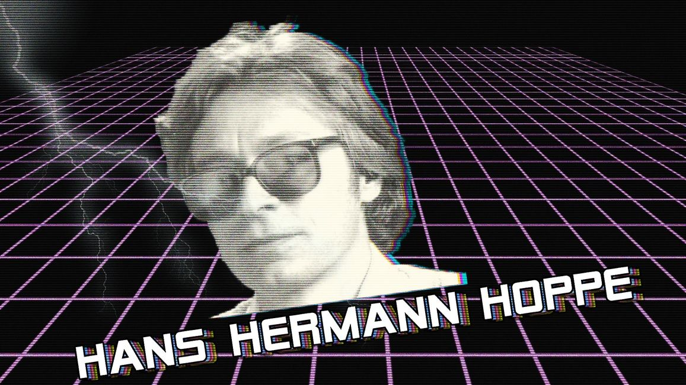

A few select quotes from **HHH** (Hans-Hermann Hoppe), renowned Freedom-Loving Austrian-Economist and author of 'Democracy: The God That Failed':

- "Democracy has nothing to do with freedom. Democracy is a soft variant of communism, and rarely in the history of ideas has it been taken for anything else."
- "What is true, just, and beautiful is not determined by popular vote. The masses everywhere are ignorant, short-sighted, motivated by envy, and easy to fool. Democratic politicians must appeal to these masses in order to be elected. Whoever is the best demagogue will win. Almost by necessity, then, democracy will lead to the perversion of truth, justice and beauty."
- "The state spends much time and effort persuading the public that it is not really what it is and that the consequences of its actions are positive rather than negative."
- "Economic theory has nothing to say as to what commodity will acquire the status of money. Historically, it happened to be gold. But if the physical makeup of our world would have been different or is to become different from what it is now, some other commodity would have become or might become money. The market will decide."

---

**My Takeaways/Distillation**

- People are imperfect and fallible social animals easily corrupted by power.
- Mob rule is inherently violent, unstable and unethical.
- Only individuals can create works of beauty, hone their craft and innovate. Sometimes choice teams of such individuals can do great things.
- The State is a parasitic entity that feeds on the energy of the populous.
- The State cannot enforce in perpetuity the use of nor maintain the soundness of any arbitrary paper money or IOU system. The market will decide what is the best money.
- "The road to hell is paved with good intentions."
