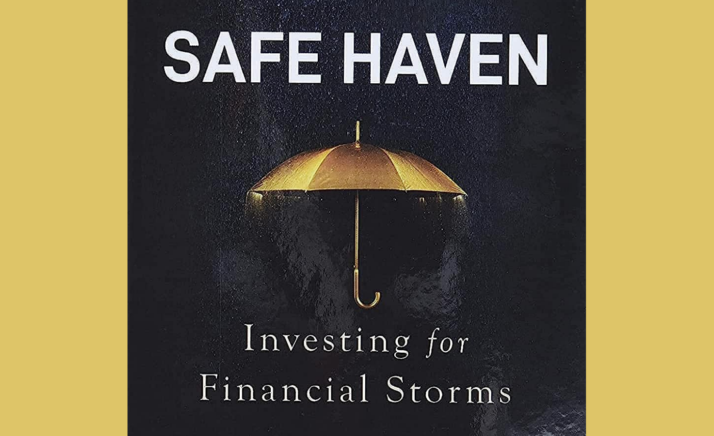
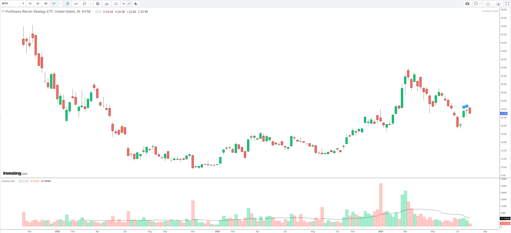
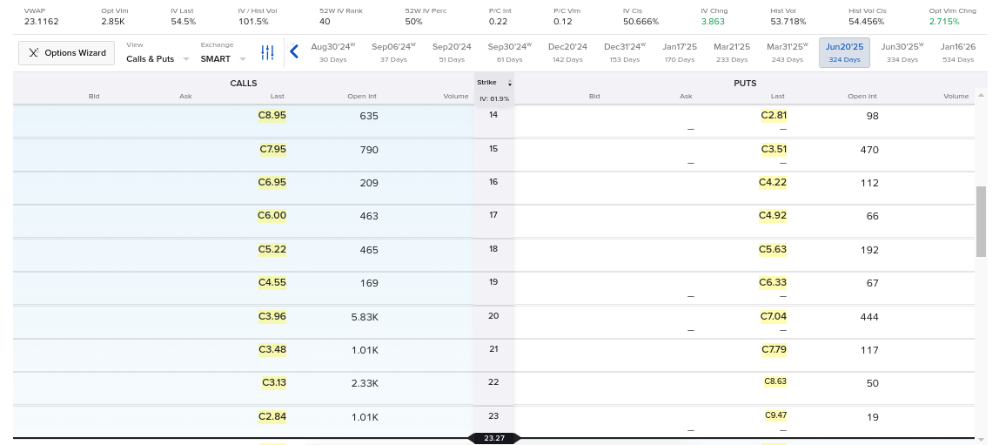

### Key Insights from Mark Spitznagel's Masterpiece

In the realm of investing, both Bitcoin enthusiasts and adherents of Modern Portfolio Theory often find themselves making similar mistakes. They tend to overlook critical aspects like path dependence and geometric average returns, instead focusing on cherry-picked starting points and talking up the *arithmetic* average returns. This common oversight can lead to misleading conclusions about an asset’s performance, emphasizing the need for a more robust, time-invariant investment strategy.

*"Bitcoin has gone up 100% a year for 10 years straight!"*

#### Understanding the Core Concept: Safe Haven Investing

Mark Spitznagel’s book, *Safe Haven Investing*, offers a novel perspective on portfolio risk mitigation. Spitznagel, the Founder and Chief Investment Officer of Universa Investments, advocates for an approach that not only reduces risk but also enhances long-term returns. This seemingly paradoxical strategy involves using out-of-the-money (OTM) Put options on key indexes, such as the S&P 500, with a recommended portfolio weight of 2%. Theoretically, the same basic approach could be applied to Bitcoin, using Put options on an ETF like BITO, for example. (The ideal weighting may vary, i.e. perhaps 3% instead of 2%.)

#### A Contrarian View on Conventional Wisdom

Spitznagel’s work challenges the conventional wisdom of diversification. He criticizes the mainstream approach, what he calls "*Di-WORSE-ification*", wherein Financial Advisors admonish anyone who doesn't own 1000 or more stocks on multiple continents PLUS bonds of all sorts and quality, in an unchanging ratio based on your birth year, WITHOUT taking into account any of the costs involved or missed opportunities. He argues instead that true risk mitigation should actually be *cost-effective*, as in it should *enhance* the portfolio's returns rather than merely providing a so-called "safety net", which as the 2020 crash showed, can be entirely illusory when all correlations "go to one".

Spitznagel’s philosophy is heavily influenced by his mentor Everett Klipp, a Pit Trader, who taught him to embrace small, manageable losses as a way to protect against catastrophic ones. His overall strategy holds up these ideals.

#### The Path to Higher Returns with Lower Risk

The central thesis of *Safe Haven Investing* is counterintuitive: higher returns can be achieved through effective risk mitigation. Spitznagel uses Monte Carlo simulations to demonstrate, with 95% confidence intervals, that incorporating defensive assets—such as OTM Put options—can increase the *geometric* return of a portfolio. This approach stands in stark contrast to the traditional belief that risk reduction necessarily leads to lower returns.

#### Practical Application

Spitznagel's convex insurance based approach is designed to offset sequence risk, ensuring that the timing of market returns does not unduly affect the overall performance of the portfolio. (I am among many bitcoiners who has enthusiastically bought more at the top and sold at the bottom multiple times for lack of a coherent strategy, I would add. If I had had a strategy such as this available to me earlier, I may have greatly improved my outcomes.)

Absent an automatic option-based hedging strategy for Bitcoin, one will have to be more high-touch to make this work. For example, you could buy Put Options on the BITO ETF that expire between 6 months to 1 year from now, rebalancing or putting 2% of your portfolio in each quarter (or each month). Ideally, the Put Options should be out-of-the-money (OTM) as they offer a more convex payoff with a strictly limited downside. You pay the premium all up front when you buy them. And if the target price (strike price) is way off (i.e. Bitcoin is still far above that price) upon expiry, your Put Option expires worthless. On the flip side, if Bitcoin drops 20% over the course of a few days, your Put Options are likely to re-rate multiples higher in value, at which point you could do a one-time rebalancing, either full or partial, to get back towards a 2% weighting. (See further breakdown below.)

For the self-custody diehards, note that you can keep all your bitcoin in your possession, and put just the 2% in cash into a Brokerage Account in order to kick off this strategy.

As for stocks, there is fortunately now a single auto-rebalancing ETF comprised of 98% S&P 500 exposure and 2% S&P 500 OTM Put Option exposure: Simplify's [SPD](https://www.simplify.us/etfs/spd-simplify-us-equity-plus-downside-convexity-etf) ETF (Simplify US Equity PLUS Downside Convexity ETF).

#### Embracing a New Paradigm

*Safe Haven Investing* challenges the foundational principles of traditional investment theory. By focusing on risk mitigation that enhances returns, Spitznagel provides a framework that can benefit both Bitcoin proponents and traditional investors. His approach underscores the importance of considering geometric returns and path dependence, offering a powerful strategy to navigate the uncertainties of financial markets.

Investors who adopt Spitznagel’s methodologies will find themselves better equipped to weather financial storms and achieve more stable, long-term growth. As markets continue to evolve, the insights from *Safe Haven Investing* will remain invaluable for those seeking to optimize their portfolios through innovative risk management techniques.

### Detailed Breakdown for Bitcoin Investors

**Why Buy Puts?**

Buying put options can be a strategic way to profit from a decline in the price of a security, such as the ProShares Bitcoin Strategy ETF (BITO).

A Put Option is a financial contract that gives you the right to sell a given amount of an underlying security (BITO) at a specified "strike" price at any time prior to the expiration date.

An Out-of-the-Money (OTM) Put is a put option with a strike price lower than the current market price of the underlying security.

For example, if BITO is trading at $23, a put option with a strike price of $20 would be considered OTM.

For a *convex* strategy, as discussed further below, you may wish to target a further OTM price, such as **30-40% below the current price**.

Note that the security doesn't necessarily need to hit the strike price in order for the trade to be profitable. Increased volatility, favorable changes in time value, or market sentiment can raise the option's premium. And you can harvest that premium at any time you wish.

> Implied Volatility plays a big role in the premium attached to a given options contract. When volatility explodes, premiums do too.

**Convex Strategy: Plunge Protection with an Explosive Payoff**

The objective of this type of insurance strategy is to allow you to wait until a large downward move in Bitcoin / BITO occurs in order to capitalize on it.

Choosing puts with expiration dates 6 months to 1 year out to gives sufficient time for the anticipated price decline to come about.

While a shorter duration may work, it can require you to rebalance more often.

***Convexity*** refers to the curvature of the payoff profile of the options.

Far OTM options exhibit greater convexity, meaning their prices can increase dramatically with small moves in the underlying asset.

The further OTM the put option is, the cheaper it typically is, but the potential payoff becomes more explosive if the underlying asset's price moves significantly lower. This is due to the leverage effect inherent in options.

#### Example Analysis

Let's consider a scenario where BITO is trading at $23, and you buy OTM puts with a strike price of $15 expiring in 1 year. Here’s how the strategy might play out:

**Cost:** The premium paid for the put options will be relatively low because they are Far OTM. For example, let's say you buy a BITO Put option expiring June 20, 2025 (324 days from the time of this writing) with a strike price of $15. The total premium is $100, or $1 per share.

**Payoff Scenario:**

- If BITO's price declines to $15 or below before the expiration date, the put option becomes highly profitable.
- The payoff is calculated as (Strike Price - Market Price) \* Number of Contracts - Premium Paid.
- Again, however, the option can be re-rated many times higher due to other factors, even without hitting the strike price, such as due to an increase in implied volatility.

Your total risk for this position is limited to the premium you paid for the option. Of course, if BITO’s price does not decline, your maximum loss is the full premium you paid.

**Profit Potential:**

- If BITO falls to $15: (23 - 15) = $8.00 profit per share, or $800, excluding the premium.
- The percentage gain can be substantial relative to the initial premium paid, demonstrating the leverage and convexity of OTM options.
- The profit may be higher based on market sentiment or implied volatility.

### Practical Considerations

Volatility: Higher volatility increases the price of options. If volatility is expected to rise, buying options might become more expensive.

Timing: The timing of the price decline is crucial. OTM puts lose value as they approach expiration if the underlying price does not move significantly.

Liquidity: Ensure that the chosen options are liquid to avoid large bid-ask spreads which can eat into profits. Look for options that have relatively higher Open Interest (open positions) and Trading Volume for the given day you are placing the trade.

#### Illustrations

Notice how many prolonged and sharp drawdowns have been observed just in BITO since its launch. With the framework we've provided here, you should now see these drops as profit opportunities.

Example Option Chain for BITO:

#### Scenario

You own $10,000 in Bitcoin. You wish to insure yourself against losses and increase your geometric average return over time. You decide to implement this strategy. You take 2% of your Bitcoin portfolio, convert it to cash, and put it into a Brokerage Account.

Initially, you buy 2 Put Options Contracts with a strike price 30-40% below the current price of BITO, with an expiration 1 year out. These cost you $200. This is your 2% dedicated to 'insurance'.

Then let's say that the price of bitcoin (and BITO) drops by 20% over the course of a 3 day period. Your Bitcoin is now worth slightly less than $8,000. But your Puts have quadrupled in value to $800. You could sell them at this point, but decide to wait and see if the Bitcoin price drops further.

Lucky you: Bitcoin dropped another 10%, and your Puts are now worth 10X what you bought them for: $2000. You sell them and purchase more Bitcoin.

Your Bitcoin is now worth around $9000; The alternate reality version of yourself that didn't pursue this path has only $7000 worth of BTC. (You keep 2% of this aside now again, however, to add back more insurance.)

After rebalancing, you have $8820 in BTC and $180 in BITO Puts.

Setting up a system such as this, such that you can continue to profit from the downside volatility of Bitcoin, can lead to superior outcomes over time.

*Best of luck!*
