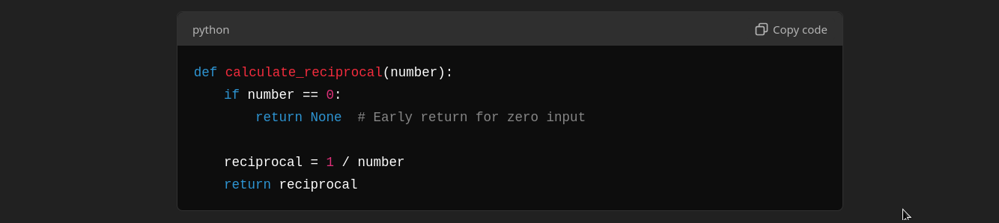

Certain advanced programming techniques can – when applied judiciously – enhance code readability, maintainability, and scalability. One example is the "Early Return". Others follow. **`*High-Five*` to you if you've used more than a few of these before!**

---

### **Early Return**

The "early return" concept involves exiting a function as soon as a specific condition is met, especially when that condition invalidates the need to proceed further. By handling special cases or errors upfront, you prevent unnecessary nesting of code, making it cleaner and more readable.

- **Improved Readability:** Reduces indentation levels by avoiding deep nesting.
- **Simplified Logic:** Makes the main logic of the function more apparent.
- **Easier Maintenance:** Simplifies updates and reduces the chance of bugs.

**Example Without Early Return:**

Let's say we have a function that calculates the reciprocal of a number but should only operate on non-zero values.

```python
def calculate_reciprocal(number):
    if number != 0:
        reciprocal = 1 / number
        return reciprocal
    else:
        return None  # Handle zero input
```

In this example, the main logic is nested inside the `if` block, increasing indentation and potentially complicating the function as more conditions are added.

**Example With Early Return:**

By applying the early return principle, we handle the special case immediately and keep the main logic unindented.

```python
def calculate_reciprocal(number):
    if number == 0:
        return None  # Early return for zero input

    reciprocal = 1 / number
    return reciprocal
```

- **Early Return:** We check if `number` is zero and return `None` immediately if it is.
- **Main Logic Simplified:** The main computation is now at the base indentation level, making it clearer and easier to follow.

**Another Example: Processing a List**

Suppose you have a function that processes a list of values but should do nothing if the list is empty.

**Without Early Return:**

```python
def process_list(values):
    if len(values) > 0:
        for value in values:
            # Process each value
            print(value)
    else:
        print("No values to process.")
```

**With Early Return:**

```python
def process_list(values):
    if not values:
        print("No values to process.")
        return  # Early return if the list is empty

    for value in values:
        # Process each value
        print(value)
```

- **Handle Edge Cases First:** Check for conditions that should halt further execution at the beginning.
- **Reduce Nesting:** By returning early, you avoid wrapping the main logic in additional `if` or `else` blocks.
- **Enhance Clarity:** The core functionality stands out and is easier to read.

The early return technique streamlines your functions by:

- Dealing with exceptions or special conditions upfront.
- Keeping the primary code path clear and less indented.
- Making the codebase easier to read and maintain over time.

**When to Use Early Return:**

- **Input Validation:** Validate function arguments at the start and return if they are invalid.
- **Error Handling:** Immediately exit when encountering errors or exceptions.
- **Edge Cases:** Handle special conditions that don't require the main logic to execute.

Adopting the early return pattern contributes to writing clean, efficient, and maintainable code. It allows developers to quickly understand the purpose of each function and the conditions under which it operates.

---

## OTHER TECHNIQUES

### Context Managers

**Explanation:** Context managers help manage resources like files, network connections, or locks by encapsulating the setup and teardown logic, ensuring that resources are properly released after use.

**Example:**

```python
# Without context manager
file = open('example.txt', 'r')
try:
    data = file.read()
finally:
    file.close()

# With context manager
with open('example.txt', 'r') as file:
    data = file.read()
# File is automatically closed after the block
```

---

### Generators

**Explanation:** Generators allow you to iterate over data without storing the entire dataset in memory, which is efficient for large datasets.

**Example:**

```python
def fibonacci(n):
    a, b = 0, 1
    while a < n:
        yield a
        a, b = b, a + b

# Using the generator
for number in fibonacci(100):
    print(number)
```

---

### Decorators

**Explanation:** Decorators are functions that modify the behavior of other functions or methods, promoting code reuse and separation of concerns.

**Example:**

```python
def debug(func):
    def wrapper(*args, **kwargs):
        print(f'Calling {func.__name__}')
        result = func(*args, **kwargs)
        print(f'{func.__name__} returned {result}')
        return result
    return wrapper

@debug
def add(a, b):
    return a + b

add(5, 3)
```

---

### Functional Programming Techniques

**Explanation:** Using functions like `map`, `filter`, and `reduce` can make your code more expressive and concise by applying functions over iterables.

**Example:**

```python
# Using map to square numbers
numbers = [1, 2, 3, 4]
squares = list(map(lambda x: x ** 2, numbers))

# Using filter to get even numbers
even_numbers = list(filter(lambda x: x % 2 == 0, numbers))
```

---

### Type Hints

**Explanation:** Adding type hints improves code readability and helps catch errors early with tools like mypy.

**Example:**

```python
def greet(name: str) -> str:
    return f'Hello, {name}!'

# Type hints indicate that 'name' should be a string
# and the function returns a string
```

---

### Data Classes

**Explanation:** Data classes reduce boilerplate code for classes that primarily store data by automatically adding special methods like `__init__()` and `__repr__()`.

**Example:**

```python
from dataclasses import dataclass

@dataclass
class Point:
    x: float
    y: float

p = Point(1.5, 2.5)
print(p)  # Output: Point(x=1.5, y=2.5)
```

---

### Dependency Injection

**Explanation:** Dependency injection involves passing dependencies to a class or function, making the code more modular and easier to test.

**Example:**

```python
class Database:
    def connect(self):
        pass  # Connection logic

class Service:
    def __init__(self, database: Database):
        self.database = database

db = Database()
service = Service(db)
```

---

### Composition Over Inheritance

**Explanation:** Favoring composition (using instances of other classes) over inheritance can lead to more flexible and maintainable code structures.

**Example:**

```python
class Engine:
    def start(self):
        print('Engine started')

class Car:
    def __init__(self, engine: Engine):
        self.engine = engine

    def start(self):
        self.engine.start()
        print('Car is running')

engine = Engine()
car = Car(engine)
car.start()
```

---

### Proper Exception Handling

**Explanation:** Using exceptions appropriately ensures that errors are handled gracefully without crashing the program.

**Example:**

```python
def divide(a, b):
    try:
        return a / b
    except ZeroDivisionError:
        return 'Cannot divide by zero'

result = divide(10, 0)
print(result)  # Output: Cannot divide by zero
```

---

### Immutability

**Explanation:** Using immutable data structures (like tuples and frozensets) prevents unintended side effects, making code safer and easier to reason about.

**Example:**

```python
# Immutable tuple
coordinates = (10, 20)

# Attempting to modify will raise an error
# coordinates[0] = 15  # This will raise a TypeError
```

---

### Separation of Concerns

**Explanation:** Dividing code into distinct sections, each handling a specific aspect of the program, improves maintainability and scalability.

**Example:**

```python
# data_processing.py
def process_data(data):
    pass  # Data processing logic

# database_access.py
def save_to_database(data):
    pass  # Database saving logic

# main.py
from data_processing import process_data
from database_access import save_to_database

data = get_data()
processed_data = process_data(data)
save_to_database(processed_data)
```

---

### Applying SOLID Principles

**Explanation:** SOLID principles are five design principles that improve object-oriented code's maintainability and extendability.

- **Single Responsibility Principle:** A class should have only one reason to change.
- **Open/Closed Principle:** Classes should be open for extension but closed for modification.

**Example (Single Responsibility Principle):**

```python
class ReportGenerator:
    def fetch_data(self):
        pass  # Fetch data logic

    def generate_report(self):
        pass  # Report generation logic

    def send_email(self):
        pass  # Email sending logic

# Refactored to adhere to SRP
class DataFetcher:
    def fetch_data(self):
        pass

class ReportGenerator:
    def generate_report(self, data):
        pass

class EmailSender:
    def send_email(self, report):
        pass
```

---

By incorporating these techniques into your programming practices, you can write code that is not only cleaner but also easier to maintain and scale over time. Each technique promotes writing code that is efficient, readable, and less prone to errors.
