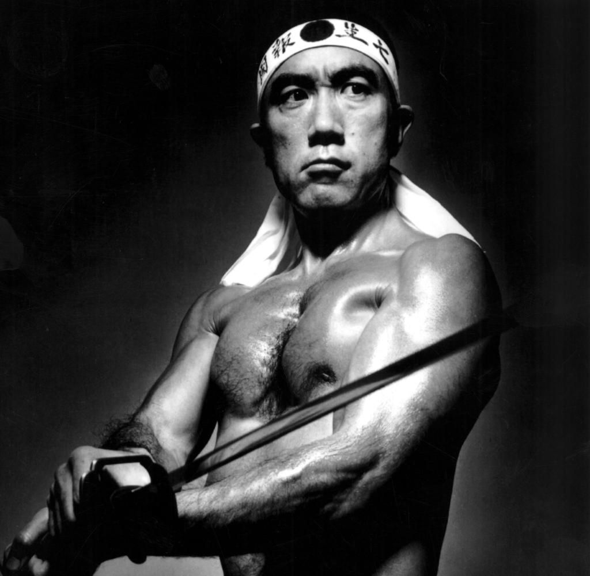
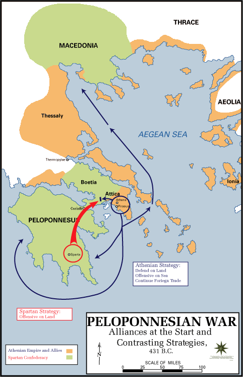
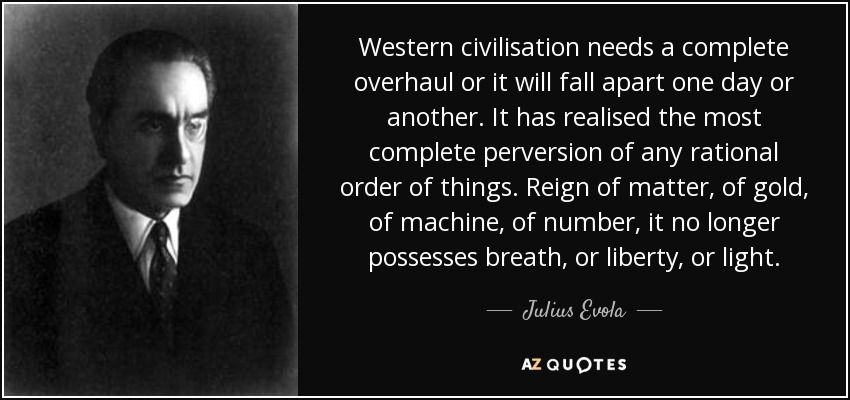
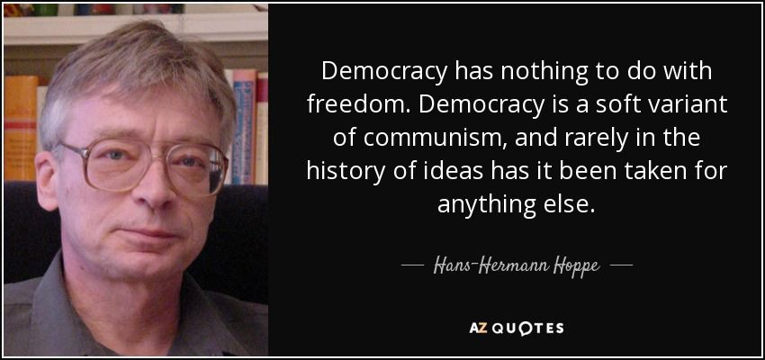
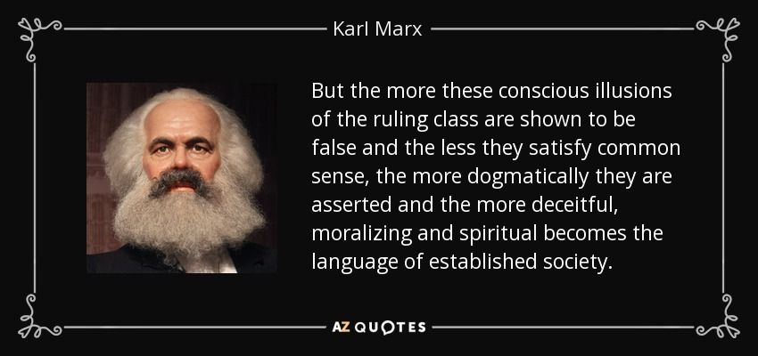

`[NOTE: This post composed 95% by AI.]`

## The Fractured Logic of Nation-States and Majority Rule

The nation-state and democracy are often framed as moral triumphs, yet their foundations are riddled with contradictions—coercion masked as consent, oligarchy disguised as equality. From 19th-century anarchists to Silicon Valley technocrats, critics across ideologies expose how these systems perpetuate violence, cultural decay, and elite control.

---

### **Moral Decay: When “Equality” Breeds Tyranny**

Plato witnessed Athenian democracy execute Socrates, later writing in *The Republic*: *“A society drunk on flattery elects tyrants, not leaders.”* His solution—philosopher-kings—reflects a distrust of mass politics sharpened by the chaos of the Peloponnesian War between Athens and Sparta.

Nietzsche, writing amid Bismarck’s nationalist unification of Germany, saw democracy as a secularized “slave morality.” In *Beyond Good and Evil* (1886), he warned: *“The democrat’s ‘equality’ is revenge against the exceptional—a poison to cultural greatness.”* His critique crystallized as Europe hurtled toward World War I, where mechanized slaughter exposed the fragility of Enlightenment ideals.

Julius Evola, writing under Mussolini’s fascist regime, condemned democracy as a symptom of Hinduism’s *Kali Yuga* (age of darkness), arguing: *“Modern parliaments are theaters where the spiritually bankrupt negotiate their decay.”* His call for feudal hierarchy mirrored interwar Europe’s embrace of authoritarianism as a cure for democratic instability.

---

### **Elite Control: The Oligarchy Behind the Curtain**

Noam Chomsky’s *Manufacturing Consent* (1988) dissected Cold War-era U.S. interventions, showing how media framed atrocities like the Indonesia genocide (1965–66) as “stability.” His axiom—*“Propaganda is to democracy what violence is to dictatorship”*—echoes Emma Goldman’s critique of Woodrow Wilson’s WWI rhetoric: *“They talk of democracy, but mean conscription; they preach liberty, but practice censorship.”*

In *The International Jew* (1920), Henry Ford argued that: *"Democracy is a tool of international finance to erode national sovereignty."* The economic turmoil post-WWI, he posited, was caused in large part by *‘global financiers’*  stripping nations bare.

Peter Thiel’s 2009 essay, written after the Iraq War and 2008 financial crisis, declared: *“Freedom and democracy are incompatible.”* His techno-libertarian antidote to democratic gridlock was one of private cities and seasteading, islands of freedom.

---

### **Digital Age Hypocrisy: Surveillance Capitalism and Empty Consent**

Byung-Chul Han’s *Psychopolitics* (2017) argues platforms like Facebook weaponize democracy’s ideals: *“We ‘like’ our own exploitation.”* This “neoliberal panopticon” updates Chomsky’s critique—where 20th-century media oligarchs controlled narratives, 21st-century algorithms commodify dissent.

---

### **State Violence: Blood and Borders**

Mikhail Bakunin, exiled after the 1848 revolutions, saw the Paris Commune’s 1871 massacre as proof that *“all states rest on executioners.”* Anarchist Emma Goldman, deported during the 1919 U.S. Red Scare, added: *“Laws are spiderwebs to catch the weak, chains to bind the strong.”*

Hans-Hermann Hoppe’s *Democracy: The God That Failed* (2001) contrasts medieval monarchs’ long-term stewardship with democratic short-termism: *“Kings treated nations like heirlooms; presidents treat them like rented cars.”* His analysis mirrors Rome’s transition from Republic to Empire—power centralized as democratic institutions crumbled.

---

### **Contradictory Cures: From Philosopher-Kings to Anarchist Utopias**

How have these thinkers and writers conceived of alternatives to the democratic status quo in their time?

- **Plato** believed only those who discern the Good should rule, insisting that philosopher-kings could shield society from the tyranny of the ignorant majority. As he explained, *“The object of education is to teach us to love what is beautiful,”* implying a guardian class that transcends popular whims.
- **Joseph de Maistre** championed monarchy as divinely ordained, teaching that *“hangmen are the glue of society,”* which underscores his view that strong, God-sanctioned authority is necessary to maintain social and moral order.
- **Mikhail Bakunin** rejected every form of state power, calling for an anarchist revolution that abolishes hierarchies completely.
- **Tristan Tzara** mocked nationalist and democratic conventions through Dada’s absurdist manifestos, proclaiming, *“Dada is anti-dada.”* By ridiculing the structures of parliament and society, he aimed to topple the foundations of national identity and bourgeois complacency.
- **Yukio Mishima** envisioned reviving the emperor’s divine authority and *bushidō* values to restore Japan’s sacred unity. His 1970 coup attempt embodied a dramatic break with Western-style democracy, as he cried out for a reawakened *samourai* spirit.
- **Oswald Spengler** praised medieval guilds and traditional communities as antidotes to the soul-crushing forces of industrial modernity. In his view, the cyclical decline of Western democracies evidenced the need to return to more organic, culturally-rooted forms of social organization.

---

## Conclusion

The diverse critiques woven together here frame democracy and the nation-state not as universally emancipatory institutions, but as parasitic constructs that foster manipulation, coercion, and moral decay. Across eras and cultures—from Plato’s philosopher-kings to Bakunin’s anarchism, from Chomsky’s media critiques to Thiel’s techno-utopian experiments—these thinkers demand us to examine the power dynamics at the heart of majority rule, and to question whether it truly reflects the will of the people or simply the ambitions of those who wield influence behind the scenes. Their cautionary tales highlight a persistent tension between ideals of freedom and the mechanisms by which modern societies organize, compelling us to recognize democracy’s inherent flaws in the face of the overwhelming consent that has been manufactured in its favor.

Karl Marx, on Democracy (probably)
