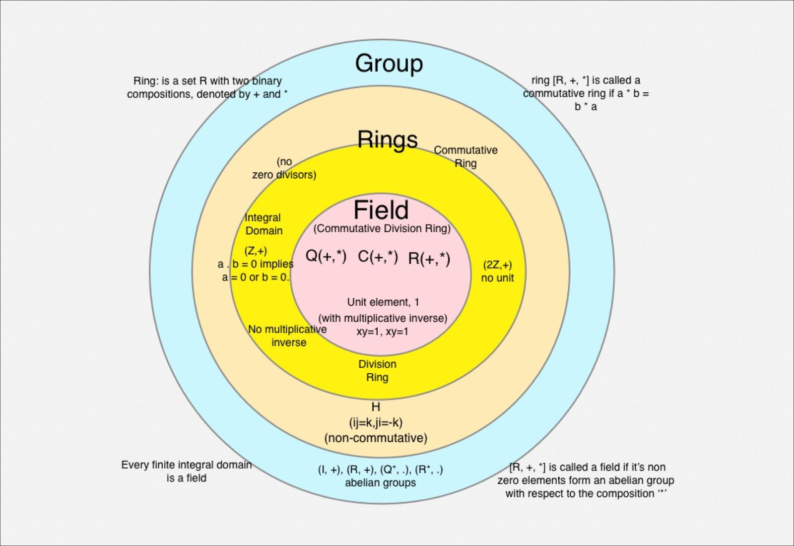

### Foundations of Cryptography: Groups, Rings, and Finite Fields

#### Building Blocks of Secure Systems

To understand the cryptographic principles underpinning decentralized systems like Bitcoin and Monero, we begin with three mathematical pillars: **groups**, **rings**, and **fields**. These structures enable the privacy, security, and trustlessness of modern cryptocurrencies.

`[NOTE: Written by DeepSeek R1. Still learning about this topic myself; these are my notes so far.]`

---

### 1. Cryptographic Essentials: Groups, Rings, and Fields

#### ****Groups: Operations with Structure****

A **group** is a set *G* paired with an operation (e.g., addition, multiplication) satisfying:

- **Closure**: For all *a, b* ∈ *G*, the result of *a · b* stays in *G*.
- **Associativity**: *a · (b · c) = (a · b) · c*.
- **Identity**: An element *e* ∈ *G* exists such that *a · e = e · a = a*.
- **Inverses**: For every *a* ∈ *G*, there exists *b* ∈ *G* where *a · b = e*.

**Examples**:

- Integers ℤ under addition: Identity is 0; inverse of 5 is -5.
- **Elliptic curve groups**: The basis of Bitcoin’s ECDSA, where solving *k · G = P* (finding scalar *k* from public point *P*) is computationally infeasible.

---

#### ****Rings: Dual Operations****

A **ring** adds a second operation to a group:

- **Addition** is commutative (abelian group).
- **Multiplication** is associative and distributive over addition.

**Examples**:

- Integers ℤ with addition and multiplication.
- Polynomial rings ℤ[x], crucial for constructing finite fields.

---

#### ****Fields: Division and Perfection****

A **field** is a ring where every non-zero element has a multiplicative inverse. Key examples:

- **Prime fields**: Integers modulo a prime *p* (e.g., ℤ/7ℤ: 3⁻¹ = 5 in mod 7).
- **Extension fields**: Built by extending prime fields with irreducible polynomials (e.g., 𝔽₂⁸ used in AES).

---

### 2. Finite Fields: Cryptography’s Workhorse

Finite fields (Galois`*` fields) enable secure computation:

1. **Prime fields**: Arithmetic modulo *p*, like Bitcoin’s ℤ/pℤ for large primes.
2. **Polynomial extensions**: Construct 𝔽ₚⁿ by adjoining roots of irreducible polynomials.

**Example: 𝔽₄**

- Base field: 𝔽₂ = {0, 1}.
- Define 𝔽₄ = 𝔽₂[x]/(x² + x + 1). Elements: {0, 1, x, x+1}.
- *x* behaves like a root: *x² ≡ x + 1* in this field.

---

### 3. Cryptography in Practice: Bitcoin and Monero

#### ****Bitcoin: ECDSA over Prime Fields****

- **Private keys**: Integers *k* in ℤ/pℤ.
- **Public keys**: Points *K = k · G* on an elliptic curve (e.g., secp256k1).

#### ****Monero: Privacy Through Algebra****

- **Ring Signatures**: Combine signatures using group operations.
- **Stealth Addresses**: Generate one-time keys via field arithmetic.

---

### 4. Sovereignty Through Mathematics

Bitcoin and Monero use **openly verifiable** structures:

1. **Prime fields** for collision-resistant hashing.
2. **Elliptic curve groups** for unforgeable signatures.
3. **Polynomial rings** for efficient zero-knowledge proofs.

---

### Conclusion: Equations of Freedom

Groups (ℤ, elliptic curves), rings (ℤ[x]), and fields (𝔽ₚ) are tools of liberation. By encoding rights into mathematical protocols, Bitcoin and Monero shift power from intermediaries to individuals.

***Trust math, not middlemen.***

---

### Notes

- **`*` Évariste *Galois***, French mathematician. His last name is pronounced **"Gal-wah"** (/ɡalˈwa/ in IPA).

### Sources

- DeepSeek R1 synthesis of its own training data plus the following additional sources:
- <https://people.csail.mit.edu/madhu/ST12/scribe/lect03.pdf>
- <https://www-users.cse.umn.edu/~brubaker/docs/152/152groups.pdf>
- <https://people.maths.ox.ac.uk/flynn/genus2/sheets0405/grfnotes1011.pdf>
- <https://people.engr.tamu.edu/andreas-klappenecker/629/finite_fields.pdf>
- <https://www.geeksforgeeks.org/group-rings-and-fields-in-group-theory/>

---

**Inspired by: "Motivate The Math" Podcast, by Fundamentals and average\_gary**

- Motivate The Math: <https://serve.podhome.fm/motivate-the-math_638723836566573210>
