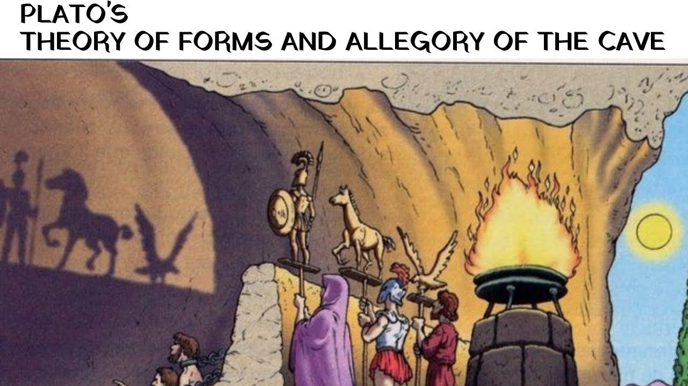
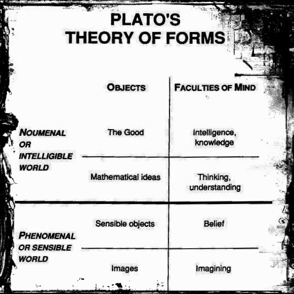
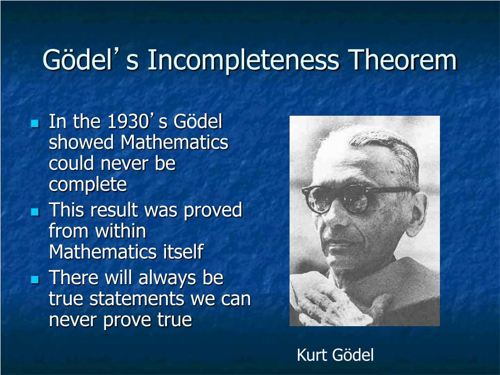
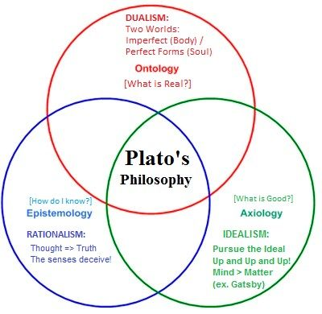
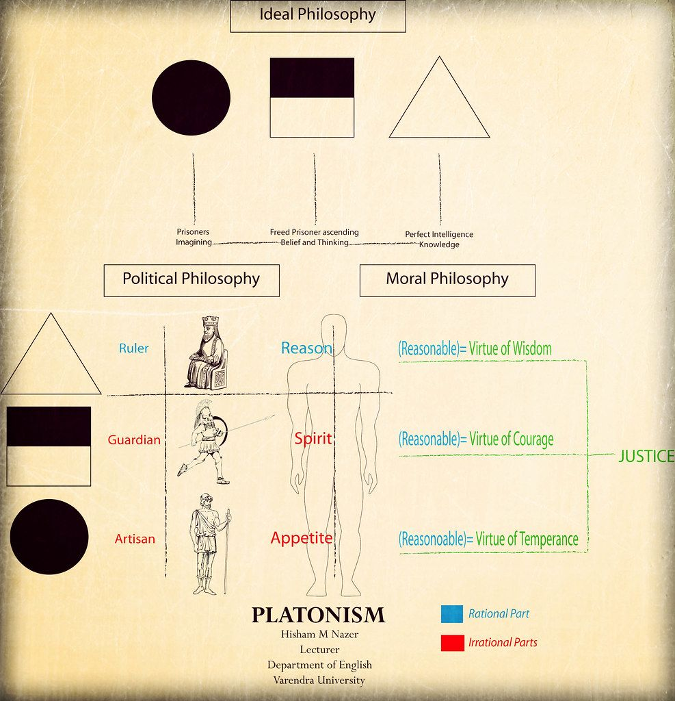

## UBCO study debunks the idea that the universe is a computer simulation

**Patty Wellborn – October 30, 2025**  
`Original Article: https://news.ok.ubc.ca/2025/10/30/ubco-study-debunks-the-idea-that-the-universe-is-a-computer-simulation`

> New study uses logic and physics to definitively answer one of science's biggest questions

In the film *The Matrix*, about a computer-simulated world, the red and blue pills symbolize a choice the hero must make between illusion and the truth of reality.

It’s a plot device beloved by science fiction: our entire universe might be a simulation running on some advanced civilization’s supercomputer.

But new research from UBC Okanagan has mathematically proven this isn’t just unlikely—it’s impossible.

Dr. Mir Faizal, Adjunct Professor with UBC Okanagan’s [Irving K. Barber Faculty of Science](https://science.ok.ubc.ca/), and his international colleagues, Drs. Lawrence M. Krauss, Arshid Shabir and Francesco Marino have shown that the fundamental nature of reality operates in a way that no computer could ever simulate.

Their findings, published in the [Journal of Holography Applications in Physics](https://arxiv.org/abs/2507.22950), go beyond simply suggesting that we’re not living in a simulated world like The Matrix. They prove something far more profound: the universe is built on a type of understanding that exists beyond the reach of any algorithm.

“It has been suggested that the universe could be simulated. If such a simulation were possible, the simulated universe could itself give rise to life, which in turn might create its own simulation. This recursive possibility makes it seem highly unlikely that our universe is the original one, rather than a simulation nested within another simulation,” says Dr. Faizal. “This idea was once thought to lie beyond the reach of scientific inquiry. However, our recent research has demonstrated that it can, in fact, be scientifically addressed.”

The research hinges on a fascinating property of reality itself. Modern physics has moved far beyond Newton’s tangible “stuff” bouncing around in space. Einstein’s theory of relativity replaced Newtonian mechanics. Quantum mechanics transformed our understanding again. Today’s cutting-edge theory—quantum gravity—suggests that even space and time aren’t fundamental. They emerge from something deeper: pure information.

This information exists in what physicists call a Platonic realm—a mathematical foundation more real than the physical universe we experience. It’s from this realm that space and time themselves emerge.

Here’s where it gets interesting. The team demonstrated that even this information-based foundation cannot fully describe reality using computation alone. They used powerful mathematical theorems—including Gödel’s incompleteness theorem—to prove that a complete and consistent description of everything requires what they call “non-algorithmic understanding.”

Think of it this way. A computer follows recipes, step by step, no matter how complex. But some truths can only be grasped through non-algorithmic understanding—understanding that doesn’t follow from any sequence of logical steps. These “Gödelian truths” are real, yet impossible to prove through computation.

Here’s a basic example using the statement, “This true statement is not provable.” If it were provable, it would be false, making logic inconsistent. If it’s not provable, then it’s true, but that makes any system trying to prove it incomplete. Either way, pure computation fails.

“We have demonstrated that it is impossible to describe all aspects of physical reality using a computational theory of quantum gravity,” says Dr. Faizal. “Therefore, no physically complete and consistent theory of everything can be derived from computation alone. Rather, it requires a non-algorithmic understanding, which is more fundamental than the computational laws of quantum gravity and therefore more fundamental than spacetime itself.”

Since the computational rules in the Platonic realm could, in principle, resemble those of a computer simulation, couldn’t that realm itself be simulated?

No, say the researchers. Their work reveals something deeper.

“Drawing on mathematical theorems related to incompleteness and indefinability, we demonstrate that a fully consistent and complete description of reality cannot be achieved through computation alone,” Dr. Faizal explains. “It requires non-algorithmic understanding, which by definition is beyond algorithmic computation and therefore cannot be simulated. Hence, this universe cannot be a simulation.”

Co-author Dr. Lawrence M. Krauss says this research has profound implications.

“The fundamental laws of physics cannot be contained within space and time, because they generate them. It has long been hoped, however, that a truly fundamental theory of everything could eventually describe all physical phenomena through computations grounded in these laws. Yet we have demonstrated that this is not possible. A complete and consistent description of reality requires something deeper—a form of understanding known as non-algorithmic understanding.”

The team’s conclusion is clear and marks an important scientific achievement, says Dr. Faizal.

“Any simulation is inherently algorithmic—it must follow programmed rules,” he says. “But since the fundamental level of reality is based on non-algorithmic understanding, the universe cannot be, and could never be, a simulation.”

The simulation hypothesis was long considered untestable, relegated to philosophy and even science fiction, rather than science. This research brings it firmly into the domain of mathematics and physics, and provides a definitive answer.

**SOURCE:**

- The University of British Columbia, Okanagan Campus: <https://news.ok.ubc.ca/2025/10/30/ubco-study-debunks-the-idea-that-the-universe-is-a-computer-simulation/>

---

# Original Study: Consequences of Undecidability in Physics on the Theory of Everything

**July 29, 2025**  
**Mir Faizal, Lawrence M. Krauss, Arshid Shabir, Francesco Marino**

### ABSTRACT

General relativity treats spacetime as dynamical and exhibits its breakdown at singularities. This failure is interpreted as evidence that quantum gravity is not a theory formulated within spacetime; instead, it must explain the very emergence of spacetime from deeper quantum degrees of freedom, thereby resolving singularities. Quantum gravity is therefore envisaged as an axiomatic structure, and algorithmic calculations acting on these axioms are expected to generate spacetime. However, Gödel's incompleteness theorems, Tarski's undefinability theorem, and Chaitin's information-theoretic incompleteness establish intrinsic limits on any such algorithmic programme. Together, these results imply that a wholly algorithmic "Theory of Everything" is impossible: certain facets of reality will remain computationally undecidable and can be accessed only through non-algorithmic understanding. We formalize this by constructing a "Meta-Theory of Everything" grounded in non-algorithmic understanding, showing how it can account for undecidable phenomena and demonstrating that the breakdown of computational descriptions of nature does not entail a breakdown of science. Because any putative simulation of the universe would itself be algorithmic, this framework also implies that the universe cannot be a simulation.

**SOURCE: Consequences of Undecidability in Physics on the Theory of Everything**

- **HTML: <https://arxiv.org/html/2507.22950v1>**
- **Abstract: <https://arxiv.org/abs/2507.22950>**

---

## FULL TEXT

****Abstract****

General relativity treats spacetime as dynamical and exhibits its breakdown at singularities. This failure is interpreted as evidence that quantum gravity is not a theory formulated within spacetime; instead, it must explain the very emergence of spacetime from deeper quantum degrees of freedom, thereby resolving singularities. Quantum gravity is therefore envisaged as an axiomatic structure, and algorithmic calculations acting on these axioms are expected to generate spacetime. However, Gödel’s incompleteness theorems, Tarski’s undefinability theorem, and Chaitin’s information-theoretic incompleteness establish intrinsic limits on any such algorithmic programme. Together, these results imply that a wholly algorithmic “Theory of Everything” is impossible: certain facets of reality will remain computationally undecidable and can be accessed only through non-algorithmic understanding. We formalize this by constructing a “Meta-Theory of Everything” grounded in non-algorithmic understanding, showing how it can account for undecidable phenomena and demonstrating that the breakdown of computational descriptions of nature does not entail a breakdown of science. Because any putative simulation of the universe would itself be algorithmic, this framework also implies that the universe cannot be a simulation.

Physics has journeyed from classical tangible “stuff” to ever deeper layers of abstraction. In Newtonian mechanics reality consists of point-like masses tracing deterministic trajectories in an immutable Euclidean space with a universal time parameter [Landau1976](https://arxiv.org/html/2507.22950v1#bib.bib1). This picture sufficed for celestial mechanics and terrestrial dynamics, yet its very foundations, including the separability of space and time and the notion of absolute simultaneity, were overturned by Einstein’s special relativity. By welding space and time into a single Lorentzian continuum, special relativity replaced Newton’s rigid arena with an observer-dependent spacetime geometry whose interval, not time or space separately, is invariant [Rindler1977](https://arxiv.org/html/2507.22950v1#bib.bib2).

Quantum mechanics introduced a second conceptual revolution: even with a fixed spacetime backdrop, the microscopic world resists classical deterministic descriptions. Wave functions evolve unitarily, but measurement outcomes are inherently probabilistic, encoded in the Born rule and constrained by complementarity and uncertainty principles [Sakurai2017](https://arxiv.org/html/2507.22950v1#bib.bib3). When the relativistic requirement of locality is imposed on quantum theory, particles cease to be fundamental. Instead, quantum field theory (QFT) elevates fields to primary status; “particles” emerge from those fields via creation and annihilation operators acting on the vacuum state [Srednicki2007](https://arxiv.org/html/2507.22950v1#bib.bib4). Here the vacuum is itself a seething medium. Time-dependent boundary conditions in superconducting wave-guides emulate moving mirrors and catalyse the dynamical Casimir effect, producing real particles from vacuum fluctuations [Wilson2011](https://arxiv.org/html/2507.22950v1#bib.bib5). Likewise, an accelerated observer perceives the Minkowski vacuum as a thermal bath via the so-called the Unruh effect, emphasizing that particle content is observer-dependent rather than absolute [Crispino2008](https://arxiv.org/html/2507.22950v1#bib.bib6). These phenomena confirm QFT: what we call a particle is contingent on both the quantum state of quantum fields and even the kinematics of the detector. Thus, particles moving in spacetime become a contingent structure, yet spacetime remains fundamental and fixed.

All these theories presuppose a fixed background spacetime. General relativity (GR), by contrast, is a theory of spacetime itself. It accurately describes phenomena from Mercury’s perihelion precession to the direct detection of gravitational waves [Einstein1915](https://arxiv.org/html/2507.22950v1#bib.bib7); [Abbott2016](https://arxiv.org/html/2507.22950v1#bib.bib8). Nevertheless, GR predicts curvature singularities at the center of black holes and at the big bang, where the spacetime description of reality breaks down [Penrose1965](https://arxiv.org/html/2507.22950v1#bib.bib9); [Hawking1970](https://arxiv.org/html/2507.22950v1#bib.bib10). Singular behavior of this sort is not unique to gravity; it signals the breakdown of any effective model once its underlying degrees of freedom are pushed beyond their domain of validity [Arnold92](https://arxiv.org/html/2507.22950v1#bib.bib11); [Berry2023](https://arxiv.org/html/2507.22950v1#bib.bib12). Classical fluid discontinuities, for example, correspond to curvature singularities of an acoustic metric and are smoothed out in a full quantum-hydrodynamic treatment [Faccio2016](https://arxiv.org/html/2507.22950v1#bib.bib13); [Braunstein:2023jpo](https://arxiv.org/html/2507.22950v1#bib.bib14).

Thus, it is expected that curvature singularities in GR will also be removed in a full quantum theory of gravity. These singularities do not indicate a breakdown of physics, but the breakdown of a spacetime description of nature. Instead, it is presumed the physics of a quantum theory of gravity will not break down, even in such extreme conditions. Candidate quantum gravity frameworks likewise remove curvature singularities. Loop quantum cosmology replaces the big bang singularity with a big bounce [Bojowald2001](https://arxiv.org/html/2507.22950v1#bib.bib15); [Ashtekar2006](https://arxiv.org/html/2507.22950v1#bib.bib16), while the fuzzball paradigm in string theory substitutes extended microstate geometries for point-like singularity at the center of black holes [Mathur2005](https://arxiv.org/html/2507.22950v1#bib.bib17); [Mathur2008](https://arxiv.org/html/2507.22950v1#bib.bib18). More broadly, both loop quantum gravity and string theory depict spacetime as emergent: spin-foam models build it from discrete quantum structures [Perez2013](https://arxiv.org/html/2507.22950v1#bib.bib19), and the doubled-geometry formalism of double field theory introduces T-folds whose transition functions involve T-duality rather than ordinary diffeomorphisms, showing that classical spacetime may fail to be well defined at some points [Hohm2010](https://arxiv.org/html/2507.22950v1#bib.bib20); [Hull2005](https://arxiv.org/html/2507.22950v1#bib.bib21).

These insights resonate with Wheeler’s “it from bit” programme and its modern versions in both string theory [Jafferis:2022crx](https://arxiv.org/html/2507.22950v1#bib.bib22); [VanRaamsdonk:2020ydg](https://arxiv.org/html/2507.22950v1#bib.bib23) and loop quantum gravity [Makela:2019vgf](https://arxiv.org/html/2507.22950v1#bib.bib24), which propose that information is more fundamental than physical reality consisting of spacetime and quantum fields defined on it [Wheeler1990](https://arxiv.org/html/2507.22950v1#bib.bib25). Singularities in classical models then mark precisely those regions where the informational degrees of freedom can no longer be captured by a spacetime geometry. Although the emergent “it” spacetime with its quantum fields fails at singularities, one might hope that the underlying “bit”, a complete quantum-gravity theory, could be formulated as a consistent, computable “theory of everything.” However, we now argue that that such a purely algorithmic formulation is unattainable.

As we do not have a fully consistent theory of quantum gravity, several different axiomatic systems have been proposed to model quantum gravity [Witten:1985cc](https://arxiv.org/html/2507.22950v1#bib.bib26); [Ziaeepour:2021ubo](https://arxiv.org/html/2507.22950v1#bib.bib27); [Faizal2024](https://arxiv.org/html/2507.22950v1#bib.bib28); [bombelli1987spacetime](https://arxiv.org/html/2507.22950v1#bib.bib29); [Majid:2017bul](https://arxiv.org/html/2507.22950v1#bib.bib30); [DAriano:2016njq](https://arxiv.org/html/2507.22950v1#bib.bib31); [Arsiwalla:2021eao](https://arxiv.org/html/2507.22950v1#bib.bib32). In all these programs, it is assumed a candidate theory of quantum gravity is encoded as a computational formal system

<table class="ltx_equation ltx_eqn_table" id="S0.E1" style="box-sizing: border-box; caption-side: bottom; border-collapse: collapse; width: 832px; margin: 0.65rem auto; display: table;"><tbody style="box-sizing: border-box; border-color: inherit; border-style: solid; border-width: 0px;"><tr class="ltx_equation ltx_eqn_row ltx_align_baseline" style="box-sizing: border-box; border-color: inherit; border-style: solid; border-width: 0px; vertical-align: baseline; display: table-row;"><td class="ltx_eqn_cell ltx_eqn_center_padleft" style="box-sizing: border-box; border-color: inherit; border-style: solid; border-width: 0px; width: 306.75px; padding: 0.3rem 0.2rem; display: table-cell; min-width: 2em;"></td><td class="ltx_eqn_cell ltx_align_center" style="box-sizing: border-box; border-color: inherit; border-style: solid; border-width: 0px; text-align: center; width: auto; padding: 0.3rem 0.2rem; display: table-cell;"><math alttext="{\;\mathcal{F}_{QG}\;=\;\{\mathcal{L}_{QG},\Sigma_{QG},\mathcal{R}_{\mathrm{alg}}\}\;}." class="ltx_Math" display="block" id="S0.E1.m1"><semantics><mrow><mrow><msub><mi class="ltx_font_mathcaligraphic">ℱ</mi><mrow><mi>Q</mi><mo lspace="0em" rspace="0em">​</mo><mi>G</mi></mrow></msub><mo lspace="0.558em" rspace="0.558em">=</mo><mrow><mo stretchy="false">{</mo><msub><mi class="ltx_font_mathcaligraphic">ℒ</mi><mrow><mi>Q</mi><mo lspace="0em" rspace="0em">​</mo><mi>G</mi></mrow></msub><mo>,</mo><msub><mi mathvariant="normal">Σ</mi><mrow><mi>Q</mi><mo lspace="0em" rspace="0em">​</mo><mi>G</mi></mrow></msub><mo>,</mo><msub><mi class="ltx_font_mathcaligraphic">ℛ</mi><mi>alg</mi></msub><mo stretchy="false">}</mo></mrow></mrow><mo>.</mo></mrow></semantics></math></td><td class="ltx_eqn_cell ltx_eqn_center_padright" style="box-sizing: border-box; border-color: inherit; border-style: solid; border-width: 0px; width: 306.75px; padding: 0.3rem 0.2rem; display: table-cell; min-width: 2em;"></td><td class="ltx_eqn_cell ltx_eqn_eqno ltx_align_middle ltx_align_right" rowspan="1" style="box-sizing: border-box; border-color: inherit; border-style: solid; border-width: 0px; text-align: right; vertical-align: middle; width: 3em; padding: 0.3rem 0.2rem; display: table-cell; white-space: nowrap;">(1)</td></tr></tbody></table>

Here, ℒQ​G a first-order language whose non-logical symbols denote quantum states, fields, curvature, causal relations, etc. ΣQ​G={A1,A2,…} is a finite (or at least recursively-enumerable) set of closed ℒQ​G-sentences embodying the fundamental physical principles. ℛalg the standard, effective rules of inference used for computations. They operationalise “algorithmic calculations”; we write ΣQ​G⊢algφ⟺φ is derivable from ΣQ​G via ℛalg. Crucially, spacetime is not a primitive backdrop but a theorem-level construct emergent inside models of ℱQ​G. Concrete mechanisms for which such geometry can emerge include dynamics in string theory [Seiberg2006](https://arxiv.org/html/2507.22950v1#bib.bib33); [Polchinski1998](https://arxiv.org/html/2507.22950v1#bib.bib34), entanglement in holography [Jafferis:2022crx](https://arxiv.org/html/2507.22950v1#bib.bib22); [VanRaamsdonk:2020ydg](https://arxiv.org/html/2507.22950v1#bib.bib23), and spin-network dynamics in LQG [Perez2013](https://arxiv.org/html/2507.22950v1#bib.bib19); [Rovelli2004](https://arxiv.org/html/2507.22950v1#bib.bib35); [Makela:2019vgf](https://arxiv.org/html/2507.22950v1#bib.bib24).

Any viable ℱQ​G must meet four intertwined criteria: Effective axiomatizability; The number of axioms in ΣQ​G are finite. This ensures that proofs are well-posed. In fact, it is expected that spacetime can be algorithmically generated from this, and so it has to be computationally well defined [Faizal2023](https://arxiv.org/html/2507.22950v1#bib.bib36); [Braunstein:2023jpo](https://arxiv.org/html/2507.22950v1#bib.bib14). Arithmetic expressiveness; ℒQ​G can internally model the natural numbers with their basic operations. This is important as quantum gravity should reproduce calculations used for amplitudes, curvature scalars, entropy, etc in appropriate limits. Both string theory [Polchinski1998](https://arxiv.org/html/2507.22950v1#bib.bib34); [Green1987](https://arxiv.org/html/2507.22950v1#bib.bib37) and LQG [Rovelli2004](https://arxiv.org/html/2507.22950v1#bib.bib35); [Thiemann2007](https://arxiv.org/html/2507.22950v1#bib.bib38) satisfy this by reproducing GR and QM in appropriate limits. Internal consistency; no ΣQ​G⊢alg⊥. Strings secure this via anomaly cancellation [Green1984](https://arxiv.org/html/2507.22950v1#bib.bib39); [Polchinski1998](https://arxiv.org/html/2507.22950v1#bib.bib34); LQG via an anomaly-free constraint algebra [Ashtekar1986](https://arxiv.org/html/2507.22950v1#bib.bib40); [Rovelli2004](https://arxiv.org/html/2507.22950v1#bib.bib35). Empirical completeness; predictive all physical phenomena from the Planck scale to cosmology, and even resolves singularities.

The axiom set ΣQ​G is finite, arithmetically expressive and consistent. As a result, Gödel’s incompleteness theorems apply [Godel1931](https://arxiv.org/html/2507.22950v1#bib.bib41); [Smith2007](https://arxiv.org/html/2507.22950v1#bib.bib42). Here, we consider the algorithmic core of quantum gravity as a finite, consistent and arithmetically expressive formal system ℱQ​G=(ℒQ​G,ΣQ​G,ℛalg). Its deductive closure is the recursively enumerable set of theorems Th(ℱQ​G)={φ∈ℒQ​G∣ΣQ​G⊢ℛalgφ}, while the semantically true sentences are True⁡(ℱQ​G)={φ∈ℒQ​G∣ℕ⊧φ}. Thus, Gödel’s first incompleteness theorem asserts the strict containment Th⁡(ℱQ​G)⊊True⁡(ℱQ​G) [Godel1931](https://arxiv.org/html/2507.22950v1#bib.bib41); [Smith2007](https://arxiv.org/html/2507.22950v1#bib.bib42), guaranteeing the existence of well‑formed ℒQ​G-statements that are true but unprovable within the algorithmic machinery of ℱQ​G. Physically these Gödel sentences correspond to empirically meaningful facts—e.g., specific black‑hole microstates—that elude any finite, rule‑based derivation. Gödel’s second theorem deepens the impasse: the self‑referential consistency statement Con⁡(ℱQ​G)≡¬ProvΣQ​G⁡(⊥) cannot itself be proved by ℱQ​G without contradiction [Godel1931](https://arxiv.org/html/2507.22950v1#bib.bib41); [Smith2007](https://arxiv.org/html/2507.22950v1#bib.bib42). A purely computational theory of everything would therefore not be able to establish its own internal soundness. Tarski’s undefinability theorem further bars the construction of an internal truth predicate 𝖳𝗋𝗎𝗍𝗁​(x)∈ℒQ​G obeying ΣQ​G⊢ℛalg[𝖳𝗋𝗎𝗍𝗁(⌜φ⌝)↔φ] for all φ [Tarski1933](https://arxiv.org/html/2507.22950v1#bib.bib43); [Tarski1983](https://arxiv.org/html/2507.22950v1#bib.bib44); [Faizal20241](https://arxiv.org/html/2507.22950v1#bib.bib45). So, a truth predicate for quantum gravity cannot be defined within the theory itself. Finally, Chaitin’s information‑theoretic incompleteness establishes a constant KℱQ​G such that any sentence S with prefix‑free Kolmogorov complexity K​(S)>KℱQ​G is undecidable in ℱQ​G [chaitin1975theory](https://arxiv.org/html/2507.22950v1#bib.bib46); [Chaitin2004](https://arxiv.org/html/2507.22950v1#bib.bib47); [kritchman2010surprise](https://arxiv.org/html/2507.22950v1#bib.bib48). This bound caps the epistemic reach of algorithmic deduction by declaring ultra‑complex statements—inevitable in high‑energy quantum gravity—formally inaccessible.

Together, the Gödel–Tarski–Chaitin triad delineates an insurmountable frontier for any strictly computable framework. To attain a genuinely complete and self‑justifying theory of quantum gravity one must augment ℱQ​G with non‑algorithmic resources—an external truth predicate axioms, or other meta‑logical mechanisms—that transcend recursive enumeration while remaining empirically consonant with physics at the Planck scale. Although these limits restrict what can be known computationally, the Lucas–Penrose argument shows that non-algorithmic understanding can access truths beyond formal proofs [lucas1961minds](https://arxiv.org/html/2507.22950v1#bib.bib49); [Penrose2011](https://arxiv.org/html/2507.22950v1#bib.bib50); [Penrose1990-PENTNM](https://arxiv.org/html/2507.22950v1#bib.bib51); [hameroff2014consciousness](https://arxiv.org/html/2507.22950v1#bib.bib52); [lucas\_penrose\_2023](https://arxiv.org/html/2507.22950v1#bib.bib53). Purely algorithmic deduction is therefore insufficient for a complete foundational account [Faizal:2025gip](https://arxiv.org/html/2507.22950v1#bib.bib54).

To transcend these computations limitations, we adjoin an external truth predicate T​(x) and a non-effective inference mechanism ℛnonalg, enlarging the formal apparatus to

<table class="ltx_equation ltx_eqn_table" id="S0.E2" style="box-sizing: border-box; caption-side: bottom; border-collapse: collapse; width: 832px; margin: 0.65rem auto; display: table;"><tbody style="box-sizing: border-box; border-color: inherit; border-style: solid; border-width: 0px;"><tr class="ltx_equation ltx_eqn_row ltx_align_baseline" style="box-sizing: border-box; border-color: inherit; border-style: solid; border-width: 0px; vertical-align: baseline; display: table-row;"><td class="ltx_eqn_cell ltx_eqn_center_padleft" style="box-sizing: border-box; border-color: inherit; border-style: solid; border-width: 0px; width: 239.656px; padding: 0.3rem 0.2rem; display: table-cell; min-width: 2em;"></td><td class="ltx_eqn_cell ltx_align_center" style="box-sizing: border-box; border-color: inherit; border-style: solid; border-width: 0px; text-align: center; width: auto; padding: 0.3rem 0.2rem; display: table-cell;"><math alttext="\mathcal{M}_{\mathrm{ToE}}=\{\mathcal{L}_{QG}\!\cup\!\{T\},\Sigma_{QG}\!\cup\!\Sigma_{T},\mathcal{R}_{\mathrm{alg}}\!\cup\!\mathcal{R}_{\mathrm{nonalg}}\}." class="ltx_Math" display="block" id="S0.E2.m1"><semantics><mrow><mrow><msub><mi class="ltx_font_mathcaligraphic">ℳ</mi><mi>ToE</mi></msub><mo>=</mo><mrow><mo stretchy="false">{</mo><mrow><msub><mi class="ltx_font_mathcaligraphic">ℒ</mi><mrow><mi>Q</mi><mo lspace="0em" rspace="0em">​</mo><mi>G</mi></mrow></msub><mo rspace="0.052em">∪</mo><mrow><mo stretchy="false">{</mo><mi>T</mi><mo stretchy="false">}</mo></mrow></mrow><mo>,</mo><mrow><msub><mi mathvariant="normal">Σ</mi><mrow><mi>Q</mi><mo lspace="0em" rspace="0em">​</mo><mi>G</mi></mrow></msub><mo rspace="0.052em">∪</mo><msub><mi mathvariant="normal">Σ</mi><mi>T</mi></msub></mrow><mo>,</mo><mrow><msub><mi class="ltx_font_mathcaligraphic">ℛ</mi><mi>alg</mi></msub><mo rspace="0.052em">∪</mo><msub><mi class="ltx_font_mathcaligraphic">ℛ</mi><mi>nonalg</mi></msub></mrow><mo stretchy="false">}</mo></mrow></mrow><mo lspace="0em">.</mo></mrow></semantics></math></td><td class="ltx_eqn_cell ltx_eqn_center_padright" style="box-sizing: border-box; border-color: inherit; border-style: solid; border-width: 0px; width: 239.656px; padding: 0.3rem 0.2rem; display: table-cell; min-width: 2em;"></td><td class="ltx_eqn_cell ltx_eqn_eqno ltx_align_middle ltx_align_right" rowspan="1" style="box-sizing: border-box; border-color: inherit; border-style: solid; border-width: 0px; text-align: right; vertical-align: middle; width: 3em; padding: 0.3rem 0.2rem; display: table-cell; white-space: nowrap;">(2)</td></tr></tbody></table>

Here ΣT is an external, non-recursively-enumerable set of axioms about T. We write ΣT⊢nonalgφ precisely when T​(⌜​φ​⌝)∈ΣT. The external truth predicate axioms obey four intertwined conditions. (S1) Soundness for ℱQ​G: whenever T​(⌜​φ​⌝) is an axiom, φ holds in every model of the base theory. (S2) Reflective completeness: if φ is algorithmically derivable from ΣQ​G, then the implication φ→T​(⌜​φ​⌝) itself belongs to ΣT. (S3) Modus-ponens closure: T respects logical consequence, for T​(⌜​φ→ψ​⌝) together with T​(⌜​φ​⌝) entails T​(⌜​ψ​⌝). (S4) Trans-algorithmicity: the induced theory ThT={φ∣T​(⌜​φ​⌝)∈ΣT} is not recursively enumerable; sentences of arbitrarily high Kolmogorov complexity can still be T-true, exceeding the information bound KℱQ​G.

With these properties the external truth predicate certifies every Gödel sentence of ℱQ​G and can single out, for instance, concrete black-hole microstates that elude all algorithmic searches, thereby side-stepping the information-loss puzzle and illuminating Planck-scale dynamics. The non-algorithmic understanding encoded by ℛnonalg and ΣT thus supplies conceptual resources inaccessible to purely computational physics.

For clarity of notation: ΣQ​G is the computable axiom set; ℛalg comprises the standard, effective inference rules; ℛnonalg is the non-effective external truth predicate rule that certifies T-truths; ℱQ​G={ℒQ​G,ΣQ​G,ℛalg} denotes the computational core; and ℳToE={ℒQ​G∪{T},ΣQ​G∪ΣT,ℛalg∪ℛnonalg} denotes the full meta-theory that weds algorithmic deduction to an external truth predicate.

Crucially, the appearance of undecidable phenomena in physics already offers empirical backing for ℳToE. Whenever an experiment or exact model realises a property whose truth value provably eludes every recursive procedure, that property functions as a concrete witness to the truth predicate T​(x) operating within the fabric of the universe itself. Far from being a purely philosophical embellishment, ℳToE thus emerges as a structural necessity forced upon us by the physics of undecidable observables. Working at the deepest layer of description, ℳToE fuses algorithmic and non-algorithmic modes of reasoning into a single coherent architecture, providing the semantic closure that a purely formal system ℱQ​G cannot reach on its own. In this enriched setting, quantum measurements, Planck-scale processes, quantum-gravitational amplitudes and cosmological initial conditions might all become accessible to principled yet non-computable inference, ensuring that no physically meaningful truth is left outside the scope of theoretical understanding. Just as Riemannian geometry, which describes general relativity, or gauge theories, which describe various interactions of the Standard Model, are each actualized in nature, this truth predicate T​(x) would also be actualized in nature.

The logical limitations reviewed above bear directly on several open questions in quantum gravity, beginning with the black-hole information paradox [Almheiri2021](https://arxiv.org/html/2507.22950v1#bib.bib55). If the microstates responsible for the Bekenstein–Hawking entropy live at Planckian scales, where smooth geometry breaks down, Chaitin’s incompleteness theorem suggests that their detailed structure may forever lie beyond algorithmic derivation. In such circumstances, classical spacetime must re-emerge through a collective, effectively thermal, behaviour of microscopic degrees of freedom. Yet deciding whether a given many-body system thermalises is itself algorithmically undecidable [Shiraishi2021](https://arxiv.org/html/2507.22950v1#bib.bib56). Here ℳToE becomes indispensable: by adjoining the external truth predicate T​(x) that certifies physically admissible yet uncomputable properties, the meta-theory legitimizes the passage from undecidable Planck-scale microphysics to the macroscopic notion of spacetime thermalization.

Thermalization already plays a central role in leading quantum-gravity models. In AdS/CFT, bulk perturbations relax into black-hole horizons whose thermodynamic parameters are sharply defined [Chesler:2009cy](https://arxiv.org/html/2507.22950v1#bib.bib57); in the fuzzball paradigm, an ensemble of horizonless microstate geometries reproduces the Hawking spectrum [Mathur:2005zp](https://arxiv.org/html/2507.22950v1#bib.bib58); and in LQG, coarse-graining drives discrete quantum geometries toward a classical continuum phase [dittrich2020coarse](https://arxiv.org/html/2507.22950v1#bib.bib59). Because thermalisation is undecidable in the general many-body setting [Shiraishi2021](https://arxiv.org/html/2507.22950v1#bib.bib56), each route from Planck-scale physics to smooth spacetime must contain steps that transcend algorithmic control. The non-algorithmic scaffold provided by ℳToE supplies precisely the logical footing required to keep such trans-computational steps consistent.

Computational undecidability likewise shadows other structural questions in many-body physics and hence in quantum gravity. No algorithm can decide in full generality whether a local quantum Hamiltonian is gapped or gapless [cubitt2015undecidability](https://arxiv.org/html/2507.22950v1#bib.bib60); the proof embeds Turing’s halting problem [turing1936computable](https://arxiv.org/html/2507.22950v1#bib.bib61), which links back to Chaitin’s theorem [li1997introduction](https://arxiv.org/html/2507.22950v1#bib.bib62). Entire renormalization-group flows can behave uncomputably [watson2022uncomputably](https://arxiv.org/html/2507.22950v1#bib.bib63), even though RG ideas underpin string-theoretic beta-functions [Callan:1985ia](https://arxiv.org/html/2507.22950v1#bib.bib64), background-independent flows in LQG [Steinhaus:2018](https://arxiv.org/html/2507.22950v1#bib.bib65) and continuum-limit programmes such as asymptotic safety and causal dynamical triangulations [Litim:2004](https://arxiv.org/html/2507.22950v1#bib.bib66); [Ambjorn:2005db](https://arxiv.org/html/2507.22950v1#bib.bib67). If generic RG trajectories defy algorithmic prediction, then translating fundamental quantum-gravity data into classical spacetime observables again lies beyond finite computation. By embedding these flows into ℳToE, one places them under a broader logical umbrella where non-computational criteria rooted in T​(x) can still certify physical viability.

Related undecidable sectors abound. Key properties of tensor networks ubiquitous in holography [hayden2016holographic](https://arxiv.org/html/2507.22950v1#bib.bib68) and LQG [Dittrich:2011zh](https://arxiv.org/html/2507.22950v1#bib.bib69) are formally uncomputable [kliesch2014matrix](https://arxiv.org/html/2507.22950v1#bib.bib70). Deducing supersymmetry breaking in certain two-dimensional theories is undecidable [tachikawa2023undecidable](https://arxiv.org/html/2507.22950v1#bib.bib71), influencing model building in string theory [Green1984](https://arxiv.org/html/2507.22950v1#bib.bib39). Phase diagrams of engineered spin models encode uncomputable problems [bausch2021uncomputability](https://arxiv.org/html/2507.22950v1#bib.bib72), and the mathematical kinship between such systems and LQG kinematics [Feller:2015](https://arxiv.org/html/2507.22950v1#bib.bib73) hints at analogous intractabilities in the full phase structure of loop gravity. Each undecidable domain slots naturally into ℳToE, which extends explanatory reach beyond algorithmic barriers while maintaining logical coherence through its external truth predicate axioms.

These technical results respect rather than undermine the principle of sufficient reason [amijee2021principle](https://arxiv.org/html/2507.22950v1#bib.bib74); [leibniz1996discourse](https://arxiv.org/html/2507.22950v1#bib.bib75). The core demand of that principle is that every true fact must be grounded in an adequate explanation. This forms the basis of science. Gödel incompleteness, Tarski undefinability, and Chaitin bounds do not negate this demand; they merely show that “adequate explanation” is broader than “derivable by a finite, mechanical procedure.” In other words, the existence of true but unprovable ℒQ​G-sentences does not imply that those facts lack reasons, but only that their reasons need not be encoded syntactically within any recursively enumerable axiom set. The semantic external truth predicate T introduced above models such non-algorithmic grounding: it certifies truth directly at the level of the underlying mathematical structure, thereby supplying sufficient reasons that transcend the deductive reach of ΣQ​G. Thus, far from conflicting with the principle of sufficient reason, the logical limits on computation affirm it by revealing that explanatory resources extend beyond formal proof theory. So, a breakdown of computational explanations does not imply a breakdown of science.

Many undecidable statements encountered in physics ultimately trace back to the halting problem [bennett1990undecidable](https://arxiv.org/html/2507.22950v1#bib.bib76), yet non-algorithmic understanding can still apprehend such truths [Stewart1991](https://arxiv.org/html/2507.22950v1#bib.bib77). The Lucas–Penrose proposal that human cognition surpasses formal computation [lucas1961minds](https://arxiv.org/html/2507.22950v1#bib.bib49); [Penrose2011](https://arxiv.org/html/2507.22950v1#bib.bib50); [Penrose1990-PENTNM](https://arxiv.org/html/2507.22950v1#bib.bib51); [hameroff2014consciousness](https://arxiv.org/html/2507.22950v1#bib.bib52); [lucas\_penrose\_2023](https://arxiv.org/html/2507.22950v1#bib.bib53) finds a mathematical expression in ℳToE, whose external truth predicate T​(x) certifies propositions that no algorithmic verifier can capture. In line with the orchestrated objective-reduction (OR) proposal, they claim that human observers can have a truth predicate because cognitive processes exploit quantum collapse, which is produced by the truth predicate of quantum gravity [hameroff2014consciousness](https://arxiv.org/html/2507.22950v1#bib.bib52). This is why they argue that human mathematicians can apprehend Gödelian truths, whereas computers cannot.

Non-algorithmic reasoning already supplements GR through the Novikov self-consistency principle [Friedman1990](https://arxiv.org/html/2507.22950v1#bib.bib78); [novikov1989](https://arxiv.org/html/2507.22950v1#bib.bib79), which imposes a global logical constraint on spacetimes with closed timelike curves. By housing such meta-principles in ℳToE one side-steps Gödelian obstructions that would cripple a purely formal ℱQ​G. As quantum logic is itself undecidable [vandenNest2008measurement](https://arxiv.org/html/2507.22950v1#bib.bib80); [lloyd1993quantum](https://arxiv.org/html/2507.22950v1#bib.bib81), any proper wave-function–collapse mechanism must operate outside the algorithmic domain of the quantum mechanics. So, such dynamics naturally reside in the non-algorithmic ℳToE. Gravitationally induced objective-collapse proposals can therefore be interpreted as concrete instantiations of the ℳToE action on quantum states [Penrose1996](https://arxiv.org/html/2507.22950v1#bib.bib82); [Diosi1987](https://arxiv.org/html/2507.22950v1#bib.bib83). Here, the meta-layer supplies a non-algorithmic gravity-triggered collapse that is not derivable from ΣQ​G, but is nonetheless well-defined at the semantic level. A key advantage of using objective-collapse models might be cosmological: it could offer a explanation of the quantum-to-classical transition in cosmology, thereby addressing the measurement problem in quantum cosmology [Gaona-Reyes:2024qcc](https://arxiv.org/html/2507.22950v1#bib.bib84).

A growing survey confirms that undecidability permeates diverse areas of physics [peraleseceiza2024undecidabilityphysicsreview](https://arxiv.org/html/2507.22950v1#bib.bib85). These examples jointly reinforce the proposition that a quantum-gravity rooted solely in computation can be neither complete nor consistent, whereas augmenting it with the non-algorithmic resources encoded in ℳToE could restore explanatory power without losing logical soundness.

The claim that our universe is itself a computer simulation has been advanced in several forms, from Bostrom’s statistical “trilemma” [Bostrom2003](https://arxiv.org/html/2507.22950v1#bib.bib86) to more recent analyses by Chalmers [Chalmers2019](https://arxiv.org/html/2507.22950v1#bib.bib87) and Deutsch [Deutsch2016](https://arxiv.org/html/2507.22950v1#bib.bib88). These proposals assume that every physical truth is reducible to the output of a finite algorithm executed on a sufficiently powerful substrate. Yet this assumption tacitly identifies the full physical theory with its computable slice ℱQ​G.

Our framework separates the computable fragment ℱQ​G from the non-algorithmic meta-layer ℳToE. Because ℳToE contains an external truth predicate T​(x) that by construction escapes formal verification, any finite algorithm can at best emulate ℱQ​G while systematically omitting the meta-theoretic truths enforced by T​(x). Consequently, no simulation could in principle reproduce what would otherwise be the full underyling structure of the physics of our universe. Our analysis instead suggests that genuine physical reality embeds non-computational content that cannot be instantiated on a Turing-equivalent device. Since it is impossible to simulate a complete and consistent universe, our universe is definitely not a simulation. As the universe is produced by ℳToE, the simulation hypothesis is logically impossible rather than merely implausible.

The arguments presented here suggest that neither ‘its’ nor ‘bits’ may be sufficient to describe reality. Rather, a deeper description, expressed not in terms of information but in terms of non-algorithmic understanding, is required for a complete and consistent theory of everything.

## ****Acknowledgments****

We would like to thank İzzet Sakallı, Salman Sajad Wani, and Aatif Kaisar Khan for useful discussions. We would also like to thank Aatif Kaisar Khan for sharing with us an important paper on undecidability. Stephen Hawking’s discussion on Gödel’s theorems and the end of physics motivated the current work. We would also like to thank Roger Penrose for his exploration of Gödel’s theorems and the Lucas-Penrose argument, which forms the basis of meta-theoretical perspective based on non-algorithmic understanding.

## ****References****

- (1)L. D. Landau and E. M. Lifshitz, [*Mechanics*](http://dx.doi.org/https://doi.org/10.1016/C2009-0-25569-3).Butterworth–Heinemann, Oxford, 1976.
- (2)W. Rindler, [*Essential Relativity: Special, General, and Cosmological*](http://dx.doi.org/https://doi.org/10.1007/978-3-642-86650-0).Springer, Berlin, 1977.
- (3)J. J. Sakurai and J. J. Napolitano, [*Modern Quantum Mechanics*](http://dx.doi.org/https://doi.org/10.1017/9781108499996).Cambridge University Press, Cambridge, 2017.
- (4)M. Srednicki, [*Quantum Field Theory*](http://dx.doi.org/https://doi.org/10.1017/CBO9780511813917).Cambridge University Press, Cambridge, 2007.
- (5)C. M. Wilson, G. Johansson, A. Pourkabirian, M. Simoen, J. R. Johansson, T. Duty, F. Nori, and P. Delsing, “Observation of the dynamical Casimir effect in a superconducting circuit,” [*Nature* **479** (2011) 376–379](http://dx.doi.org/https://doi.org/10.1038/nature10561).
- (6)L. C. B. Crispino, A. Higuchi, and G. E. A. Matsas, “The Unruh effect and its applications,” [*Reviews of Modern Physics* **80** (2008) 787–838](http://dx.doi.org/https://doi.org/10.1103/RevModPhys.80.787).
- (7)A. Einstein, “Die Feldgleichungen der Gravitation,” [*Sitzungsberichte der Preussischen Akademie der Wissenschaften zu Berlin* (1915)](http://dx.doi.org/https://doi.org/10.1007/978-3-322-83770-7_10) .
- (8)B. P. Abbott *et al.*, “Observation of Gravitational Waves from a Binary Black Hole Merger,” [*Physical Review Letters* **116** (2016) 061102](http://dx.doi.org/10.1103/PhysRevLett.116.061102).
- (9)R. Penrose, “Gravitational Collapse and Space-Time Singularities,” [*Physical Review Letters* **14** (1965) 57](http://dx.doi.org/10.1103/PhysRevLett.14.57).
- (10)S. Hawking and R. Penrose, “The Singularities of Gravitational Collapse and Cosmology,” [*Proceedings of the Royal Society A* **314** (1970) 529](http://dx.doi.org/10.1098/rspa.1970.0021).
- (11)V. I. Arnold, *Catastrophe Theory*.Springer Berlin, Heidelberg, 1992.<https://link.springer.com/book/10.1007/978-3-642-58124-3>.
- (12)M. Berry, “The singularities of light: intensity, phase, polarisation,” [*Light Sci. Appl.* **12** (2023) 238](http://dx.doi.org/https://doi.org/10.1038/s41377-023-01270-8).
- (13)F. Marino, C. Maitland, D. Vocke, O. Ortolan, and D. Faccio, “Emergent geometries and nonlinear-wave dynamics in photon fluids,” [*Scientific Reports* **6** (2016) 23282](http://dx.doi.org/https://doi.org/10.1038/srep23282).
- (14)S. L. Braunstein, M. Faizal, L. M. Krauss, F. Marino, and N. A. Shah, “Analogue simulations of quantum gravity with fluids,” [*Nature Rev. Phys.* **5** (2023) no. 10, 612–622](http://dx.doi.org/10.1038/s42254-023-00630-y).
- (15)M. Bojowald, “Absence of Singularity in Loop Quantum Cosmology,” [*Physical Review Letters* **86** (2001) 5227](http://dx.doi.org/10.1103/PhysRevLett.86.5227).
- (16)A. Ashtekar, T. Pawlowski, and P. Singh, “Quantum Nature of the Big Bang: Improved Dynamics,” [*Phys. Rev. D* **74** (2006) 084003](http://dx.doi.org/10.1103/PhysRevD.74.084003).
- (17)S. D. Mathur, “The Fuzzball Proposal for Black Holes: An Elementary Review,” [*Fortschritte der Physik* **53** (2005) 793](http://dx.doi.org/10.1002/prop.200410203).
- (18)S. D. Mathur, “Tunneling into fuzzball states,” [*Gen. Rel. Grav.* **42** (2010) 113–118](http://dx.doi.org/10.1007/s10714-009-0837-3).
- (19)A. Perez, “The Spin Foam Approach to Quantum Gravity,” [*Living Reviews in Relativity* **16** (2013) 3](http://dx.doi.org/10.12942/lrr-2013-3).
- (20)O. Hohm, C. Hull, and B. Zwiebach, “Generalized Metric Formulation of Double Field Theory,” [*Journal of High Energy Physics* **08** (2010) 008](http://dx.doi.org/10.1007/JHEP08(2010)008).
- (21)C. M. Hull, “A Geometry for Non-Geometric String Backgrounds,” [*Journal of High Energy Physics* **10** (2005) 065](http://dx.doi.org/10.1088/1126-6708/2005/10/065).
- (22)D. Jafferis, A. Zlokapa, J. D. Lykken, D. K. Kolchmeyer, S. I. Davis, N. Lauk, H. Neven, and M. Spiropulu, “Traversable wormhole dynamics on a quantum processor,” [*Nature* **612** (2022) no. 7938, 51–55](http://dx.doi.org/10.1038/s41586-022-05424-3).
- (23)M. Van Raamsdonk, “Spacetime from bits,” [*Science* **370** (2020) no. 6513, 198–202](http://dx.doi.org/10.1126/science.aay9560).
- (24)J. Mäkelä, “Wheeler’s it from bit proposal in loop quantum gravity,” [*Int. J. Mod. Phys. D* **28** (2019) no. 10, 1950129](http://dx.doi.org/10.1142/S0218271819501293).
- (25)J. A. Wheeler, “Information, physics, quantum: The search for links,” in *Proceedings III International Symposium on Foundations of Quantum Mechanics*, W. J. Archibald, ed., pp. 354–358.1989.<https://philarchive.org/rec/WHEIPQ>.
- (26)E. Witten, “Noncommutative Geometry and String Field Theory,” [*Nucl. Phys. B* **268** (1986) 253–294](http://dx.doi.org/10.1016/0550-3213(86)90155-0).
- (27)H. Ziaeepour, “Comparing Quantum Gravity Models: String Theory, Loop Quantum Gravity, and Entanglement Gravity versus SU(∞)-QGR,” [*Symmetry* **14** (2022) 58](http://dx.doi.org/10.3390/sym14010058).
- (28)M. Faizal, A. Shabir, and A. K. Khan, “Consequences of Gödel theorems on third quantized theories like string field theory and group field theory,” [*Nucl. Phys. B* **1010** (2025) 116774](http://dx.doi.org/10.1016/j.nuclphysb.2024.116774).
- (29)L. Bombelli, J. Lee, D. Meyer, and R. D. Sorkin, “Spacetime as a causal set,” [*Physical Review Letters* **59** (1987) no. 5, 521–524](http://dx.doi.org/10.1103/PhysRevLett.59.521).
- (30)S. Majid, “On the emergence of the structure of Physics,” [*Phil. Trans. Roy. Soc. Lond. A* **376** (2018) 0231](http://dx.doi.org/10.1098/rsta.2017.0231).
- (31)G. M. D’Ariano, “Physics Without Physics: The Power of Information-theoretical Principles,” [*Int. J. Theor. Phys.* **56** (2017) no. 1, 97–128](http://dx.doi.org/10.1007/s10773-016-3172-y).
- (32)X. D. Arsiwalla and J. Gorard, “Pregeometric Spaces from Wolfram Model Rewriting Systems as Homotopy Types,” [*Int. J. Theor. Phys.* **63** (2024) no. 4, 83](http://dx.doi.org/10.1007/s10773-024-05576-0).
- (33)N. Seiberg, [“Emergent spacetime,”](http://dx.doi.org/10.1142/9789812706768_0005) in *23rd Solvay Conference in Physics: The Quantum Structure of Space and Time*, pp. 163–178.1, 2006.[arXiv:hep-th/0601234](http://arxiv.org/abs/hep-th/0601234).
- (34)J. Polchinski, [*String Theory*](http://dx.doi.org/https://doi.org/10.1017/CBO9780511816079).Cambridge University Press, 1998.
- (35)C. Rovelli, [*Quantum Gravity*](http://dx.doi.org/https://doi.org/10.1017/CBO9780511755804).Cambridge University Press, Cambridge, UK, 2004.
- (36)M. Faizal, “The end of space–time,” [*Int. J. Mod. Phys. A* **38** (2023) no. 35n36, 2350188](http://dx.doi.org/10.1142/S0217751X23501889).
- (37)M. B. Green, J. H. Schwarz, and E. Witten, [*Superstring Theory*](http://dx.doi.org/https://doi.org/10.1017/CBO9781139248563).Cambridge University Press, 1987.
- (38)T. Thiemann, [*Modern Canonical Quantum General Relativity*](http://dx.doi.org/https://doi.org/10.1017/CBO9780511755682).Cambridge University Press, 2007.
- (39)M. B. Green and J. H. Schwarz, “Anomaly cancellation in supersymmetric d=10 gauge theory,” [*Physics Letters B* **149** (1984) 117](http://dx.doi.org/10.1016/0370-2693(84)91565-X).
- (40)A. Ashtekar, “New variables for classical and quantum gravity,” [*Physical Review Letters* **57** (1986) 2244](http://dx.doi.org/https://doi.org/10.1103/PhysRevLett.57.2244).
- (41)K. Gödel, “Über formal unentscheidbare sätze der principia mathematica und verwandter systeme i,” [*Monatshefte für Mathematik* **38** (1931) no. 1, 173–198](http://dx.doi.org/https://doi.org/10.1007/BF01700692).
- (42)P. Smith, [*An Introduction to Gödel’s Theorems*](http://dx.doi.org/https://doi.org/10.1017/CBO9781139149105).Cambridge University Press, Cambridge, 2nd ed., 2007.
- (43)A. Tarski, “Pojecie Prawdy w Jezykach Nauk Dedukcyjnych (The Concept of Truth in the Languages of the Deductive Sciences),” *Prace Towarzystwa Naukowego Warszawskiego, Wydział III* **34** (1933) . <https://openlibrary.org/books/OL5813583M/Poje%CC%A8cie_prawdy_w_je%CC%A8zykach_nauk_dedukcyjnych>.
- (44)A. Tarski, [*Logic, Semantics, Metamathematics: Papers from 1923 to 1938*](http://dx.doi.org/http://dx.doi.org/10.2307/2275031).Hackett Publishing Company, Indianapolis, 1983.
- (45)M. Faizal, A. Shabir, and A. K. Khan, “Implications of Tarski’s undefinability theorem on the Theory of Everything,” [*EPL* **148** (2024) no. 3, 39001](http://dx.doi.org/10.1209/0295-5075/ad80c2).
- (46)G. J. Chaitin, “A theory of program size formally identical to information theory,” [*Journal of the ACM* **22** (1975) no. 3, 329–340](http://dx.doi.org/10.1145/321892.321894).
- (47)G. J. Chaitin, [*Meta Math!: The Quest for Omega*](http://dx.doi.org/https://doi.org/10.48550/arXiv.math/0404335).Pantheon Books, New York, 2004.
- (48)S. Kritchman and R. Raz, “The surprise examination paradox and the second incompleteness theorem,” [*Notices of the AMS* **57** (2010) no. 11, 1454](http://dx.doi.org/10.48550/arXiv.1011.4974).
- (49)J. R. Lucas, “Minds, machines and gödel,” [*Philosophy* **36** (1961) no. 137, 112–127](http://dx.doi.org/10.1017/S0031819100057983).
- (50)R. Penrose, [“Gödel, the mind, and the laws of physics,”](http://dx.doi.org/https://doi.org/10.1017/CBO9780511974236.019) in *Kurt Gödel’s and the foundations of mathematics: horizons of truth*, p. 339.Cambridge University Press, 2011.
- (51)R. Penrose, “The nonalgorithmic mind,” [*Behavioral and Brain Sciences* **13** (1990) no. 4, 692–](http://dx.doi.org/10.1017/s0140525x0008105x).
- (52)S. Hameroff and R. Penrose, “Consciousness in the universe: A review of the ’orch or’ theory,” [*Physics of Life Reviews* **11** (2014) no. 1, 39–78](http://dx.doi.org/10.1016/j.plrev.2013.08.002).
- (53)J. P. S., [“The lucas–penrose arguments,”](http://dx.doi.org/10.1007/978-3-031-64217-3_7) in *The Argument of Mathematics*, p. Chapter 7.Springer, 2023.
- (54)M. Faizal, L. M. Krauss, A. Shabir, F. Marino, and B. Pourhassan, “Quantum gravity cannot be both consistent and complete,” [arXiv:2505.11773 [gr-qc]](http://arxiv.org/abs/2505.11773).
- (55)A. Almheiri, T. Hartman, J. Maldacena, E. Shaghoulian, and A. Tajdini, “The entropy of hawking radiation,” [*Reviews of Modern Physics* **93** (2021) no. 3, 035002](http://dx.doi.org/10.1103/RevModPhys.93.035002).
- (56)N. Shiraishi and K. Matsumoto, “Undecidability in quantum thermalization,” [*Nature Communications* **12** (2021) 5084](http://dx.doi.org/10.1038/s41467-021-25053-0).
- (57)P. M. Chesler and L. G. Yaffe, “Horizon formation and far-from-equilibrium isotropization in a supersymmetric yang-mills plasma,” [*Phys. Rev. Lett.* **102** (2009) 211601](http://dx.doi.org/10.1103/PhysRevLett.102.211601).
- (58)S. D. Mathur, “The fuzzball proposal for black holes: An elementary review,” [*Fortsch. Phys.* **53** (2005) 793–827](http://dx.doi.org/10.1002/prop.200410203).
- (59)S. Steinhaus, “Coarse graining spin foam quantum gravity—a review,” [*Frontiers in Physics* **8** (2020)](http://dx.doi.org/10.3389/fphy.2020.00295) .
- (60)T. Cubitt, D. Perez-Garcia, and M. M. Wolf, “Undecidability of the spectral gap,” [*Forum of Mathematics, Pi* **10** (2022) e14](http://dx.doi.org/10.1017/fmp.2021.15).
- (61)A. M. Turing, “On computable numbers, with an application to the entscheidungsproblem,” [*Proceedings of the London Mathematical Society* **s2-42** (1937) no. 1, 230](http://dx.doi.org/10.1112/plms/s2-42.1.230).
- (62)M. Li and P. Vitányi, [*An Introduction to Kolmogorov Complexity and Its Applications*](http://dx.doi.org/10.1007/978-3-030-11298-1).Springer, 2019.
- (63)J. D. Watson, E. Onorati, and T. S. Cubitt, “Uncomputably complex renormalisation group flows,” [*Nature Communications* **13** (2022) no. 1, 7618](http://dx.doi.org/10.1038/s41467-022-35179-4).
- (64)C. G. Callan, D. Friedan, E. J. Martinec, and M. J. Perry, “Strings in background fields,” [*Nucl. Phys. B* **262** (1985) 593–609](http://dx.doi.org/10.1016/0550-3213(85)90506-1).
- (65)S. Steinhaus and J. Thürigen, “Emergence of spacetime in a restricted spin-foam model,” [*Phys. Rev. D* **98** (2018) no. 2, 026013](http://dx.doi.org/10.1103/PhysRevD.98.026013).
- (66)D. Litim, “Fixed points of quantum gravity,” [*Phys. Rev. Lett.* **92** (2004) 201301](http://dx.doi.org/10.1103/PhysRevLett.92.201301).
- (67)J. Ambjørn, J. Jurkiewicz, and R. Loll, [“The spectral dimension of the universe is scale dependent,”*Phys. Rev. Lett.* **95** (Oct, 2005) 171301](http://dx.doi.org/10.1103/PhysRevLett.95.171301).
- (68)P. Hayden, S. Nezami, X.-L. Qi, N. Thomas, M. Walter, and Z. Yang, “Holographic duality from random tensor networks,” [*Journal of High Energy Physics* **2016** (2016) 009](http://dx.doi.org/10.1007/JHEP11(2016)009).
- (69)B. Dittrich, F. C. Eckert, and M. Martin-Benito, “Coarse graining methods for spin net and spin foam models,” [*New J. Phys.* **14** (2012) 035008](http://dx.doi.org/10.1088/1367-2630/14/3/035008).
- (70)M. Kliesch, D. Gross, and J. Eisert, “Matrix-product operators and states: Np-hardness and undecidability,” [*Physical Review Letters* **113** (2014) no. 16, 160503](http://dx.doi.org/10.1103/PhysRevLett.113.160503).
- (71)Y. Tachikawa, “Undecidable problems in quantum field theory,” [*International Journal of Theoretical Physics* **62** (2023) 199](http://dx.doi.org/10.1007/s10773-023-05357-1).
- (72)J. Bausch, T. S. Cubitt, and J. D. Watson, “Uncomputability of phase diagrams,” [*Nature Communications* **12** (2021) 452](http://dx.doi.org/10.1038/s41467-020-20504-6).
- (73)A. Feller and E. R. Livine, “Ising spin network states for loop quantum gravity: A toy model for phase transitions,” [*Class. Quant. Grav.* **33** (2016) no. 6, 065005](http://dx.doi.org/10.1088/0264-9381/33/6/065005).
- (74)F. Amijee, [“Principle of sufficient reason,”](http://dx.doi.org/10.1007/978-3-319-20791-9_593-1) in *Encyclopedia of Early Modern Philosophy and the Sciences*, D. Jalobeanu and C. T. Wolfe, eds.Springer, 2021.
- (75)G. W. Leibniz, *Discourse on Metaphysics*.Hackett Publishing Company, Indianapolis, 1996.<https://www.earlymoderntexts.com/assets/pdfs/leibniz1686d.pdf>.A seminal work where Leibniz famously asserts that ”nothing happens without a reason.”.
- (76)C. H. Bennett, “Undecidable dynamics,” [*Nature* **346** (1990) 606–607](http://dx.doi.org/10.1038/346606a0).
- (77)I. Stewart, “Deciding the undecidable,” [*Nature* **352** (1991) 664–665](http://dx.doi.org/10.1038/352664a0).
- (78)J. L. Friedman, M. S. Morris, I. D. Novikov, F. Echeverria, G. Klinkhammer, K. S. Thorne, and U. Yurtsever, “Cauchy problem in spacetimes with closed timelike curves,” [*Physical Review D* **42** (1990) no. 6, 1915–1930](http://dx.doi.org/10.1103/PhysRevD.42.1915).
- (79)I. D. Novikov, “Time machine and self-consistent evolution in problems with self-interaction,” [*Phys. Rev. D* **45** (1992) no. 11,](http://dx.doi.org/https://doi.org/10.1103/PhysRevD.45.1989) .
- (80)M. Van den Nest and H. J. Briegel, “Measurement-based quantum computation and undecidable logic,” [*Foundations of Physics* **38** (2008) 448–457](http://dx.doi.org/10.1007/s10701-008-9212-6).
- (81)S. Lloyd, “Quantum-mechanical computers and uncomputability,” [*Physical Review Letters* **71** (1993) no. 6, 943–946](http://dx.doi.org/10.1103/PhysRevLett.71.943).
- (82)R. Penrose, “On gravity’s role in quantum state reduction,” [*General Relativity and Gravitation* **28** (1996) 581](http://dx.doi.org/10.1007/BF02105068).
- (83)L. Diósi, “A universal master equation for the gravitational violation of quantum mechanics,” [*Physics Letters A* **120** (1987) 377](http://dx.doi.org/https://doi.org/10.1016/0375-9601(87)90681-5).
- (84)J. L. Gaona-Reyes, L. Menéndez-Pidal, M. Faizal, and M. Carlesso, “Spontaneous collapse models lead to the emergence of classicality of the Universe,” [*JHEP* **02** (2024) 193](http://dx.doi.org/10.1007/JHEP02(2024)193).
- (85)Álvaro Perales-Eceiza, T. Cubitt, M. Gu, D. Pérez-García, and M. M. Wolf, “Undecidability in physics: a review,” 2024.<https://arxiv.org/abs/2410.16532>.
- (86)N. Bostrom, “Are we living in a computer simulation?,” [*Philosophical Quarterly* **53** (2003) no. 211, 243–255](http://dx.doi.org/10.1111/1467-9213.00309).
- (87)S. Guttenplan, [*David J. Chalmers, Reality+: Virtual Worlds and the Problems of Philosophy*](http://dx.doi.org/10.1007/s12115-023-00832-1), vol. 60.2023.
- (88)D. Deutsch, *The Fabric of Reality*.Penguin, London, 1997.<https://www.daviddeutsch.org.uk/books/the-fabric-of-reality/>.

---

### Good luck!
