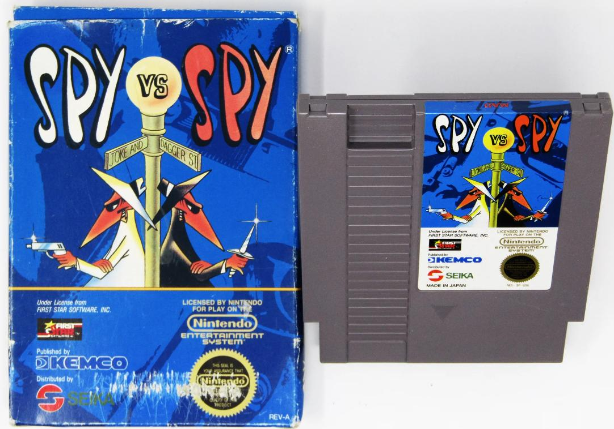
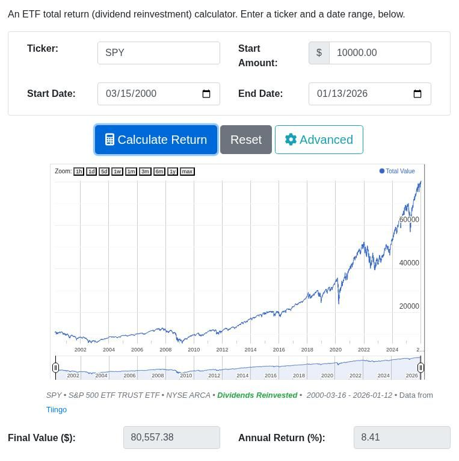
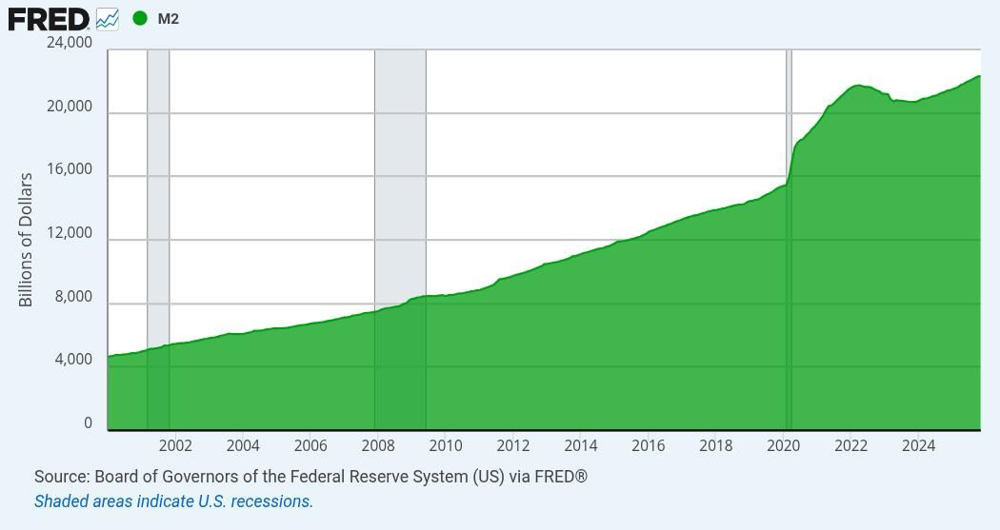
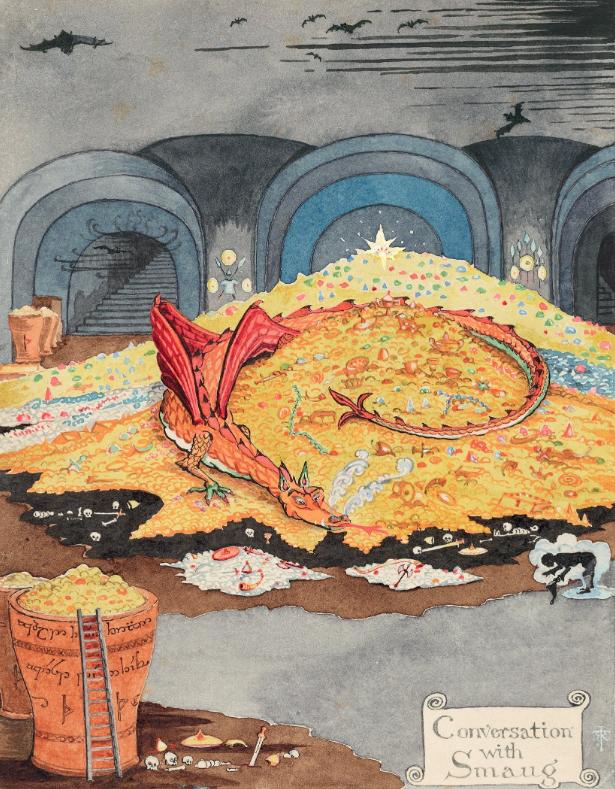

From the dotcom peak in 2000 to today, the price of the S&P 500 index has risen on average 5.9% per year.

With dividends reinvested, e.g. via the **SPY** ETF, the total return increases to **8.41%** CAGR.

via: <https://dqydj.com/etf-return-calculator/?ticker=SPY>

This is a great return, despite starting at a then "exuberant" peak. Especially considering that the M2 money supply has grown by **6.2%** per year over that same period of time.

via: <https://fred.stlouisfed.org/series/M2SL#>

Subtracting the CAGR of M2 over that period of time, we can derive a type of "Real Return" for the SPY ETF (with dividends reinvested, of course). We simply subtract from our 8.41% the 6.2% average growth in M2 per year, in order to end up at our Real CAGR of **2.21%** for SPY.

But how does that compare to gold? We could use GLD (or PHYS) nowadays, but these ETFs didn't exist back at the turn of the Millenium. However if you held physical gold from the dotcom peak in 2000 to today in January, 2026, you would have earned a total return of **10.78%** CAGR.

Subtracting out the M2 money supply growth, your Real CAGR in gold was **4.58%**!

So is GLD the best SPY? That is to say, does GLD best SPY? Over the last 26 years, it did, indeed.

Of course this doesn't tell us what will happen over the next 26 years. It says a lot about monetary metals, but it really says more about how anemic real growth has been in American Public Equities. Think about it. All that innovation that we've seen. Cell phones, the internet, smart phones, computers getting faster and more affordable, commodity off the shelf servers taking over from mainframes, software development changes, huge growth in open source software, and now large language models and other machine learning breakthroughs. A lot has changed. But to be honest, I would have expected more than 2.2% real growth for all that work. *It's almost as if stocks* were *the economy, and we had to keep printing massive amounts of money to keep them going up... (Can't be, can it?)*

In the meantime, if you just sat on your pile of shiny yellow metal, you'd have outperformed all of this by more than 2X!

"In which Smaug beats the pants off of SPY in his sleep..."

These days I believe less and less in the miraculous breakthroughs that we've been promised are just around the corner. I doubt we will invent Artificial General Intelligence that makes humans obsolete, or Cryptographically Relevant Quantum Computers that can break widely used public-key encryption by running algorithms like Shor's at scale.

Both of these types of problems require orders of magnitude better technology and engineering, and multiple breakthroughs.

For AGI, it's things like improvements in training/inference/energy efficiency, and the development of durable memory with stable performance over long tasks for LLMs (e.g. into days and weeks). We don't just need a better model to get to the point where an "AGI" could become an expert in and soon dominate major fields like manufacturing, R&D, coding and defense all together. It would require a new paradigm of reliable closed-loop autonomy. As fast as LLMs and MCPs and tooling around these things has improved, it doesn't approximate Artificial *General* Intelligence that is truly and independently *Smart*.

For Quantum Computing, we'll need to move from a paradigm of “many noisy qubits” to one of many reliable logical qubits. We'll need to reduce error correction overhead by orders of magnitude. Then we'll need to overcome crosstalk, correlated noise, leakage, and parameter drift, i.e. “death by a thousand cuts” failure modes, in order to scale the systems sufficiently enough to matter. And don't forget about the control stack, which needs to scale and improve: RF/microwave lines, DAC/ADC, filtering, amplification, shielding, synchronization. And finally there's the industrial problem of repeatedly fabricating the millions of components needed with very tight tolerances. Basically, we need unprecedented process control and automation. So that's probably more than 26 years away.

But I am sure both of these fields will be pursued and funded and hyped relentlessly over this next quarter century. You might even find profitable work in one of these areas. But to say that you are going to become rich investing in the companies that are grinding away spending billions and trillions trying desperately to bend or break real physical and economic laws of the universe sounds foolhardy. You might do well. But maybe you should hold some gold and silver just in case...

After all, just as there is no guarantee of precious metals' continued outperformance, there is no guarantee that the Top 500 Public Companies stock index continues to outpace the expansion of the money supply.

If you were entering markets today and had the choice of any set of ETFs, but had to lock in your choice for the next 25 years, I would tell you to go 50/50 into SPY and PHYS (Sprott's Physical Gold Trust ETF).

Half US Large Cap Stocks, Half Gold. ***It's elementary, my dear Watson!***

---

**Good Luck!**
