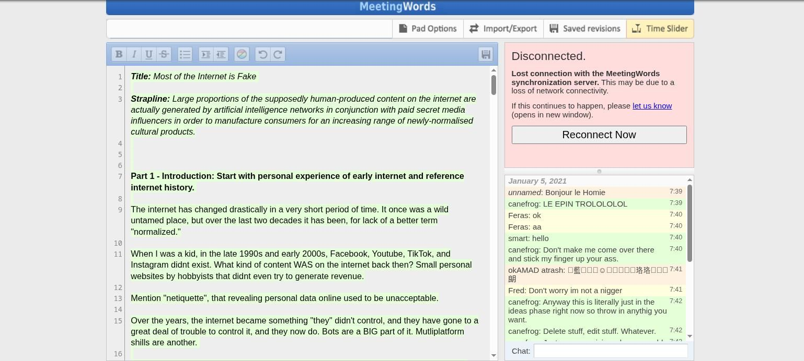

`AI;DR (AI, Didn't Read) -- This post was generated by combining various sources on the topic of 'Dead Internet Theory', with a couple prompts to the "ChatGPT 5.4 Thinking" LLM (a robot) asking it to explore the spiritual significance of empty and deceptive internet content from a Christian point of view.`

## MY PERSONAL NOTES

One guiding principle I find most helpful is to **seek what is Good, True and Beautiful**, and to examine new phenomena and experiences critically to judge them on these traits. With the explosion of new content, news, media, posts and writing, both human and machine-made, and the ever-evolving techniques to manufacture consensus and consent, my gut tells me we should tread carefully in the new wild west of the world wide web. I don't believe technology is inherently evil. But it seems reasonable to assume that as it becomes more powerful (fast, efficient, calculating, strategic, etc.), that we, in turn, should be that much more conscientious and careful about our use and employment of it. May this essay help shine a light on the problem and provide helpful framing to better address it.

---

## Dead Internet Theory, Technology, and the Separation of the Soul from God

The internet was once imagined as a place of human connection: a place where real people could share ideas, learn, create, argue, build friendships, and form communities across long distances. In many ways, that still happens. Yet many people now sense that something has changed. More and more of online life feels repetitive, artificial, manipulative, and strangely empty. This feeling has helped give rise to what is called the **Dead Internet Theory**.

At its simplest, the theory claims that much of today’s internet is no longer shaped mainly by genuine human interaction. Instead, it is increasingly shaped by bots, algorithms, artificial intelligence, fake engagement, mass-produced content, and systems designed to control attention. In its most extreme form, the theory says that most online activity is fake. That stronger claim likely goes too far. Even so, the theory has endured because it expresses a real experience many people have: the sense that the internet is becoming less human.

The theory also changed over time. In its earlier form, it was often tied to fringe forums and broad suspicions. The 2021 Agora Road post that helped popularize it claimed that **“The Internet feels empty and devoid of people”** and that compared to earlier years **“the Internet of today is entirely sterile.”** It also argued that **“Large proportions of the supposedly human-produced content on the internet are actually generated by artificial intelligence networks in conjunction with paid secret media influencers.”** The tone there was highly suspicious and often conspiratorial, but the core fear was clear: human speech was being replaced, drowned out, or copied.

By 2024, major publications were no longer treating the subject as only a fringe curiosity. *The Guardian* argued that the early theory was not simply false, but early, saying, **“The theory wasn’t wrong – it was just too soon.”** The article added an important shift: **“In 2021, the internet felt dead because aggressive algorithmic curation was driving people to act like robots. In 2024, the opposite has happened: the robots are posting like people.”** *Forbes* took a more cautious view, saying the theory does not literally describe the whole internet, yet admitting that it captures a real decline: **“The Dead Internet Theory might not reflect the reality of the average browsing experience, but it does describe the feeling of boredom and alienation that can accompany it.”** And *The Conversation* described it as **“an interesting lens through which to view the internet,”** warning that **“Any interaction, trend, and especially ‘overall sentiment’ could very well be synthetic.”**

That evolution matters. The idea moved from anonymous complaint, to cultural metaphor, to a serious question about whether online life is being overwhelmed by synthetic content, fake consensus, and machine-shaped communication.

From a Christian point of view, this matters because Christianity is not built on abstraction. It is built on truth, incarnation, moral responsibility, and communion with God and neighbor. Human beings are made in the image of God, not as programmable machines, but as living souls called to truth, love, worship, wisdom, and obedience. If the modern internet is increasingly filled with imitations of life, then the issue is not only technological. It is spiritual.

## Truth, Deception, and the Biblical Need for Discernment

The Bible repeatedly warns that deception is one of the chief ways evil works in the world. Jesus said:

**“Take heed that no man deceive you.**  
**For many shall come in my name, saying, I am Christ; and shall deceive many.”**  
(Matthew 24:4–5, KJV)

He also said:

**“And many false prophets shall rise, and shall deceive many.”**  
(Matthew 24:11, KJV)

And later in the same chapter:

**“For there shall arise false Christs, and false prophets, and shall shew great signs and wonders; insomuch that, if it were possible, they shall deceive the very elect.”**  
(Matthew 24:24, KJV)

These warnings were not written about social media, bots, or AI. But they do establish a lasting biblical principle: the world contains forces that aim not simply to inform but to deceive. The Christian is therefore commanded to be discerning.

This fits the strongest reasonable insight of Dead Internet Theory. Even if it is exaggerated when it claims that nearly everything online is fake, it does name a real danger: a digital world in which false appearance can overpower truth. As *The Conversation* warns, artificial accounts and inflated engagement can create **“a vicious cycle of artificial engagement.”** That cycle matters because people often trust what seems popular, repeated, and socially approved.

Scripture speaks to this moral confusion. Isaiah writes:

**“And judgment is turned away backward, and justice standeth afar off: for truth is fallen in the street, and equity cannot enter.**  
**Yea, truth faileth; and he that departeth from evil maketh himself a prey.”**  
(Isaiah 59:14–15, KJV)

That image is striking. Truth does not merely lose an argument. Truth “falls in the street.” Public life becomes hostile to it. A Christian reading of digital culture can see the parallel. When attention is ruled by outrage, novelty, manipulation, and performance, truth is not simply debated; it is pushed aside.

Paul adds another layer:

**“And no marvel; for Satan himself is transformed into an angel of light.”**  
(2 Corinthians 11:14, KJV)

Evil often appears attractive, intelligent, efficient, or even helpful. That is important in a technological age. The danger is not just ugly lies. The danger is polished falsehood: content that looks plausible, moral, informed, or compassionate while quietly distorting reality.

## The Internet Feels Dead Because People Are Being Trained to Act Less Human

One of the most insightful parts of the early Dead Internet writing was not its conspiratorial side but its observation about imitation and feedback loops. The MeetingWords draft argued that social media created **“a copy-feedback subconscious,”** so that people increasingly copy what is already approved rather than speaking honestly. It said the internet had shifted from the creation of original content toward repetition shaped by likes, trends, and algorithmic reward.

Whether or not one accepts all the writer’s claims, this point is strong. The deepest problem may not be that bots exist. The deeper problem is that real people can begin to behave like bots.

*The Guardian* made this exact point when it wrote that in 2021 the web felt dead because **“algorithms were driving people to act like robots.”** That is a powerful observation. A machine-filled internet is troubling, but perhaps even more troubling is a human being trained to live mechanically: reacting instead of reflecting, reposting instead of discerning, performing instead of speaking honestly, seeking visibility instead of wisdom.

The Bible warns against this kind of moral shaping. Paul says:

**“And be not conformed to this world: but be ye transformed by the renewing of your mind.”**  
(Romans 12:2, KJV)

The issue here is formation. Something is always shaping the mind. If a person spends long hours in systems designed to reward imitation, emotional reaction, envy, lust, anger, or tribal belonging, then that person is being formed. The Christian command is not merely to avoid obvious sin, but to resist being conformed to patterns of life that deform the soul.

This is why the Dead Internet discussion reaches beyond bots. It points to a crisis of personhood. In Christian theology, a person is not a bundle of impulses optimized for engagement. A person is a creature made in God’s image, capable of truth, repentance, self-control, and love. Any technology that systematically pushes human beings away from those goods deserves moral scrutiny.

## “Dead” in a Biblical Sense: Lifelike but Empty

The Christian meaning of “dead” is deeper than mere inactivity. Something may appear active and still be spiritually dead. It may look alive while being inwardly hollow.

Psalm 115 describes idols this way:

**“Their idols are silver and gold, the work of men’s hands.**  
**They have mouths, but they speak not: eyes have they, but they see not:**  
**They have ears, but they hear not: noses have they, but they smell not:**  
**They have hands, but they handle not: feet have they, but they walk not: neither speak they through their throat.**  
**They that make them are like unto them; so is every one that trusteth in them.”**  
(Psalm 115:4–8, KJV)

This passage gives an unexpectedly helpful framework for modern digital life. Idols imitate life but do not possess it. They have features of living beings, yet they are dead. More importantly, those who trust them become like them.

That is a powerful warning for a world filled with synthetic images, synthetic authority, synthetic intimacy, and synthetic emotion. The modern internet often offers a lifelike imitation of reality: social connection without friendship, sexual stimulation without covenant love, influence without wisdom, information without understanding, identity without rootedness, speech without accountability. It looks alive, but it often leaves the soul thinner, more distracted, and more alone.

There is also a careful, not sensational, way to connect this with Revelation. The book describes a moment when people are deceived into making an image, and then that image is treated as if it lives:

**“Saying to them that dwell on the earth, that they should make an image to the beast, which had the wound by a sword, and did live.**  
**And he had power to give life unto the image of the beast, that the image of the beast should both speak.”**  
(Revelation 13:14–15, KJV)

This should not be forced into a direct prediction about AI. But as a biblical category, it is striking: an image that speaks, commands attention, and participates in deception. At the very least, it shows that Scripture is not naïve about the spiritual danger of lifelike images that rival truth and demand allegiance.

## False Multitudes and Manufactured Consensus

A major danger of the internet is not just false content but false crowds. A person often believes something more quickly if it appears popular. The crowd can pressure the conscience.

This is why Exodus says:

**“Thou shalt not follow a multitude to do evil.”**  
(Exodus 23:2, KJV)

That verse becomes even more relevant in a world where the multitude may be partly manufactured. The Agora Road text repeatedly worried about repeated posts, copied messages, and bots that could force opinion through repetition. *The Conversation* similarly warns that even harmless-looking engagement farms may build high-follower accounts that later become tools of propaganda. It writes that such accounts can become **“an army of accounts”** ready for use, and warns that social media manipulation has already been used to sway opinion through disinformation. In its phrase, **“overall sentiment” could very well be synthetic.**

This is not a small issue. If false consensus can be manufactured, then public opinion itself becomes easier to shape. Christianity has always taught that the crowd is not the source of truth. God is. The apparent popularity of a message proves nothing about its righteousness.

Paul warns believers not to be children tossed around by manipulation:

**“That we henceforth be no more children, tossed to and fro, and carried about with every wind of doctrine, by the sleight of men, and cunning craftiness.”**  
(Ephesians 4:14, KJV)

The phrase “cunning craftiness” fits modern systems more closely than it first appears. The Christian must ask not only whether a message is emotionally powerful, but whether it is true, just, and holy.

## Information Without Wisdom

One reason the Dead Internet Theory resonates is that many people sense a contradiction in modern life: the internet contains endless information, yet many people seem less grounded, less thoughtful, and less able to tell truth from error.

Paul describes a similar condition:

**“Ever learning, and never able to come to the knowledge of the truth.”**  
(2 Timothy 3:7, KJV)

This may be one of the clearest biblical descriptions of the digital age. People consume content all day. They watch, scroll, click, compare, and react. Yet this constant exposure does not necessarily produce wisdom. In fact, it can weaken it.

Paul also warns:

**“For the time will come when they will not endure sound doctrine; but after their own lusts shall they heap to themselves teachers, having itching ears;**  
**And they shall turn away their ears from the truth, and shall be turned unto fables.”**  
(2 Timothy 4:3–4, KJV)

This too applies in a profound way. Modern platforms are built to serve people more of what they already desire. If someone wants outrage, lust, novelty, fear, self-justification, vanity, or fantasy, the system can deliver it in endless supply. The result is not wisdom but appetite management. The person becomes easier to guide because desire has replaced judgment.

## Technology, Spiritual Warfare, and Moral Formation

A Christian interpretation of Dead Internet Theory should not fall into panic or reckless superstition. Not every app is demonic. Not every glitch is a sign of spiritual attack. Yet it would also be shallow to treat the whole matter as only technical.

The Bible teaches that human life includes unseen moral and spiritual conflict:

**“For we wrestle not against flesh and blood, but against principalities, against powers, against the rulers of the darkness of this world, against spiritual wickedness in high places.”**  
(Ephesians 6:12, KJV)

That does not mean that every bad website is directly possessed. It does mean that Christians should expect evil to work through systems, powers, incentives, and structures, not only through obvious villains. Technology can become one vehicle among many through which temptation, pride, lust, fear, falsehood, and hatred spread.

Peter gives a practical warning:

**“Be sober, be vigilant; because your adversary the devil, as a roaring lion, walketh about, seeking whom he may devour.”**  
(1 Peter 5:8, KJV)

“Sober” and “vigilant” are fitting words for an age of endless scrolling and constant stimulation. A person who is never quiet, never reflective, and never self-controlled is easier to lead astray.

Paul says something similar:

**“Lest Satan should get an advantage of us: for we are not ignorant of his devices.”**  
(2 Corinthians 2:11, KJV)

In its original context, “devices” means schemes. But the principle still applies. Christians should not be ignorant of the ways manipulation works, including manipulation carried by modern technological systems.

## Technology Is Not Evil, but It Is Not Neutral

A balanced Christian view should say two things at once. First, technology is not evil in itself. Second, technology is not spiritually neutral in its effects.

A smartphone can carry Scripture, call a lonely relative, help a student learn, or spread truthful teaching. Yet the same device can become a delivery system for envy, pornography, slander, rage, vanity, and addiction. The question is not only what a tool can do. The question is what kind of person the tool is helping to form.

Paul gives a principle that speaks directly to this:

**“All things are lawful unto me, but all things are not expedient: all things are lawful for me, but I will not be brought under the power of any.”**  
(1 Corinthians 6:12, KJV)

This is an excellent test for modern technology. Does the tool remain a servant, or has it become a master? Does it help a person become more truthful, more disciplined, more charitable, and more present before God? Or does it gain power over attention, imagination, and desire?

Proverbs adds:

**“Keep thy heart with all diligence; for out of it are the issues of life.”**  
(Proverbs 4:23, KJV)

The heart is the wellspring of life. What repeatedly enters it matters. This is why the Christian cannot shrug off media habits as trivial.

## Other Areas of Exponential Change

Dead Internet Theory is really one example of a wider pattern. The same concerns appear in many areas of rapid technological change.

Artificial intelligence can increase efficiency and access to information, but it can also flood the world with synthetic writing, synthetic images, and synthetic authority. Dmitry Kudryavtsev captures the emotional side of this when he writes, **“But today, I no longer know what is real.”** He describes seeing corporate posts, comment sections, and even software projects that seem touched by AI in ways that blur authorship and trust. His concern is not merely technical failure. It is the loss of confidence that one is dealing with reality.

Entertainment algorithms can replace craft with optimization. The MeetingWords draft argues that content creators increasingly stop asking what is good and start asking what will trigger the system. Even if that claim is overstated in places, it names a real temptation: to produce not what is true or beautiful, but what performs.

Social media can replace community with audience. A person becomes a brand. Friendship becomes content. Approval becomes a measurable commodity. This tends to deepen pride, comparison, and envy.

Search and information systems can replace inquiry with prepackaged answers. A person begins to receive rather than seek, to consume rather than test.

Across all of these areas, the spiritual danger is similar: technological power can expand human capacity while shrinking human depth. It can increase control while decreasing wisdom. It can intensify communication while weakening communion. It can fill the mind while starving the soul.

## A Christian Judgment: Separation from God Through Substitutes

The core biblical problem here is not innovation itself but substitution. Sin loves substitutes. It replaces God with idols, wisdom with appetite, truth with image, and communion with performance.

Digital life often offers substitutes that look close enough to the real thing to keep people occupied:

- stimulation instead of peace
- attention instead of love
- image instead of character
- data instead of wisdom
- performance instead of sincerity
- simulation instead of communion

These substitutes can gradually separate a person from God, not always by open rebellion, but by constant distraction and spiritual thinning.

The psalmist says:

**“I will set no wicked thing before mine eyes.”**  
(Psalm 101:3, KJV)

Paul says:

**“Wherefore putting away lying, speak every man truth with his neighbour.”**  
(Ephesians 4:25, KJV)

John says:

**“Beloved, believe not every spirit, but try the spirits whether they are of God.”**  
(1 John 4:1, KJV)

These are not outdated commands. They are intensely relevant. The Christian must ask not only, “Is this useful?” but also, “What is this doing to my soul? Does this lead me toward truth, humility, chastity, prayer, patience, and love? Or does it lead me toward falsehood, vanity, agitation, lust, and unreality?”

## Conclusion

The strongest versions of Dead Internet Theory likely overstate the case. The internet is not literally empty of people, and much real human creation still remains. *Forbes* is right to resist the most extreme claim. Yet *The Guardian* and *The Conversation* are also right to note that the theory contains a real warning. The internet increasingly feels dead because human communication is being reshaped by algorithmic pressure, synthetic content, fake engagement, and machine-generated imitation. The older fear that people were becoming robotic has now been joined by a newer fear: robots are becoming socially convincing enough to pass as people.

A Christian perspective can interpret this without panic and without naivety. Scripture teaches that deception is real, that false appearances are powerful, that crowds can be manipulated, that idols imitate life without possessing it, and that human beings become like what they worship. It also teaches that believers must guard their hearts, renew their minds, try the spirits, and refuse to be brought under the power of any created thing.

So the deepest danger is not simply that bots may replace people online. The deeper danger is that people may accept substitutes for reality and, in doing so, drift further from God. When a culture becomes satisfied with imitation, performance, and artificial consensus, it becomes easier to forget what human beings are for.

Christianity answers that question clearly. Human beings are made for truth, worship, holiness, love, wisdom, and communion with the living God. Any technology (or way of using a given technology) that helps serve those ends can be used with gratitude. Any technology that steadily pulls the soul away from them must be resisted, disciplined, or rejected. In an age of growing simulation, faithfulness may begin with a simple but demanding task: to remain fully human before God.

---

**Sources:**

- <https://kudmitry.com/articles/dead-internet-theory/>
- <https://grokipedia.com/page/dead-internet-theory>
- <https://www.theguardian.com/technology/2024/apr/30/techscape-artificial-intelligence-bots-dead-internet-theory>
- <https://theconversation.com/the-dead-internet-theory-makes-eerie-claims-about-an-ai-run-web-the-truth-is-more-sinister-229609>
- <https://www.forbes.com/sites/danidiplacido/2024/01/16/the-dead-internet-theory-explained/>
- <https://forum.agoraroad.com/index.php?threads/dead-internet-theory-most-of-the-internet-is-fake.3011/>
- <https://web.archive.org/web/20210105211330/https://meetingwords.com/IVlnVpwRfx>
