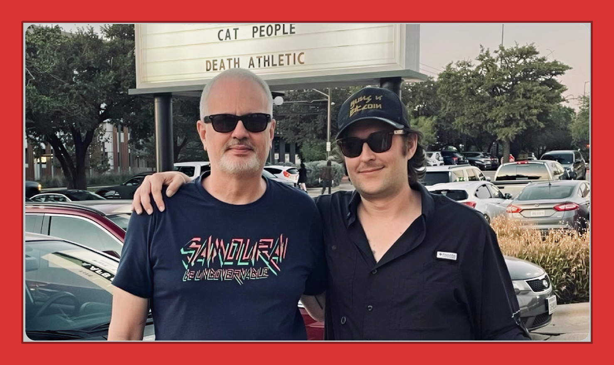
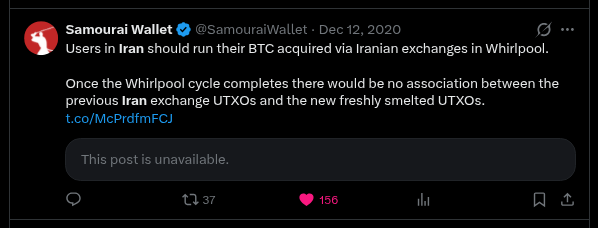
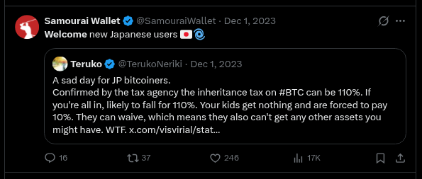
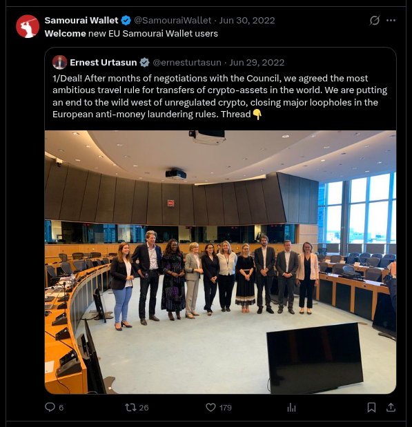

Two software developers are now serving federal prison sentences – five years and four years respectively – for building a Bitcoin privacy tool called Samourai Wallet.

I used that tool. I followed the case closely. And there's something that anyone who values the rule of law should know: The government's own experts said the conduct wasn't illegal. That finding was never shared with the defense.

**Here's what happened.**

FinCEN, the Treasury bureau that defines who counts as a money transmitter, conducted an internal analysis of Samourai's architecture. Their conclusion: It did not constitute money transmission, because no third party took possession or control of user funds. Users held their own keys. They initiated their own transactions. The software coordinated activity between peers but never took custody.

That analysis was never disclosed to the defense while prosecutors advanced a theory requiring the opposite – that building non-custodial software is functionally the same as operating a financial institution.

Keonne Rodriguez and William Lonergan Hill ultimately took plea deals. Rodriguez received the statutory maximum of five years. Hill received four – the judge reduced his sentence partly due to a recent autism diagnosis, which his own lawyer argued explained his "magical thinking" belief that building non-custodial tools was legal.

Both men pleaded guilty to conspiracy to operate an unlicensed money transmitting business. The money laundering conspiracy charges were dropped – yet the government's sentencing memo referenced money laundering allegations throughout, and mentioned sanctions evasion thirteen times despite never charging it.

No cease-and-desist letter was ever sent. No administrative action. No warning. Just an arrest.

### Why should I care if I don't use crypto?

Here's why this should matter to people who don't care about cryptocurrency at all: If the government can decide after the fact that your work was criminal – even when its own regulatory agency analyzed your architecture and concluded otherwise – then legal clarity doesn't exist. You can't comply with a law that changes retroactively. You can't adjust your conduct based on guidance the prosecution chooses not to share with you.

This isn't about whether privacy tools are good or bad. It's about whether we jail people based on rules that exist at the time, or based on rules the government invents after it decides you're a target.

Judge Cote said at Rodriguez's sentencing that she saw "no acknowledgement of the criminal world for whom digital currency is a gift." Fair point – that conversation is worth having. But that conversation belongs in Congress, where laws get written, not in a courtroom where two men face years in prison under a statute the Treasury Department itself had already interpreted in their favor.

If we want to restrict privacy tools, pass a law. Don't prosecute people under a law that wasn't clear – and don't bury the evidence that your own agency disagreed with the charges.

### Illustrating Further

To further illustrate the absurdity of what happened to Keonne and Bill, please consider the following examples in which the makers of different kinds of tools, or providers of neutral platforms, are held responsible for what the end users do.

**The mapmaker and the bank robber**

A cartographer publishes a street map of a city. A robber uses that map to plan an escape route after a heist. The mapmaker didn’t hand the map to the robber with the purpose of furthering the robbery; the map is a general-purpose tool offered to everyone. Charging the mapmaker as an accomplice would erase the line between furnishing lawful goods and intentionally aiding a specific crime.

**The phone company and the drug deal**

Telecommunications carriers provide a network. Drug dealers routinely use that network to arrange transactions. No sensible legal system would convict the phone company as an accomplice to every drug deal conducted over its lines, because the company lacks the specific intent to promote or facilitate those individual crimes. It merely supplies an infrastructure that is overwhelmingly used for lawful activity.

**The chemistry textbook and the bomb maker**

An author writes an undergraduate textbook explaining organic synthesis. A terrorist reads it and uses one of the described reactions to build a bomb. The author intended to educate, not to aid terrorism. The book’s content is neutral, and the author has no control over which purposes readers choose. Absent proof that the author specifically meant for that knowledge to be used in a bombing, criminal liability would punish information creation rather than actual participation.

**The ISP and the scammer (or the postal service and the fraudster)**

An internet service provider gives customers access to the web, or the post office delivers mail. A fraudster uses either to send scam letters or run phishing sites. Neither the ISP nor the post office intends for those specific crimes to occur; they provide a general communication platform. Holding them liable as accomplices would mean that anyone who provides a conduit for information or goods is automatically complicit in whatever a recipient chooses to do – a result that collapses the distinction between tool and intent.

### Intentions Matter

Ok. But what do we know about the Samourai developers' intentions? Didn't they openly "Welcome Russian Oligarchs" to use their tools after sanctions were announced following Russia's invasion of Ukraine?

Let's address the "Russian oligarchs" tweet directly. After all, it is one of the main tweets the DOJ highlighted and the one most people cite as proof these guys were courting criminals...

First – context matters, and the DOJ cherry-picked. The Samourai developers had a long, consistent pattern of stating that their tools existed for people cut off from traditional financial rails for political reasons. They said it about Iranian dissidents. They said it about Japanese bitcoiners. They said it about Kuwaiti's after Kuwait banned bitcoin. They said it about people in countries with capital controls or hyperinflation. The "Russian oligarchs" tweet was one data point in a multi-year, ideologically consistent position: Financial privacy is a human right, and it matters most when the state decides who gets to participate in the economy.

If you only look at the one tweet the prosecution pulled out, it looks damning. If you look at the full timeline, it looks like a principled – maybe obnoxiously principled – stance that you either agree with or you don't. But **principled stances aren't crimes.**

Second – everything was done in the open. These developers didn't operate in the dark. They announced every feature months in advance, on public blogs and Twitter. They explained exactly how each tool worked and who it was for. Their code was fully open source – anyone could inspect it, fork it, audit it. The entire architecture was documented. When they were gearing up to launch a Decentralized Whirlpool in March 2024, they published a detailed blog post explaining the "Whack-A-Mole" architecture, the Soroban communication protocol, and exactly how users should update their software. They invited the public to watch. That's not how you behave if you believe you're running a criminal enterprise.

Third – "being an jerk" isn't a crime, and it's dangerous to let it substitute for one. The government's own regulatory agency, FinCEN, analyzed Samourai's architecture and concluded it did not constitute money transmission. That analysis was never disclosed to the defense. If the government had to suppress its own expert analysis to make the case, then the provocativeness of the defendants' Twitter feed is doing a lot of work that the law couldn't do on its own.

We don't jail people for being smug on the internet. We jail them for breaking laws that were clear at the time. If the standard becomes "you annoyed us on Twitter, so we found a charge," then the law doesn't mean what it says – and nobody is safe, regardless of how polite they are.

### What to do?

**A small ask now, if you've read this far.**

Maybe you think these developers brought this on themselves. Maybe you think privacy tools shouldn't exist at all. Fair enough – I'm not asking you to change your mind about that.

But if you agree on one narrow point – that the government should not prosecute people under a law its own regulatory agency says doesn't apply, and then bury that agency's analysis for over a year – then I'd ask you to do two things:

First, **sign the pardon petition**. It's at [**billandkeonne.org**](https://billandkeonne.org/). There's a long way to go – around 15,900 signatures as of early May 2026, and the target is 100,000. It takes thirty seconds.

Second, if you're moved by what these families are going through, **consider donating**. Each developer owes $250,000 in fines that keep accruing interest while they're inside, unable to work. That is on top of millions in legal fees they still have to pay. The GiveSendGo campaign splits everything evenly between both families. The direct links to donate to them are on the [**billandkeonne.org**](https://billandkeonne.org/) site (not the change.org site).

You don't have to love cryptocurrency to believe the rules should be clear before someone goes to prison. And you don't have to agree with a developer's politics to believe their family shouldn't go bankrupt while they serve time under a law that FinCEN itself said didn't apply.

## #FreeSamourai

---

**REFERENCES**

- [freesamourai.com/news](https://freesamourai.com/news)
- [therage.co/samourai-sev-sentence/](https://www.therage.co/samourai-sev-sentence/)
- [therage.co/keonne-rodriguez-samourai-sentenced/](https://www.therage.co/keonne-rodriguez-samourai-sentenced/)
- [btcpolicy.org/articles/pardoning-the-samourai-developers-would-correct-a-misapplication-of-federal-law-and-protect-the-future-of-non-custodial-software](https://www.btcpolicy.org/articles/pardoning-the-samourai-developers-would-correct-a-misapplication-of-federal-law-and-protect-the-future-of-non-custodial-software)
- [coindesk.com/policy/2025/11/19/samourai-wallet-co-founder-bill-hill-sentenced-to-4-years-in-prison-for-unlicensed-money-transmitting](https://www.coindesk.com/policy/2025/11/19/samourai-wallet-co-founder-bill-hill-sentenced-to-4-years-in-prison-for-unlicensed-money-transmitting)
- [**billandkeonne.org**](https://billandkeonne.org/)
