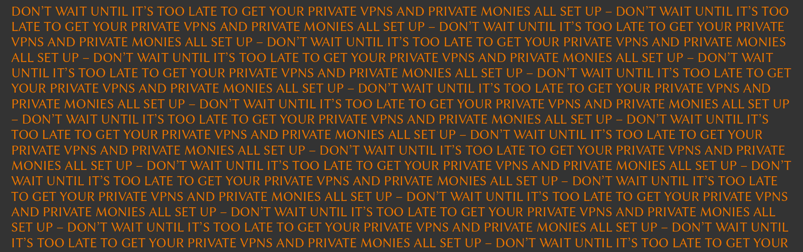

Utah residents concerned about restrictions surrounding VPN use can still reliably reach providers like [**Mullvad**](https://mullvad.net/), [**IVPN**](https://www.ivpn.net/), and [**TorGuard**](https://torguard.net/) by installing Tor Browser, which routes traffic through the Tor network to bypass blocks and restrictions imposed at the website or network level. Under SB 73, signed into law by Governor Spencer Cox on March 19, 2026, a user is considered to be accessing a website from Utah if they are physically there, regardless of any proxy server or VPN masking their IP address, and the law prohibits commercial entities hosting a substantial portion of material harmful to minors from providing any instructions on how to use a VPN to circumvent these checks. Before or alongside installing Tor, many users find it useful to adjust their DNS settings because their ISP's default resolver may interfere with access or log every domain they query. Reliable options include Cloudflare's privacy-respecting resolver at 1.1.1.1 and Mullvad's uncensored encrypted DNS at 194.242.2.2, whose public DNS servers run fully in RAM so that all traces of activity on disk are removed. Both emphasize user privacy and avoid the censorship tendencies seen with mainstream providers like Google.

Changing DNS on Windows involves navigating to the network adapter properties through the Settings app, locating the IPv4 configuration, and entering the chosen resolver addresses before applying the changes and restarting the connection. On macOS the process is handled through System Settings under Network, where advanced options allow manual addition of the preferred DNS servers followed by applying the update. Android 9 and later supports encrypted DNS natively, configured in Settings → Network → Private DNS with dns.mullvad.net or the Cloudflare equivalent. iOS requires selecting the connected Wi-Fi network, choosing Configure DNS, and manually adding the addresses before saving, or installing a DNS-over-HTTPS configuration profile for stronger encryption.

Once DNS is updated, downloading Tor Browser becomes the primary tool for circumventing remaining blocks. Tor Browser is available for Android, Windows, macOS, and Linux, and the Tor Project's site documents the system requirements and installation steps for each platform. On Windows and macOS the official Tor Browser can be obtained from the Tor Project website or transferred from another device if direct access is limited, after which the standard installer runs like any other application. Android users can download it directly from the Tor Project site, the Google Play Store, or F-Droid through the Guardian Project repository. For iOS, it's important to know that there is no official Tor Browser for iOS, and the Tor Project itself recommends an iOS app called Onion Browser, which is open source, uses Tor routing, and is developed by someone who works closely with the Tor Project. Users should avoid the various unofficial "Tor Browser" apps in the App Store, which are not endorsed by the Tor Project and have been reported to be sketchy or paywalled. Opening Tor Browser or Onion Browser and allowing it to connect usually provides immediate access to otherwise restricted domains.

With Tor active, the official websites for Mullvad, IVPN, and TorGuard become reachable, allowing direct downloads of their client software or configuration files without further interference. The slower speeds inherent to Tor are expected during this initial phase and are only temporary. Installation of the chosen VPN then proceeds normally on each platform through the downloaded files, with most providers offering straightforward setup wizards that support WireGuard or OpenVPN protocols for optimal performance once the VPN is active.

For payment, these services typically accept Bitcoin or the more private Monero, both of which can be acquired in Utah without extensive verification. Bitcoin is simplest through local Bitcoin ATMs scattered across Salt Lake City, Provo, and other areas, where cash can be converted instantly to a personal wallet, or via apps like Cash App and Strike that support direct purchases and withdrawals. Monero purchases are often completed by first obtaining Bitcoin through the same methods and then swapping it on a Tor-accessible non-KYC exchange service. For finding reliable swap services, [**kycnot.me**](https://kycnot.me) is an essential resource that catalogs no-KYC exchanges and rates them by privacy score and trust rating, with the directory actively flagging scams and unreliable operators so users can avoid losing funds. It also lists tools like atomic swap software for Bitcoin to Monero swaps in a decentralized manner using open-source desktop software, alongside other trusted aggregators and peer-to-peer options. After funding the VPN account with a short-term subscription to test the connection, connecting and attempting to navigate to various websites that may have otherwise been blocked would serve to confirm that the bypass is complete and privacy protections are in place.
